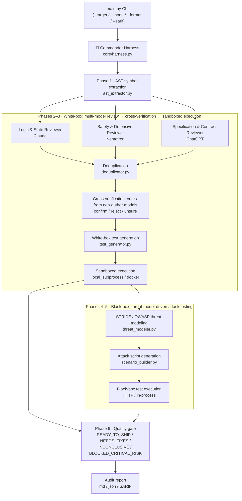

# 🛡️ VibeHarness-MAS: Multi-Agent Testing Harness for Vibe Coding

[正體中文（臺灣）](README.md) | English (US)

[](https://github.com/chinchiang/MultiAgentGama/actions/workflows/tests.yml)

> **An AI software quality-assurance toolkit that runs white-box first (heterogeneous model cross-review + executable test verification), then black-box (STRIDE/OWASP threat-model-driven attack testing).**

Designed for the failure modes of today's **Vibe Coding (natural-language-prompt-driven programming)**: code that looks fine on the surface (the happy path passes) but lacks defensive boundaries and ships BOLA/IDOR holes and uncaught exceptions.

---

## 🏛️ Architecture & Pipeline Overview



### 🤖 Agent Responsibilities

Every agent's model and prompt live in [`config/agents_config.yaml`](config/agents_config.yaml) and can be reassigned freely (field details in [docs/configuration.en.md](docs/configuration.en.md)):

| Sub-agent (agent_id) | Default model | Responsibility | temperature |
| :--- | :--- | :--- | :--- |
| Logic & State Reviewer (`whitebox_reviewer_claude`) | claude | Deep logical edge cases, unhandled exceptions, state inconsistencies, null-pointer/type bugs | 0.2 |
| Safety & Defensive Reviewer (`whitebox_reviewer_nemotron`) | nemotron | Input sanitization, defensive guards, resource exhaustion, memory/buffer/concurrency safety | 0.1 |
| Specification & Contract Reviewer (`whitebox_reviewer_chatgpt`) | chatgpt | API signature compliance, business-spec adherence, contract violations, standard test coverage | 0.2 |
| Cross-verification votes (`whitebox_verifier_*` ×3) | claude / nemotron / chatgpt | Vote only on findings reported by *other* models: confirm / reject / unsure | 0.0 |
| White-box test generator (`whitebox_test_generator`) | chatgpt | Generates executable pytest tests targeting confirmed defects | 0.3 |
| STRIDE threat modeler (`blackbox_threat_modeler`) | claude | Extracts trust boundaries and assets; builds the STRIDE + OWASP attack matrix | 0.2 |
| Attack scenario synthesizer (`blackbox_test_synthesizer`) | chatgpt | Turns threat scenarios into black-box attack scripts (BOLA, injection, rate limiting) | 0.2 |

---

## 🚀 Key Features

1. **AI Harness Commander**: owns the global state machine, schedules the white-box and black-box sub-agents in order, and arbitrates the final Quality Gate.
2. **Heterogeneous multi-model de-biasing**: the white-box review stage fans out to LLMs with different training lineages:
   - **Claude**: complex boundary conditions, non-null-pointer assumptions, and state-machine flaws.
   - **NVIDIA Nemotron**: input sanitization, resource-exhaustion limits (DoS defense), and memory-safety guardrails.
   - **ChatGPT**: API protocol contract compliance, specification consistency, and generic test-case synthesis.
   - **Cross-model verification**: no single arbiter model. Each finding is ruled on independently by every model that did *not* report it — models never judge their own findings. If another model also reported the same defect (recorded when duplicates are merged), that counts as one confirm vote. More confirms than rejects → confirmed; more rejects → disputed (no test is generated); a tie → kept and left to the test to decide. The agreement ratio is computed from the actual votes. With no real, usable votes, no findings are filtered and the report shows N/A.
3. **Mandatory threat-modeling first**: no blind brute-force testing. A STRIDE (Spoofing, Tampering, Repudiation, Information disclosure, Denial of service, Elevation of privilege) and OWASP API Security Top 10 attack matrix is built first, then attack tests are generated against it.
4. **An execution-based quality gate**: model findings and threats are only hypotheses; only tests that actually ran can fail or block the gate. Assertion-free empty tests, unusable model output (non-JSON / missing fields, recorded as `invalid`), and untested threats are all listed as evidence gaps.
5. **Two sandboxes**: generated tests run in a temp directory with an environment-variable allowlist (API keys are never passed in), per-batch and per-test timeouts, and the whole process tree is killed on timeout (Docker removes the container instead).
   - `local_subprocess` (default): a local subprocess.
   - `docker`: each test batch runs in a disposable container — no network by default, read-only root filesystem and target mount, all capabilities dropped, no privilege escalation, non-root user, and memory/CPU/process limits. Only the run's temp directory is writable.

> ⚠️ **`local_subprocess` is not a security boundary.** It executes model-generated code with your user's permissions, with file and network access. For untrusted targets or live mode, use `sandbox_provider: docker`.

### 🧭 Not yet implemented (planned)

| Feature | Status |
| :--- | :--- |
| Mutation testing | Not implemented; white-box tests are currently measured by line coverage (pytest-cov) |
| Dynamic DAST / fuzzing agent | Not implemented; black-box tests are generated per threat as pytest attack scripts |
| Hypothesis property-based testing | Not built in; models may generate it, but the target environment needs `hypothesis` installed |
| `e2b` sandbox | Not implemented; `sandbox_provider` supports `local_subprocess` and `docker`, anything else fails fast |
| JS/TS test execution | Heuristic symbol extraction only (for review and threat modeling); generated and executed tests support Python only |

---

## 📦 Repository Layout

```text
MultiAgentGama/
├── config/
│   ├── agents_config.yaml       # Multi-model routing (Claude, Nemotron, ChatGPT)
│   └── threat_rules.yaml        # STRIDE and OWASP baseline rules
├── docker/
│   └── sandbox.Dockerfile       # Base image for the docker sandbox (pytest / pytest-cov)
├── core/
│   ├── harness.py               # Commander state machine (orchestrator)
│   ├── llm_gateway.py           # Unified LiteLLM gateway with simulation fallback
│   ├── models.py                # Pydantic data models
│   ├── codecheck.py             # Static checks on generated tests (needs test_ functions and assertions)
│   ├── codecontext.py           # Source code and import guidance handed to the models
│   └── sandbox.py               # Sandboxes: local subprocess (not a security boundary) and Docker containers
├── agents/
│   ├── whitebox/
│   │   ├── ast_extractor.py     # AST symbol parsing and route extraction
│   │   ├── multi_reviewer.py    # Heterogeneous model ensemble review
│   │   ├── deduplicator.py      # Merges the same defect reported by multiple models
│   │   ├── debater.py           # Cross-verification: ruled on by non-author models
│   │   └── test_generator.py    # Automatic unit/boundary test generation
│   └── blackbox/
│       ├── threat_modeler.py    # STRIDE threat-modeling engine
│       └── scenario_builder.py  # Turns threats into executable attack scripts
├── runners/
│   └── test_executor.py         # Sandboxed pytest executor with PoC capture
├── reports/
│   └── report_generator.py      # Markdown/JSON/SARIF audit report generator
├── examples/
│   └── vibe_sample_app.py       # A representative sample of typical Vibe-Coding defects
├── docs/
│   ├── sample_report.md         # Sample report produced in mock mode
│   ├── configuration.md         # Configuration reference (Traditional Chinese)
│   └── configuration.en.md      # Configuration reference (English)
├── tests/                       # The toolkit's own tests (offline, no API keys needed)
└── main.py                      # CLI entry point
```

---

## 🛠️ Getting Started

### 1. Install dependencies

```bash
pip install -r requirements.txt
```

Or install as a package (this also registers the `vibeharness` command):

```bash
pip install .
vibeharness --version
```

### 2. Configure API keys (optional)

The toolkit supports real API calls and an offline simulation mode (Hybrid Mode):

> For a complete reference to every field in `config/agents_config.yaml` — defaults, model reassignment, and Docker sandbox examples — see **[docs/configuration.en.md](docs/configuration.en.md)** ([正體中文](docs/configuration.md)).

```bash
# To use live models:
export ANTHROPIC_API_KEY="sk-ant-..."
export NVIDIA_API_KEY="nvapi-..."
export OPENAI_API_KEY="sk-..."
export GEMINI_API_KEY="AIza..."
```

Default models are in `config/agents_config.yaml` (Claude `claude-sonnet-5`, Nemotron via NVIDIA NIM, ChatGPT `gpt-4o`, Gemini `gemini/gemini-3.8-flash`). Each model can set a `fallback_model`; after the primary model exhausts its retries the fallback is tried, and the report records which model was actually used.

Any agent can point at any defined model via `model_alias`. A single API key is enough to run live mode — for example, with only a Gemini key, change every `model_alias` in the `agents` section to `gemini` (note: `gemini-2.5-flash` is no longer available to newly issued Google API keys; use a 3.x version).

*Note: without API keys, `hybrid` mode falls back to the simulation engine so you can experience the workflow offline. The simulation returns **fixed templates unrelated to the target code**; the report marks them with `[SIMULATED]` and an "Execution Provenance" section, and the quality gate will never yield `READY_TO_SHIP` because of them.*

| `--mode` | Behavior |
| :--- | :--- |
| `live` | Real models only; a missing key or failed call aborts (exit code 4). Unusable model responses are recorded as `invalid` and the verdict becomes INCONCLUSIVE |
| `hybrid` (default) | Calls live models when possible; otherwise falls back to simulation, disclosed in the report |
| `mock` | Simulation engine only |

In simulation mode, white-box tests use deterministic None-input robustness probes derived automatically from the target functions (`WB-PROBE-*`); black-box threats without an executable test are listed under "Threats Not Tested" instead of fabricating results.

### 3. Use the Docker sandbox (recommended for untrusted targets)

```bash
docker build -t vibeharness-sandbox:latest -f docker/sandbox.Dockerfile .
```

Set `sandbox_provider: "docker"` in `config/agents_config.yaml`. Tunables: `docker_image`, `docker_network`, `docker_memory`, `docker_cpus`, `docker_pids_limit`.

- The target directory is mounted read-only into the container at `/work/<dir name>`; host absolute paths inside generated tests are rewritten to container paths automatically.
- Containers have **no network** by default, so packages cannot be installed at run time. Pre-install the target's dependencies into the image: build a project-specific image `FROM vibeharness-sandbox:latest`, `pip install` the dependencies, and point `docker_image` at it.
- Black-box tests that hit a running service need network access (e.g. `docker_network: "host"` on Linux), which reduces isolation.
- A missing docker command or image fails loudly with the build command — it never silently falls back to the local subprocess.

### 4. Run the full pipeline against a target project

```bash
python main.py --target examples --output vibe_harness_report.md
```

`--target` accepts a directory or a single file. If a service is running at `--base-url`, black-box tests send real HTTP requests; otherwise they import the target in-process. See [`docs/sample_report.md`](docs/sample_report.md) for example output.

Report formats: `--format md` (default) or `--format json` (machine-readable, with the complete findings, threat model, and test results — suited to CI/CD):

```bash
python main.py --target examples --output report.json --format json
```

You can also pass `--sarif <path>` to emit a [SARIF 2.1.0](https://docs.oasis-open.org/sarif/sarif/v2.1.0/sarif-v2.1.0.html) report alongside: confirmed white-box findings carry file/line locations (resolved from `line_number` or the symbol table), and confirmed black-box breaches are error-level results. Upload the SARIF to GitHub Code Scanning to surface defects in the repo's **Security** tab:

```yaml
# Example .github/workflows/security.yml for the target project
- run: pip install vibeharness-mas   # or install from source
- run: vibeharness --target src --output report.md --sarif vibeharness.sarif
  env:
    ANTHROPIC_API_KEY: ${{ secrets.ANTHROPIC_API_KEY }}
- uses: github/codeql-action/upload-sarif@v3
  with:
    sarif_file: vibeharness.sarif
```

> Note: file paths in the SARIF are relativized against the `--target` directory; point `--target` at the repo root so paths line up with Code Scanning's viewer.

Exit codes (evaluated in order):

| Code | Verdict | Condition |
| :--- | :--- | :--- |
| `2` | BLOCKED_CRITICAL_RISK | At least one black-box attack test confirmed a defense was breached |
| `1` | NEEDS_FIXES | At least one white-box test failed (exposed a defect) |
| `3` | INCONCLUSIVE | No failures, but evidence gaps exist: simulation engine used, unusable model output, test errors / not run, untested threats, file parse failures, etc. |
| `0` | READY_TO_SHIP | None of the above |
| `4` | — | Live-mode model invocation failed |

### 5. Run the toolkit's own tests and linters

```bash
pip install -r requirements-dev.txt
python -m pytest
python -m ruff check .
```

Optional: install [pre-commit](https://pre-commit.com/) to run ruff automatically before every `git commit`:

```bash
pip install pre-commit
pre-commit install
```
