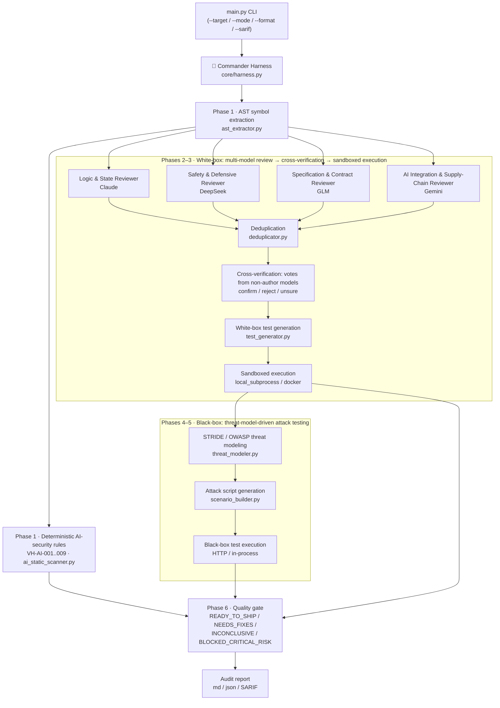

# 🛡️ VibeHarness-MAS: Multi-Agent Testing Harness for Vibe Coding

[正體中文（臺灣）](README.md) | English (US)

[](https://github.com/chinchiang/MultiAgentGama/actions/workflows/tests.yml)

> **An AI software quality-assurance toolkit that runs white-box first (heterogeneous model cross-review + executable test verification), then black-box (STRIDE/OWASP threat-model-driven attack testing).**

Designed for the failure modes of today's **Vibe Coding (natural-language-prompt-driven programming)**: code that looks fine on the surface (the happy path passes) but lacks defensive boundaries and ships BOLA/IDOR holes and uncaught exceptions.

---

## 🏛️ Architecture & Pipeline Overview



### 🤖 Agent Responsibilities

Every agent's model and prompt live in [`config/agents_config.yaml`](config/agents_config.yaml) and can be reassigned freely (field details in [docs/configuration.en.md](docs/configuration.en.md)):

| Sub-agent (agent_id) | Default model | Responsibility | temperature |
| :--- | :--- | :--- | :--- |
| Logic & State Reviewer (`whitebox_reviewer_claude`) | claude | Deep logical edge cases, unhandled exceptions, state inconsistencies, null-pointer/type bugs | 0.2 |
| Safety & Defensive Reviewer (`whitebox_reviewer_deepseek`) | deepseek | Input sanitization, injection (SQL/command/path), defensive guards, resource exhaustion, unsafe concurrency | 0.1 |
| Specification & Contract Reviewer (`whitebox_reviewer_glm`) | glm | API signature compliance, business-spec adherence, contract violations, authorization checks (BOLA/BFLA) | 0.2 |
| AI Integration & Supply-Chain Reviewer (`whitebox_reviewer_gemini`) | gemini | OWASP Top 10 for LLM Applications 2026 (LLM01–LLM10) in code that calls models; hard-coded credentials, unpinned dependencies | 0.2 |
| Cross-verification votes (`whitebox_verifier_*` ×4) | claude / deepseek / glm / gemini | Vote only on findings reported by *other* models: confirm / reject / unsure | 0.0 |
| White-box test generator (`whitebox_test_generator`) | deepseek | Generates executable pytest tests targeting confirmed defects | 0.3 |
| STRIDE threat modeler (`blackbox_threat_modeler`) | claude | Extracts trust boundaries and assets; builds the STRIDE + OWASP API (and, for AI-integrated targets, OWASP LLM) attack matrix | 0.2 |
| Attack scenario synthesizer (`blackbox_test_synthesizer`) | deepseek | Turns threat scenarios into black-box attack scripts (BOLA, injection, rate limiting, prompt injection) | 0.2 |

The reviewer roster is config-driven: every `whitebox_reviewer_*` entry is used with its own `name`, `model_alias`, `temperature`, and `focus` (the focus text goes into its prompt), so adding or removing an entry changes the ensemble.

---

## 🚀 Key Features

1. **AI Harness Commander**: owns the global state machine, schedules the white-box and black-box sub-agents in order, and arbitrates the final Quality Gate.
2. **Heterogeneous multi-model de-biasing**: the white-box review stage fans out to four LLM families with different training lineages, so their blind spots do not overlap:
   - **Claude**: complex boundary conditions, non-null-pointer assumptions, and state-machine flaws.
   - **DeepSeek**: input sanitization, injection, defensive guards, resource-exhaustion limits (DoS defense), and unsafe concurrency.
   - **GLM**: API contract compliance, specification consistency, and authorization checks (BOLA/BFLA).
   - **Gemini**: AI-integration and supply-chain security — prompts built from untrusted input, secrets in prompts, unchecked tool agency, unpinned models and packages, uncapped spend, and model output reaching `eval`/shell/SQL/HTML (OWASP Top 10 for LLM Applications 2026). Reviewers may tag findings with an `owasp_mapping` such as `LLM01:2026`.
   - **Cross-model verification**: no single arbiter model. Each finding is ruled on independently by every model that did *not* report it — models never judge their own findings. If another model also reported the same defect (recorded when duplicates are merged), that counts as one confirm vote. More confirms than rejects → confirmed; more rejects → disputed (no test is generated); a tie → kept and left to the test to decide. The agreement ratio is computed from the actual votes. With no real, usable votes, no findings are filtered and the report shows N/A.
3. **Mandatory threat-modeling first**: no blind brute-force testing. A STRIDE (Spoofing, Tampering, Repudiation, Information disclosure, Denial of service, Elevation of privilege) and OWASP API Security Top 10 attack matrix is built first, then attack tests are generated against it. Like the white-box reviewers, target symbols are sent in batches (split by token budget) so every symbol is visible to the threat model; threats from all batches are merged and deduplicated.
4. **Deterministic AI-security rules**: before any model sees the code, `ai_static_scanner.py` runs rules that cannot be prompt-injected, each mapped to OWASP LLM Top 10 2026, MITRE ATLAS, and CWE:

   | Rule | Severity | Detects | OWASP / ATLAS |
   | :--- | :--- | :--- | :--- |
   | `VH-AI-001` | HIGH | `trust_remote_code=True` (remote model code execution) | LLM04 / AML.T0010.003, AML.T0011.000 |
   | `VH-AI-002` | HIGH | `torch.load` without `weights_only=True` | LLM04 / AML.T0011.000 |
   | `VH-AI-003` | MEDIUM | Pickle-based deserialization of data or model artifacts | LLM04 / AML.T0011.000 |
   | `VH-AI-004` | MEDIUM | Hub model download without a pinned `revision=` | LLM04 / AML.T0010.003, AML.T0109 |
   | `VH-AI-005` | MEDIUM | LLM call without an output-token cap | LLM06 / AML.T0034 |
   | `VH-AI-006` | HIGH | Model output flowing into a code, shell, or SQL execution sink | LLM10 / AML.T0050, AML.T0102 |
   | `VH-AI-007` | HIGH | Hard-coded credential in source | LLM02 / AML.T0055 |
   | `VH-AI-008` | HIGH (zero-width only: MEDIUM) | Invisible or bidirectional-control characters | LLM01 / AML.T0068 |
   | `VH-AI-009` | MEDIUM | Instructions addressed to AI reviewers embedded in the code | LLM01 / AML.T0051.001 |

   HIGH+ hits make the verdict `NEEDS_FIXES`. `VH-AI-008`/`009` hits also add an evidence gap (the model-driven phases may have been manipulated), so such a run can never be `READY_TO_SHIP`. If the target imports an AI SDK (`openai`, `anthropic`, `litellm`, `langchain`, `transformers`, ...), the detected `ai_components` switch on the OWASP LLM Top 10 2026 checklist in threat modeling, and threats can carry an `atlas_mapping`.
5. **An execution-based quality gate**: model findings and threats are only hypotheses; only tests that actually ran (or the deterministic rules above) can fail or block the gate. Assertion-free empty tests, unusable model output (non-JSON / missing fields, recorded as `invalid`), untested threats, and black-box attack tests that failed without being classified as an exploit are all listed as evidence gaps.
6. **Two sandboxes**: generated tests run in a temp directory with an environment-variable allowlist (API keys are never passed in), per-batch and per-test timeouts, and the whole process tree is killed on timeout (Docker removes the container instead).
   - `local_subprocess` (default): a local subprocess.
   - `docker`: each test batch runs in a disposable container — no network by default, read-only root filesystem and target mount, all capabilities dropped, no privilege escalation, non-root user, and memory/CPU/process limits. Only the run's temp directory is writable.

> ⚠️ **`local_subprocess` is not a security boundary.** It executes model-generated code with your user's permissions, with file and network access. For untrusted targets or live mode, use `sandbox_provider: docker`.

### 🔐 Security design basis

VibeHarness-MAS is itself an LLM application: the target's code is untrusted input to its models, and model output is untrusted input to its reports. Its controls map to the [OWASP Top 10 for LLM Applications 2026](https://genai.owasp.org/) and [MITRE ATLAS](https://atlas.mitre.org/):

| Risk | Harness control |
| :--- | :--- |
| LLM01 Prompt Injection (AML.T0051.001, AML.T0068) | Target code is passed in a provenance-labeled `<untrusted_target_code>` channel with a security policy appended to every system prompt; invisible Unicode (tag block, variation selectors, zero-width, bidi controls) is stripped first; planted reviewer-directed instructions and invisible characters are detected by `VH-AI-008`/`009` |
| LLM02 Sensitive Information Disclosure (AML.T0055) | Hard-coded secrets are redacted to `<REDACTED:kind>` before any code reaches a model; call records keep only a `prompt_sha256`, not the prompt |
| LLM04 Supply Chain (AML.T0060) | `api_base` must be https (http only for loopback); pinned, versioned model ids; generated tests that install packages (`pip`/`uv`/`poetry`/`npm install`, `import pip`) are refused (slopsquatting) |
| LLM06 Unbounded Consumption | `max_model_calls`, `max_output_tokens`, request and sandbox timeouts |
| LLM07 Misinformation | Verdicts come only from executed tests or deterministic rules, never from a model's "nothing found"; a warning is printed when fewer than two distinct reviewer models are configured (monoculture) |
| LLM10 Improper Output Handling (AML.T0077) | Model text is sanitized per sink: Markdown (images and raw HTML defanged), SARIF and console (rich markup escaped, ANSI/OSC sequences stripped) |

### 🧭 Not yet implemented (planned)

| Feature | Status |
| :--- | :--- |
| Mutation testing | Not implemented; white-box tests are currently measured by line coverage (pytest-cov) |
| Dynamic DAST / fuzzing agent | Not implemented; black-box tests are generated per threat as pytest attack scripts |
| Hypothesis property-based testing | Not built in; models may generate it, but the target environment needs `hypothesis` installed |
| `e2b` sandbox | Not implemented; `sandbox_provider` supports `local_subprocess` and `docker`, anything else fails fast |
| JS/TS test execution | Heuristic symbol extraction only (for review and threat modeling); generated and executed tests support Python only |

---

## 📦 Repository Layout

```text
MultiAgentGama/
├── config/
│   ├── agents_config.yaml       # Multi-model routing (Claude, GLM, DeepSeek, Gemini)
│   └── threat_rules.yaml        # STRIDE, OWASP API and OWASP LLM Top 10 2026 baseline rules
├── docker/
│   └── sandbox.Dockerfile       # Base image for the docker sandbox (pytest / pytest-cov)
├── core/
│   ├── harness.py               # Commander state machine (orchestrator)
│   ├── llm_gateway.py           # Unified LiteLLM gateway with simulation fallback
│   ├── models.py                # Pydantic data models
│   ├── codecheck.py             # Static checks on generated tests (needs test_ functions and assertions)
│   ├── codecontext.py           # Source code and import guidance handed to the models
│   ├── sanitize.py              # Trust-boundary hygiene: invisible chars, secret redaction, untrusted-code channel, output sanitizing
│   └── sandbox.py               # Sandboxes: local subprocess (not a security boundary) and Docker containers
├── agents/
│   ├── whitebox/
│   │   ├── ast_extractor.py     # AST symbol parsing and route extraction
│   │   ├── ai_static_scanner.py # Deterministic AI-security rules (VH-AI-001..009)
│   │   ├── multi_reviewer.py    # Heterogeneous model ensemble review
│   │   ├── deduplicator.py      # Merges the same defect reported by multiple models
│   │   ├── debater.py           # Cross-verification: ruled on by non-author models
│   │   └── test_generator.py    # Automatic unit/boundary test generation
│   └── blackbox/
│       ├── threat_modeler.py    # STRIDE threat-modeling engine
│       └── scenario_builder.py  # Turns threats into executable attack scripts
├── runners/
│   └── test_executor.py         # Sandboxed pytest executor with PoC capture
├── reports/
│   └── report_generator.py      # Markdown/JSON/SARIF audit report generator
├── examples/
│   └── vibe_sample_app.py       # A representative sample of typical Vibe-Coding defects
├── docs/
│   ├── sample_report.md         # Sample report produced in mock mode
│   ├── configuration.md         # Configuration reference (Traditional Chinese)
│   └── configuration.en.md      # Configuration reference (English)
├── tests/                       # The toolkit's own tests (offline, no API keys needed)
└── main.py                      # CLI entry point
```

---

## 🛠️ Getting Started

### 1. Install dependencies

```bash
pip install -r requirements.txt
```

Or install as a package (this also registers the `vibeharness` command):

```bash
pip install .
vibeharness --version
```

### 2. Configure API keys (optional)

The toolkit supports real API calls and an offline simulation mode (Hybrid Mode):

> For a complete reference to every field in `config/agents_config.yaml` — defaults, model reassignment, and Docker sandbox examples — see **[docs/configuration.en.md](docs/configuration.en.md)** ([正體中文](docs/configuration.md)).

```bash
# To use live models:
export ANTHROPIC_API_KEY="sk-ant-..."
export ZAI_API_KEY="..."
export DEEPSEEK_API_KEY="sk-..."
export GEMINI_API_KEY="AIza..."
```

Default models are in `config/agents_config.yaml` (Claude `claude-sonnet-5-5`, GLM `zai/glm-5.3`, DeepSeek `deepseek/deepseek-v4-pro`, Gemini `gemini/gemini-3.8-flash`; versioned ids rather than moving aliases). Target code is sent to every configured provider, so only configure providers whose data-retention terms you accept. Each model can set a `fallback_model`; after the primary model exhausts its retries the fallback is tried, and the report records which model was actually used.

Any agent can point at any defined model via `model_alias`. A single API key is enough to run live mode — for example, with only a Gemini key, change every `model_alias` in the `agents` section to `gemini`; with a single model family, cross-model verification cannot run (note: `gemini-2.5-flash` is no longer available to newly issued Google API keys; use a 3.x version).

*Note: without API keys, `hybrid` mode falls back to the simulation engine so you can experience the workflow offline. The simulation returns **fixed templates unrelated to the target code**; the report marks them with `[SIMULATED]` and an "Execution Provenance" section, and the quality gate will never yield `READY_TO_SHIP` because of them.*

| `--mode` | Behavior |
| :--- | :--- |
| `live` | Real models only; a missing key or failed call aborts (exit code 4). Unusable model responses are recorded as `invalid` and the verdict becomes INCONCLUSIVE |
| `hybrid` (default) | Calls live models when possible; otherwise falls back to simulation, disclosed in the report |
| `mock` | Simulation engine only |

In simulation mode, white-box tests use deterministic None-input robustness probes derived automatically from the target functions (`WB-PROBE-*`); black-box threats without an executable test are listed under "Threats Not Tested" instead of fabricating results.

### 3. Use the Docker sandbox (recommended for untrusted targets)

```bash
docker build -t vibeharness-sandbox:latest -f docker/sandbox.Dockerfile .
```

Set `sandbox_provider: "docker"` in `config/agents_config.yaml`. Tunables: `docker_image`, `docker_network`, `docker_memory`, `docker_cpus`, `docker_pids_limit`.

- The target directory is mounted read-only into the container at `/work/<dir name>`; host absolute paths inside generated tests are rewritten to container paths automatically.
- Containers have **no network** by default, so packages cannot be installed at run time. Pre-install the target's dependencies into the image: build a project-specific image `FROM vibeharness-sandbox:latest`, `pip install` the dependencies, and point `docker_image` at it.
- Black-box tests that hit a running service need network access (e.g. `docker_network: "host"` on Linux), which reduces isolation.
- A missing docker command or image fails loudly with the build command — it never silently falls back to the local subprocess.

### 4. Run the full pipeline against a target project

```bash
python main.py --target examples --output vibe_harness_report.md
```

`--target` accepts a directory or a single file. Black-box tests import the target in-process by default; they send real HTTP requests only when you pass `--base-url` explicitly (e.g. `--base-url http://localhost:8000`) and a service answers there. No default address is ever probed, so attack scripts cannot hit an unrelated local service. See [`docs/sample_report.md`](docs/sample_report.md) for example output.

Scale and cost limits can be overridden from the CLI: `--max-files` (number of source files analyzed per run, default 50; the rest are reported as skipped) and `--max-model-calls` (cap on model invocations per run, unlimited by default; when exhausted, hybrid falls back to simulation and lists an evidence gap, live fails). See [`docs/configuration.md`](docs/configuration.md).

Report formats: `--format md` (default) or `--format json` (machine-readable, with the complete findings, threat model, and test results — suited to CI/CD). Both keep every generated test's code: the Markdown appendix "Generated Test Code" lists each test's code next to its outcome in collapsible blocks (control characters removed), and the JSON `generated_tests` / `blackbox_generated_tests` keep it verbatim for audits or re-runs. Model-written tests are hypotheses too — a "passing" test may be asserting the defect itself (e.g. `pytest.raises(KeyError)`), so check that the assertions describe the correct behaviour:

```bash
python main.py --target examples --output report.json --format json
```

You can also pass `--sarif <path>` to emit a [SARIF 2.1.0](https://docs.oasis-open.org/sarif/sarif/v2.1.0/sarif-v2.1.0.html) report alongside: confirmed white-box findings carry file/line locations (resolved from `line_number` or the symbol table), confirmed black-box breaches are error-level results (located at the attacked symbol when the attack vector names one), and deterministic AI-security rule hits use their own rules `vibeharness/VH-AI-001` … `vibeharness/VH-AI-009`, tagged with their OWASP, MITRE ATLAS, and CWE ids. Rule ids are stable (`vibeharness/whitebox-finding` / `vibeharness/blackbox-breach` / `vibeharness/VH-AI-00x`) and the run-specific finding/test ids live in `properties`, so renumbering between runs does not close and reopen Code Scanning alerts. Upload the SARIF to GitHub Code Scanning to surface defects in the repo's **Security** tab:

```yaml
# Example .github/workflows/security.yml for the target project
- run: pip install vibeharness-mas   # or install from source
- run: vibeharness --target src --output report.md --sarif vibeharness.sarif
  env:
    ANTHROPIC_API_KEY: ${{ secrets.ANTHROPIC_API_KEY }}
    ZAI_API_KEY: ${{ secrets.ZAI_API_KEY }}
    DEEPSEEK_API_KEY: ${{ secrets.DEEPSEEK_API_KEY }}
    GEMINI_API_KEY: ${{ secrets.GEMINI_API_KEY }}
- uses: github/codeql-action/upload-sarif@v3
  with:
    sarif_file: vibeharness.sarif
```

> Note: file paths in the SARIF are relativized against the root of the git repository containing `--target` (falling back to the `--target` directory outside a repository), so `--target src` still yields Code-Scanning-aligned paths such as `src/app.py`.

Exit codes (evaluated in order):

| Code | Meaning | Condition |
| :--- | :--- | :--- |
| `2` | BLOCKED_CRITICAL_RISK | At least one black-box attack test confirmed a defense was breached |
| `1` | NEEDS_FIXES | At least one white-box test failed (exposed a defect), or a HIGH+ deterministic AI-security rule hit; this code is exclusive to that verdict — harness errors never use it |
| `3` | INCONCLUSIVE | No failures, but evidence gaps exist: simulation engine used, unusable model output, test errors / not run, untested threats, file parse failures, planted reviewer-directed instructions or invisible characters (`VH-AI-008`/`009`), no reviewers configured, etc.; an unknown verdict string also fails closed with this code |
| `0` | READY_TO_SHIP | None of the above |
| `4` | — | Live-mode model invocation failed |
| `5` | — | Harness configuration or usage error: `--target` missing, config file absent or invalid YAML, sandbox unavailable, CLI usage error, or an unexpected internal error (a crash is never misreported as a verdict) |

### 5. Run the toolkit's own tests and linters

```bash
pip install -r requirements-dev.txt
python -m pytest
python -m ruff check .
python -m mypy core/ agents/ runners/ reports/ main.py
```

Supply-chain check (the CI `audit` job runs the same command against the locked set; a dependency with a known CVE fails before merge):

```bash
pip install pip-audit
python -m pip_audit -r requirements.lock --disable-pip --no-deps
```

Optional: install [pre-commit](https://pre-commit.com/) to run ruff automatically before every `git commit`:

```bash
pip install pre-commit
pre-commit install
```
