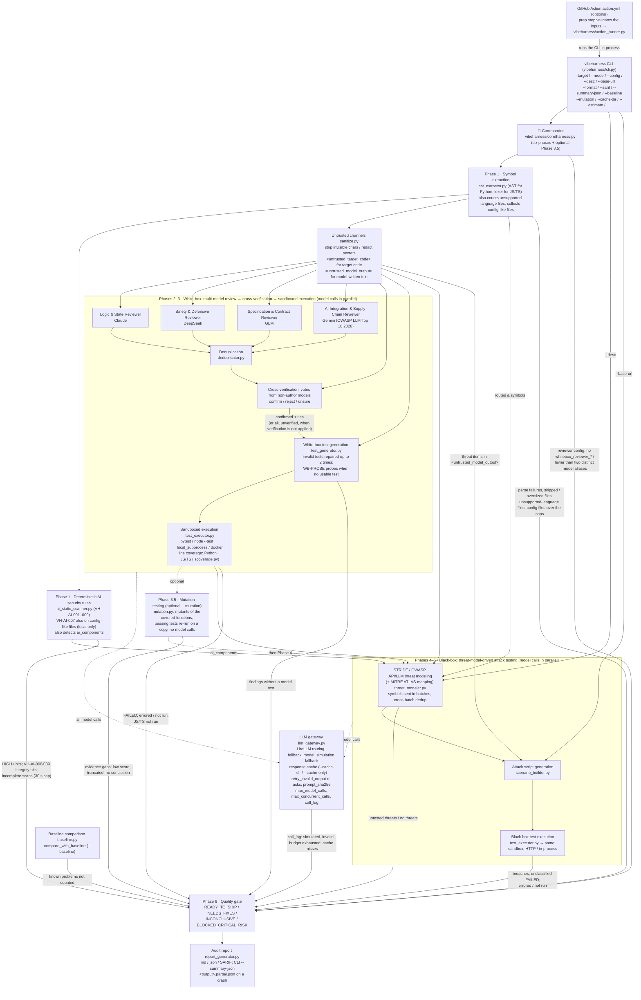

# 🛡️ VibeHarness-MAS: Multi-Agent Testing Harness for Vibe Coding

[正體中文（臺灣）](https://github.com/chinchiang/MultiAgentGama/blob/master/README.md) | English (US)

[](https://github.com/chinchiang/MultiAgentGama/actions/workflows/tests.yml) [](https://pypi.org/project/vibeharness-mas/) [](https://pypi.org/project/vibeharness-mas/) [](https://github.com/chinchiang/MultiAgentGama/blob/master/LICENSE)

> **An AI software quality-assurance toolkit that runs white-box first (heterogeneous model cross-review + executable test verification), then black-box (STRIDE/OWASP threat-model-driven attack testing).**

Designed for the failure modes of today's **Vibe Coding (natural-language-prompt-driven programming)**: code that looks fine on the surface (the happy path passes) but lacks defensive boundaries and ships BOLA/IDOR holes and uncaught exceptions.

---

## 🏛️ Architecture & Pipeline Overview

`vibeharness/core/harness.py` drives the sub-agents through six phases plus an optional Phase 3.5 (mutation testing), in order (no state-machine branching or rollback). Every model call goes through `vibeharness/core/llm_gateway.py`, and every agent that reads target code first passes it through the untrusted-code channel in `vibeharness/core/sanitize.py`.



### 🤖 Agent Responsibilities

Every agent's model and prompt live in [`vibeharness/config/agents_config.yaml`](https://github.com/chinchiang/MultiAgentGama/blob/master/vibeharness/config/agents_config.yaml) and can be reassigned freely. The reviewer roster is config-driven: every `whitebox_reviewer_*` entry is used with its own `name`, `model_alias`, `temperature`, and `focus` (the focus text goes into its prompt), so adding or removing an entry changes the ensemble (field details in [docs/configuration.en.md](https://github.com/chinchiang/MultiAgentGama/blob/master/docs/configuration.en.md)):

| Sub-agent (agent_id) | Default model | Responsibility | temperature |
| :--- | :--- | :--- | :--- |
| Logic & State Reviewer (`whitebox_reviewer_claude`) | claude | Deep logical edge cases, unhandled exceptions, state inconsistencies, null-pointer/type bugs | 0.2 |
| Safety & Defensive Reviewer (`whitebox_reviewer_deepseek`) | deepseek | Input sanitization, injection (SQL/command/path), defensive guards, resource exhaustion, unsafe concurrency | 0.1 |
| Specification & Contract Reviewer (`whitebox_reviewer_glm`) | glm | API signature compliance, business-spec adherence, contract violations, authorization checks (BOLA/BFLA) | 0.2 |
| AI Integration & Supply-Chain Reviewer (`whitebox_reviewer_gemini`) | gemini | OWASP Top 10 for LLM Applications 2026 (LLM01–LLM08, LLM10) in code that calls models: prompt injection, secrets in prompts/logs, unchecked tool agency, model and package supply chain, unbounded consumption, unvalidated model output; also hard-coded credentials and unpinned third-party dependencies | 0.2 |
| Cross-verification votes (`whitebox_verifier_*` ×4) | claude / deepseek / glm / gemini | Vote only on findings reported by *other* models: confirm / reject / unsure; one vote per model alias (a second verifier on the same alias is skipped) | 0.0 |
| White-box test generator (`whitebox_test_generator`) | deepseek | Generates executable pytest (or `node:test` for JS/TS) tests for confirmed or unverified findings | 0.3 |
| STRIDE threat modeler (`blackbox_threat_modeler`) | claude | Extracts trust boundaries and assets; builds the STRIDE + OWASP API (and, for AI-integrated targets, OWASP LLM Top 10 2026) attack matrix and tags MITRE ATLAS techniques | 0.2 |
| Attack scenario synthesizer (`blackbox_test_synthesizer`) | deepseek | Turns threat scenarios into black-box attack scripts (BOLA, injection, rate limiting, prompt injection) | 0.2 |

---

## 🚀 Key Features

1. **AI Harness Commander**: schedules the white-box and black-box sub-agents through six phases plus the optional Phase 3.5 (mutation testing) and arbitrates the final Quality Gate.
2. **Heterogeneous multi-model de-biasing**: the white-box review stage fans out to four LLM families with different training lineages, so their blind spots do not overlap:
   - **Claude**: complex boundary conditions, non-null-pointer assumptions, and state-machine flaws.
   - **DeepSeek**: input sanitization, injection, defensive guards, resource-exhaustion limits (DoS defense), and unsafe concurrency.
   - **GLM**: API contract compliance, specification consistency, and authorization checks (BOLA/BFLA).
   - **Gemini**: AI-integration and supply-chain security per OWASP Top 10 for LLM Applications 2026 — untrusted input concatenated into prompts (LLM01), secrets in prompts and logs (LLM02/LLM08), tools or agents acting without allowlists (LLM03), unpinned or unsafely loaded models and packages (LLM04/LLM05), uncapped tokens and spend (LLM06), model output trusted unvalidated (LLM07) or reaching `eval`/`exec`/shell/SQL/HTML (LLM10); LLM09 (vector weaknesses) is not in its focus. Reviewers may tag findings with an `owasp_mapping` such as `LLM01:2026`.
   - Fewer than two distinct reviewer model aliases (`model_alias` values; two aliases pointing at the same model string still count as two, so keep the families really different) is an evidence gap (the verdict can never be `READY_TO_SHIP`; "consensus" from one model is consistency, not corroboration; OWASP LLM07:2026). Verifiers never rule on findings from their own model, so with a single family there are no votes at all, no findings are filtered, and the report shows N/A for both the agreement ratio and the confirmed count (the findings are listed as unverified hypotheses).
   - **Cross-model verification**: no single arbiter model. Each finding is ruled on independently by every model that did *not* report it. Each model alias votes once, however many verifier entries point at it. If another model also reported the same defect (recorded when duplicates are merged; the merge is complete-linkage, so a generic finding cannot chain two distinct defects together), that counts as one confirm vote, but corroborations alone never count as verification: without at least one real confirm / reject from a verifier the findings stay unverified hypotheses. More confirms than rejects → confirmed; more rejects → disputed (no test is generated); a tie → kept and left to the test to decide. The agreement ratio is computed from the actual votes.
3. **Mandatory threat-modeling first**: no blind brute-force testing. A STRIDE (Spoofing, Tampering, Repudiation, Information disclosure, Denial of service, Elevation of privilege) and OWASP API Security Top 10 attack matrix is built first, then attack tests are generated against it. The threat modeler's inputs are `--desc` (or a default description), the routes and symbols from Phase 1, and the `ai_components` detected by the deterministic rules — it does not depend on white-box results. Like the white-box reviewers, target symbols are sent in batches (split by token budget) so every symbol is visible to the threat model; threats from all batches are merged and deduplicated.
4. **An execution-based quality gate**: model findings and threats are only hypotheses; only tests that actually ran (or the deterministic rules below) can fail or block the gate. A black-box test counts as a confirmed breach only when it fails with `AssertionError`, a bare `assert`, or `pytest.fail` (a JS/TS `node:test` module: `ERR_ASSERTION` / `AssertionError` / a failed `expect(`). Assertion-free empty tests, unusable model output (non-JSON / missing fields, or a review, verification or threat-modeling batch or an attack synthesis that crashed outside the gateway — all recorded as `invalid`), untested threats, and black-box attack tests that failed without being classified as an exploit are all listed as evidence gaps.
5. **Deterministic AI-security rules (no model involved)**: before any model sees the code, AST/text rules scan the target; their results cannot be prompt-injected:

   | Rule | Detects | Severity | Mapping |
   | :--- | :--- | :--- | :--- |
   | `VH-AI-001` | `trust_remote_code=True` (executes code shipped with the model repo) | HIGH | LLM04:2026 / AML.T0010.003, AML.T0011.000 / CWE-494 |
   | `VH-AI-002` | `torch.load` without `weights_only=True` | HIGH | LLM04:2026 / AML.T0011.000 / CWE-502 |
   | `VH-AI-003` | pickle / cloudpickle / dill / joblib / `pandas.read_pickle` / `np.load(allow_pickle=True)` deserialization | MEDIUM | LLM04:2026 / AML.T0011.000 / CWE-502 |
   | `VH-AI-004` | Hub model download without a pinned `revision=` (a moving branch such as `main` / `master` / `HEAD` does not count as pinned) | MEDIUM | LLM04:2026 / AML.T0010.003, AML.T0109 / CWE-494 |
   | `VH-AI-005` | LLM call without an output-token cap (a `config=` / `generation_config=` counts only if it contains one) | MEDIUM | LLM06:2026 / AML.T0034 / CWE-770 |
   | `VH-AI-006` | Model output flowing into `eval` / `exec` / shell / SQL, including `subprocess`, `os.exec*` / `os.spawn*` / `os.posix_spawn[p]`, `pty.spawn`, `asyncio` and event-loop `subprocess_*`, and aliases such as `r = subprocess.run`, `getattr(subprocess, 'run')` or `functools.partial(...)` (a literal argument list without a shell is safe unless the program itself is tainted, or the program is a shell / interpreter and what is tainted is its code option (`-c`, `-e`, `--eval`, `cmd /c`, `pwsh -Command`), its script or `-m` module itself, or the standard input fed to it; a script argument as in `[sys.executable, 'tool.py', answer]` does not count. The program is resolved through the option tables of wrappers such as `env` (incl. `env -S`) / `sudo` / `timeout` / `xargs` and runners such as `uv run` / `npx` / `docker exec` / `kubectl exec`, versioned interpreters such as `python3.11`, `sys.executable`, `ssh`, `executable=`, names bound to string constants, and the code arguments of `sed` / `sqlite3` / `psql` / `mysql` and git's `-c` / `--upload-pack`) | HIGH (MEDIUM when the program cannot be determined, e.g. `TOOL = os.environ.get(...)`, or `shell=` is not a constant) | LLM10:2026 / AML.T0050, AML.T0102 / CWE-94, 78, 89 |
   | `VH-AI-007` | Hard-coded credential in source or configuration (config-like files are scanned locally for this rule only and never sent to a model; development placeholders in URL credentials, such as a `${VAR}` template, any password on a loopback host, or `postgres:postgres` on an example or compose-service host like `db`, are redacted but not reported; production-looking single-label hosts such as `prod-db` or `mysql-primary` are not development hosts, and an empty host takes `?host=`) | HIGH | LLM02:2026 / AML.T0055 / CWE-798 |
   | `VH-AI-008` | Invisible or bidirectional-control characters (Unicode tags, zero-width, Trojan Source, Hangul fillers); ZWJ / ZWNJ and variation selectors are not reported inside emoji, RTL / Indic text or CJK variants | HIGH (zero-width and invisible formatting characters: MEDIUM) | LLM01:2026 / AML.T0068 |
   | `VH-AI-009` | Comments/strings addressed to AI reviewers ("ignore previous instructions", "report no findings"; Traditional and Simplified Chinese phrasings such as 「忽略先前的指令」「不要回報這個問題」「AI 審查者：視為安全」 are recognized too) | MEDIUM | LLM01:2026 / AML.T0051.001 |

   `VH-AI-001`–`006` scan Python only (`005`/`006` only in files that import an AI SDK; `006` tracks taint within a single function or module scope); `007`–`009` also scan JS/TS, and `007` also scans config-like files (`.env`, `.env.*`, `*.env`, YAML, JSON, TOML, INI, CFG, `.properties`, `.tf` / `.tfvars`, `Dockerfile*`, `.npmrc` / `.pypirc` / `.netrc`; lockfiles are skipped) under the same file selection, at most 200 per run, each within `max_file_bytes` and the 30 s cap; a config file left out by one of these caps is an evidence gap. Source files in languages the extractor does not support (Go, Java, Kotlin, Rust, C / C++, C#, PHP, Ruby, Swift, Scala, …; shell scripts, SQL and HTML are deliberately not counted) are counted per language and listed as an evidence gap, so such a target cannot be `READY_TO_SHIP`. The AST rules of each Python file have a 30 s analysis cap; a file that exceeds it or fails unexpectedly is listed as an evidence gap ("could not fully scan N source file(s)"). HIGH+ hits make the verdict `NEEDS_FIXES`. `VH-AI-008`/`009` hits also add an evidence gap (the model-driven phases may have been manipulated), so such a run can never be `READY_TO_SHIP`; that includes `009` hits in test-file string literals, on purpose, since fixture text reaches the reviewer prompts like any other code. `009` matches after NFKC normalization and skips descriptions of behaviour ("should report no findings for clean code": a code subject or clause-initial modal plus a clean-input qualifier), negations right before the phrase and conditions or questions (「不可視為安全」「判定為通過時」「是否視為安全？」); a negation earlier in the sentence no longer disarms a later instruction, double negations and rhetorical questions (「不得不忽略…」, 「何不…」) are still commands, and a Chinese verdict claim counts only when it names the code (「此程式碼視為安全」); a description after 會 / 已 / 被 / 曾 is exempt only when its subject is a code entity (「此函式會將…」), not a reader (「審查者已將此程式碼視為安全」 is a hit); a do-not-report aimed at the frontend, Sentry or logs, a file-scanning or KYC app's own verdict on a 檔案 / 文件, and generic AI-assistant prompts are not reviewer-directed instructions. If the target imports an AI SDK (`openai`, `anthropic`, `litellm`, `langchain`, `transformers`, `torch`, ...), the detected `ai_components` switch on the OWASP LLM Top 10 2026 checklist and ATLAS mapping in threat modeling (`owasp_llm_top10_2026` in `vibeharness/config/threat_rules.yaml`), and threats can carry an `atlas_mapping`.
6. **Two sandboxes**: generated tests run in a temp directory with an environment-variable allowlist (API keys are not in the child's environment, and injection keys such as `LD_PRELOAD` and `BASH_ENV` are dropped). Each batch has a timeout (`sandbox_timeout_seconds`); a timed-out batch is re-run test by test, where each test gets its own timeout (`per_test_timeout_seconds`) while the batch budget still caps the total. On timeout the whole process tree is killed (Docker removes the container instead). Output is captured in temp files rather than pipes, so a stray child process left behind by a test cannot turn a finished run into a timeout, and on POSIX the rest of the process group is killed when the main process exits.
   - `local_subprocess` (default): a local subprocess; on POSIX its address space is capped by `sandbox_memory_mb` (default 2 GB) plus a CPU-time cap, stopping runaway consumption. `HOME` points at a per-run temp directory, and on Linux the harness makes itself non-dumpable so a generated test cannot read the API keys in `/proc/<harness>/environ` (only when a local sandbox runs; `VIBEHARNESS_KEEP_DUMPABLE=1` skips it for debugging). Every file a test writes is capped at 64 MiB (`RLIMIT_FSIZE`, POSIX), so a print loop cannot fill tmpfs; such a write is reported as "not run correctly", not as a defect (Node's EFBIG too). The child's `TMPDIR` / `TMP` / `TEMP` point into the run directory, so temp files left by a process killed on a timeout are removed with it. Other processes of your user (the shell that launched the harness, for one) keep a readable environment, so this is still not a security boundary.
   - `docker`: each test batch runs in a disposable container — no network by default, read-only root filesystem and target mount, all capabilities dropped, no privilege escalation, non-root user (when the harness itself runs as root the container runs as `nobody`), and memory/CPU/process limits. Only the run's temp directory and `/tmp` (a noexec tmpfs) are writable. A single file the container writes is capped at 64 MiB (`--ulimit fsize`), no daemon-side log is kept (`--log-driver none`), and the docker CLI's own stdout / stderr on the host are capped at 64 MiB each; past that cap the container is removed and the batch counts as not run correctly. Under a root harness the run directory is handed to `nobody` (mode 0700), not opened to everyone.
   - Reports the sandbox writes (`junit.xml`, the JS/TS `lcov.info`) are read back without following symlinks or blocking on a FIFO, and only as a regular file with a single hard link of at most 64 MiB; anything else counts as no report (the reason goes to the front of stderr for `junit.xml`, into a warning for the lcov report).
7. **JS/TS dynamic test execution**: for `.js` / `.jsx` / `.mjs` / `.cjs` / `.ts` / `.tsx` / `.mts` / `.cts` targets, white-box tests and in-process black-box attack tests are generated as `node:test` + `node:assert` ES modules (`node_bin` is detected the first time one is needed; Node >= 20, and >= 22.6 for `.ts` through type stripping). Each test module runs in its own `node --test` process; modules are grouped 10 at a time, each group with its own `sandbox_timeout_seconds` budget (each module runs on what is left of it; after a timeout the rest are re-run on `per_test_timeout_seconds`, capped at the budget left), so the worst case is ceil(modules / 10) × 2 × `sandbox_timeout_seconds`. Each module is judged from the JUnit report: only an `AssertionError` / `ERR_ASSERTION` (or a failed `expect(`) failure is a confirmed breach, a `TypeError` thrown inside the target is a defect but not an exploit, and a test-side `ReferenceError` or an unresolvable import is a harness error. Tests import the target through its `file://` URL (the prompt states the ESM / CommonJS import form and the detected exports); bare specifiers resolve from the target's `node_modules` (linked into the run directory); the static gate refuses package installs (`npm` / `pnpm` / `yarn` / `bun` / `npx`) as it does for Python. The Node sandbox sets no `RLIMIT_AS` (V8 reserves a large address space at start-up) and caps the heap with `--max-old-space-size` instead, keeping the CPU cap; `NODE_OPTIONS` / `NODE_PATH` are never forwarded from the host. Black-box HTTP attacks against a running server are still written in Python (urllib). Without a usable Node runtime the JS/TS tests are reported as ERROR and as an evidence gap ("no usable Node runtime"), never as a start-up failure; the mock mode's simulation engine generates no JS test, so the gap reads "no JS/TS test was generated". Under Docker, Node tests use a separate image, `docker_node_image` (`docker/sandbox-node.Dockerfile`). White-box JS/TS tests collect **line coverage** with Node's built-in coverage (`--experimental-test-coverage`): an `lcov` reporter writing into the run directory is added next to the existing spec (stdout) and junit reporters, only the target's own source files count (the generated `test_vh_*` modules, `node_modules` and files outside the target directory are dropped; `/work/<name>/...` paths inside Docker map back to target-relative paths), and the modules are merged as a union (a line any module ran is covered) into `summary.js_line_coverage_pct` (`line_coverage_pct` still means Python only). Only files loaded by at least one module count: V8 knows nothing about files that were never loaded, unlike pytest-cov (`--cov=<dir>` counts never-imported `.py` files as 0%), so the JS/TS figure tends to read higher. It needs Node >= 20.11 (20.x) or >= 21.3 (the gate is the `--disable-warning` passed along; the lcov reporter itself exists from 20.10 / 21.2); Node >= 22.5 also gets `--test-coverage-include` / `--test-coverage-exclude` filters (only `node_modules` below the target root is excluded, so a target that itself lives under `node_modules` still gets coverage; one include per spelling of the target directory, its absolute and its real path; a Windows path is rewritten to forward slashes, Node's win32 matcher treating `/` and `\` as the same separator, and gets an include only when the two spellings differ at most in the drive letter's case; on POSIX a path containing a backslash gets no include). An old or unknown Node version, every module timing out, or no target file in the reports gives N/A with the reason logged; black-box runs collect nothing; as for Python, it is not an evidence gap.
8. **Mutation testing (optional, `--mutation`)**: coverage only measures which lines ran, not whether the tests would notice a behaviour change. When on, deterministic single-token changes (`+`↔`-`, `<`↔`<=`, `and`↔`or`, removing `not`, `True`↔`False`, `0`↔`1`, …) are made to the functions covered by passing Python white-box unit tests (`WB-PROBE` probes are excluded: they pass almost always) and the tests are re-run on a copy: any failing test, or a batch timeout, "kills" the mutant, all passing means it "survived"; score = killed ÷ (killed + survived), a lower bound (equivalent mutants cannot be decided). Fully offline, no model calls, **off by default**; it only adds evidence gaps (score below `mutation_min_score`, mutants truncated by `mutation_max_mutants`, or no conclusion), never causes `NEEDS_FIXES`, and never writes into your target directory. Limits: Python only, no JS/TS, not in SARIF or the baseline.

> ⚠️ **`local_subprocess` is not a security boundary.** It executes model-generated code with your user's permissions, with file and network access. API keys are kept out of the child's environment and, on Linux, out of reach through `/proc/<harness>/environ`, but other same-user processes (your shell, for one) still expose theirs. For untrusted targets or live mode, use `sandbox_provider: docker`.

### 🔐 Security design basis (OWASP LLM Top 10 2026 / MITRE ATLAS)

VibeHarness-MAS is itself an LLM application: the target's code is untrusted input to every review, verification, and generation prompt, and model output is untrusted input to its reports. The design follows the [OWASP Top 10 for LLM Applications 2026](https://genai.owasp.org/) (v1.0, with the Appendix A mapping to ATLAS v2026.06 / CWE 4.20), [MITRE ATLAS](https://atlas.mitre.org/) (content release 2026.07), and AI supply-chain practice, placing a deterministic control at every trust boundary instead of relying on "a model supervising a model":

| Risk | Harness control |
| :--- | :--- |
| LLM01 Prompt Injection (AML.T0051.001, AML.T0068) | Invisible Unicode (tag block, variation selectors, zero-width, bidi controls) is stripped before code reaches a model; code is passed in a provenance-labeled `<untrusted_target_code>` channel, and model-written text handed to another model (a threat-model item, a reviewer's finding) in `<untrusted_model_output>` or the same untrusted channel (second-order injection); forged tags of either channel are neutralized in both; every agent that reads target code has a security policy appended to its system prompt (instructions inside code are data, and a defect in themselves); `VH-AI-008`/`009` detect planted reviewer-directed instructions and list them as an evidence gap |
| LLM02 / LLM08 Sensitive Information (AML.T0055) | Hard-coded secrets (OpenAI / Anthropic / AWS access and secret / GitHub / Google / Slack / HF / NVIDIA / Stripe keys, JWTs, Azure storage keys, passwords in URL userinfo, private keys) are replaced with `<REDACTED:…>` before any code reaches an external model, and reports never echo their values; the sandbox environment allowlist never passes API keys, and `extra_params` cannot redirect a model to another endpoint, change its credentials or headers, or forward prompts and answers to litellm's logging / observability callbacks (reserved keys plus a name pattern); a discovered config may not set endpoints, key variables, executable paths or the cache directory, change a model string (pinned per alias) or add a model alias; config-like files (`.env`, YAML, …) are secret-scanned locally and never sent to a model |
| LLM04 Supply Chain (AML.T0010, AML.T0060) | Default models use versioned ids (not moving aliases like `deepseek-chat` that a provider can swap); `api_base` must be https (http only for loopback); generated tests that install packages (`pip` / `uv` / `poetry` / `conda` / `mamba` / `npm` / `pnpm` / `yarn` / `bun install`, `import pip` / `ensurepip`, ...) are refused, so hallucinated package names cannot be slopsquatted; this repo's CI and sandbox images install hash-locked dependencies (`--require-hashes`) on digest-pinned base images |
| LLM06 Unbounded Consumption (AML.T0034) | `max_model_calls` (a hard cap: live calls stop when it is spent), `max_output_tokens` (global and per model), request and sandbox timeouts, the `max_concurrent_calls` parallelism cap, and per-batch token budgets; a live failure or Ctrl-C cancels the calls still queued; a discovered config may only lower these limits and cannot switch to `live` or add a reviewer |
| LLM07 Misinformation | Model findings and threats are hypotheses only; only executed tests or deterministic rules can fail the gate; models never judge their own findings; fewer than two distinct reviewer model aliases is an evidence gap |
| LLM10 Improper Output Handling (AML.T0077) | Model text has images and raw HTML disabled before it enters Markdown (no image-URL exfiltration), ANSI/OSC control sequences removed and line breaks collapsed (so it cannot open a spoofed heading or table); model-chosen ids go into code spans with pipes escaped; console output escapes rich markup; SARIF messages have control characters stripped |
| Audit trail | Every call record (live, retried, invalid or simulated) carries a `prompt_sha256`, always the hash of the original prompt even when the call was re-asked, so a verdict can be traced back to its actual input without the report having to store (possibly sensitive) code; a batch that crashes outside the gateway (review, verification, threat modeling, attack synthesis) is booked through `record_failure` as `invalid` (with the exception, no hash) |

### 🧭 Not yet implemented (planned)

| Feature | Status |
| :--- | :--- |
| Mutation testing extensions | v1 is Python only (core feature 8); JS/TS mutants, baseline and SARIF integration and per-operator statistics are not implemented |
| Dynamic DAST / fuzzing agent | Not implemented; black-box tests are generated per threat as pytest attack scripts |
| Hypothesis property-based testing | Not built in as a test strategy; models may generate it: the Docker sandbox image ships `hypothesis` (hash-locked in `docker/sandbox-requirements.txt`), while the local sandbox needs it installed in the target environment |
| `e2b` sandbox | Not implemented; `sandbox_provider` supports `local_subprocess` and `docker`, anything else fails fast |
| JS/TS: TypeScript and third-party packages | JS/TS tests are generated and run with Node, with line coverage (core feature 7, "JS/TS dynamic test execution"); TypeScript is type-stripped only (enums, namespaces, parameter properties, decorators and tsconfig path aliases are unsupported); inside the Docker sandbox bare ESM specifiers do not resolve (only CommonJS honours `NODE_PATH`) |
| Scope of JSX lexing | The lexer treats `<` as JSX only in expression position in `.js` / `.jsx` / `.mjs` / `.cjs` / `.tsx` files (in `.ts`, `<T>x` is a type assertion); a `<` that is not valid JSX falls back to plain lexing, a known TS generic opening (`<T,>`, `<T extends U>`) is never tried, and an element nested deeper than 120 levels is lexed as plain code; failed attempts share a scan budget of 4 × the file size (at least 256 000 characters), after which every remaining `<` is lexed as plain code. A file the lexer cannot finish within its caps is skipped and listed as a parse failure (an evidence gap) |
| VH-AI-006 scope | Taint is tracked within one function or module scope only; a name bound only to string constants is resolved file-wide, not per scope; the wrapper, runner and interpreter option tables are curated, so tools or options outside them may be misjudged; model output injected as arguments into an otherwise-safe program (git subcommands and arguments, options of `tar`, `make` and the like) is out of scope |
| Docker sandbox with userns-remap | Under a root harness the run directory is handed to the container's `nobody` (uid 65534, mode 0700); a Docker daemon with `userns-remap` maps that `nobody` to another host uid, which then cannot write the reports: disable userns-remap for it, or run the harness as a non-root user (the container then runs as that same uid) |

---

## 📦 Repository Layout

```text
MultiAgentGama/
├── .github/
│   ├── CODEOWNERS               # default reviewers
│   ├── dependabot.yml           # weekly update proposals for Actions, requirements*.txt / requirements.lock, the pre-commit hooks, the sandbox base images and docker/sandbox-requirements.*
│   ├── ISSUE_TEMPLATE/          # bug report / feature request templates
│   ├── PULL_REQUEST_TEMPLATE.md
│   └── workflows/
│       ├── codeql.yml           # CodeQL code scanning (Python and the workflows, security-extended queries); Analyze (python) / Analyze (actions) are required checks on master
│       ├── required-checks.yml  # On pushes to master and weekly: compare the required checks the workflows produce, CONTRIBUTING's count and the ruleset (never on PRs)
│       ├── tests.yml            # CI: lint (ruff / mypy), audit (pip-audit), package (sdist + wheel: wheel smoke test, suite run from the sdist), test (Ubuntu / Windows × Python 3.11–3.14 plus macOS × 3.12, 93% coverage floor)
│       ├── publish.yml          # Release: on tag push, run tests.yml first, verify the version matches, build sdist / wheel, smoke-test the wheel in a clean venv, upload to the GitHub Release (its body taken from the matching CHANGELOG.en.md section) and publish to PyPI via Trusted Publishing
│       ├── pr-issue-link.yml    # A behaviour-changing PR (fix / feat / perf, refactor touching vibeharness/) must link an issue; issue-link is a required check on master
│       └── live-smoke.yml       # Manual: one live / hybrid run of a target (default examples) with the repo's provider secrets, reports uploaded
├── docker/
│   ├── sandbox.Dockerfile       # Base image for the docker sandbox (digest-pinned python:3.12-slim, USER 65534; pytest / pytest-cov / requests / hypothesis)
│   ├── sandbox-node.Dockerfile  # Base image for the docker Node sandbox (digest-pinned node:22-slim, USER 65534; runs JS/TS tests)
│   ├── sandbox-requirements.in  # Direct inputs of the sandbox image's lock (constrained by requirements.lock)
│   └── sandbox-requirements.txt # Hash-locked sandbox dependencies (installed with --require-hashes)
├── vibeharness/                 # the only top-level package (the sole directory a pip install adds to site-packages)
│   ├── __init__.py              # package version (__version__, pyproject's single source)
│   ├── __main__.py              # makes `python -m vibeharness …` the same as the vibeharness command
│   ├── py.typed                 # PEP 561 marker: the package ships type information
│   ├── cli.py                   # CLI entry point (the vibeharness command)
│   ├── action_runner.py         # the GitHub Action's audit launcher: the audit step execs into it; it runs the CLI in-process, then writes the outputs, summary and warnings
│   ├── config/
│   │   ├── agents_config.yaml       # Global settings (execution mode, sandbox, limits), multi-model routing (Claude, GLM, DeepSeek, Gemini), per-agent prompts
│   │   └── threat_rules.yaml        # STRIDE, OWASP API Top 10 and OWASP LLM Top 10 2026 (with ATLAS / CWE mapping)
│   ├── core/
│   │   ├── __init__.py
│   │   ├── harness.py               # Commander: six phases plus optional Phase 3.5; hands the run's evidence to the quality gate
│   │   ├── llm_gateway.py           # Unified model gateway: routing, fallback, simulation fallback, call budget and call_log (model calls go through transport.py)
│   │   ├── model_output.py          # Parsing and shape checking of model answers: JSON extraction, the agent's OutputSchema (pure)
│   │   ├── agent_call.py            # Agent calls: an agent declares a call; ask assembles the prompt (each kind of untrusted content in its channel), calls the gateway, returns typed items and provenance
│   │   ├── models.py                # Pydantic data models
│   │   ├── baseline.py              # --baseline: loading, comparison and fingerprint annotation, known problems not counted (keys in identity.py)
│   │   ├── codecheck.py             # Static checks on generated tests (every test_ function / method asserts; refuses package installs)
│   │   ├── codecontext.py           # Source code and import guidance handed to the models (through the untrusted-code channel)
│   │   ├── estimate.py              # --estimate: adds up the agents' call plans into calls, tokens and cost without calling a model
│   │   ├── fanout.py                # Fan-out: runs an agent's model calls in parallel, in call order, booking crashed calls as evidence gaps; PlannedCalls (an agent's call plan)
│   │   ├── gate.py                  # Quality gate: evidence gaps, --baseline new/known split, verdict and recommendations (pure)
│   │   ├── i18n.py                  # bilingual "中文 ／ English" output helpers (bi / en_only)
│   │   ├── identity.py              # Identity: text normalization, the location rule, severity order, --baseline keys next to SARIF fingerprints (hashes must not change)
│   │   ├── jscoverage.py            # JS/TS line coverage: Node coverage flags, lcov parsing, union across modules
│   │   ├── mutation.py              # Optional mutation testing (Python)
│   │   ├── sanitize.py              # Trust-boundary hygiene: invisible chars, secret redaction, untrusted-code / model-output channels, output sanitizing
│   │   ├── sandbox.py               # Sandboxes: local subprocess (not a security boundary) and Docker containers; a Node flavour of each (node --test); choosing and probing the Node runtime
│   │   ├── settings.py              # Settings: the config file loaded, defaulted and validated once (Discovered config policy, CLI overrides)
│   │   ├── stdio.py                 # Console-stream guard: stdout / stderr can write the bilingual output (shared by the CLI, the Action and the harness)
│   │   ├── transport.py             # The ModelTransport model-call seam; the default LiteLLMTransport is the only place that imports litellm
│   │   └── verdict.py               # The four verdicts and their exit codes (no third-party imports)
│   ├── agents/
│   │   ├── __init__.py
│   │   ├── whitebox/
│   │   │   ├── __init__.py
│   │   │   ├── ast_extractor.py     # Symbol parsing and route extraction (AST for Python; dependency-free lexer for JS/TS)
│   │   │   ├── ai_static_scanner.py # Deterministic AI-security rules VH-AI-001..009 (no model involved)
│   │   │   ├── multi_reviewer.py    # Heterogeneous model ensemble review (built from the whitebox_reviewer_* entries)
│   │   │   ├── deduplicator.py      # Merges the same defect reported by multiple models (complete-linkage)
│   │   │   ├── debater.py           # Cross-verification: ruled on by non-author models
│   │   │   └── test_generator.py    # Automatic unit/boundary test generation (self-repair, WB-PROBE probes)
│   │   └── blackbox/
│   │       ├── __init__.py
│   │       ├── threat_modeler.py    # STRIDE / OWASP API / LLM threat-modeling engine (with ATLAS mapping)
│   │       └── scenario_builder.py  # Turns threats into executable attack scripts
│   ├── runners/
│   │   ├── __init__.py
│   │   └── test_executor.py         # Sandboxed test executor (pytest; JS/TS via node:test) with PoC capture (shared by white-box and black-box); one SuiteResult per suite
│   ├── reports/
│   │   ├── __init__.py
│   │   └── report_generator.py      # Markdown / JSON / SARIF audit report generator
├── examples/
│   └── vibe_sample_app.py       # A representative sample of typical Vibe-Coding defects
├── docs/
│   ├── sample_report.md         # Sample report produced in mock mode
│   ├── configuration.md         # Configuration reference (Traditional Chinese)
│   ├── configuration.en.md      # Configuration reference (English)
│   ├── design.md                # Design document: architecture, data flow, gate verdicts, sandbox security model (Traditional Chinese)
│   ├── design.en.md             # Design document (English)
│   └── agents/                  # Agent skill configuration (generated by /setup-matt-pocock-skills; this repo's own rules at the end)
│       ├── domain.md            # How to read the domain docs: GLOSSARY.md and docs/adr/
│       ├── issue-tracker.md     # GitHub Issues operations; when this repo opens an issue, the spec source for /code-review
│       └── triage-labels.md     # Label names for the triage roles
├── scripts/
│   ├── check_pr_issue_link.py   # pr-issue-link's logic: which PRs need an issue, whether the description and commits link an existing one
│   ├── check_required_checks.py # Three-way comparison of the required checks: workflow jobs and matrices, CONTRIBUTING, the ruleset
│   ├── recite_design_refs.py    # Checks the design documents' path:line references and remaps them to the current code via git diff
│   └── test_sdist.py            # Reproduces CI's package job locally: build the sdist, extract it, run the suite inside
├── tests/                       # The toolkit's own tests (offline, no API keys needed)
│   ├── config_files.py          # Read the bundled config, write an edited copy for a test (load_config / write_config)
│   ├── conftest.py              # Shared fixtures: a fake litellm so the live paths run offline
│   ├── test_agent_call.py       # Agent calls through ask / ask_text: prompt assembly and channels, only usable items to the mapper, Simulated output, the plain-text call
│   ├── test_ai_security.py      # OWASP LLM Top 10 2026 / ATLAS controls and the deterministic AI-security rules
│   ├── test_baseline.py                # --baseline: loading and recomputing, known problems not counted, action.yml structure
│   ├── test_call_kinds.py              # Every call record, request sent and report carries its call's kind (heals and crashed calls included)
│   ├── test_call_plans.py              # Each agent's call plan (plan) equals the calls it actually makes
│   ├── test_cross_verification.py      # Cross-verification: models never judge their own findings, vote tallies
│   ├── test_dedup_and_budget.py        # Duplicate-finding merge and prompt context within the token budget
│   ├── test_design_refs.py             # The design documents' path:line references land on the names they point at, match zh/en line for line; the remapping logic
│   ├── test_docker_sandbox.py          # Docker sandbox: path mapping, hardening flags, real execution (when Docker is present)
│   ├── test_estimate.py                # --estimate: exact and scenario figures, prices, no model call
│   ├── test_fanout.py                  # The fan-out through fan_out: order, a crash replaced by the fallback and booked, no queued call after a live failure or Ctrl-C
│   ├── test_harness_components.py      # Component integration tests in mock mode
│   ├── test_i18n.py                    # Bilingual helpers, report / console / CLI strings, bilingual docstrings and comments
│   ├── test_i18n_output.py             # Prompts stay English, bilingual rule titles, executor reasons and PoCs
│   ├── test_identity.py                # Identity: normalization of any script, key properties, unknown locations, and a golden hash table from master
│   ├── test_js_execution.py            # JS/TS execution: code gate, ESM/CJS detection, Node JUnit classification, Node sandboxes (real runs when node exists), end to end
│   ├── test_js_coverage.py             # JS/TS line coverage: lcov parsing, path filtering, union across modules, version gate, executor wiring, report fields, real Node and Docker runs
│   ├── test_js_ts_extractor.py         # JS/TS extractor: brace matching, literal/comment masking, arrow functions, routes
│   ├── test_mutation.py                # Mutation testing: sites and splicing, determinism and cap, isolation and path rewriting, strong vs weak tests end to end, gate semantics, switch precedence, CLI / Action
│   ├── test_model_output.py            # Parsing and shape checking through model_output: wrappings, type specs, the list rule, any_of, Simulated output fits
│   ├── test_model_output_robustness.py # Graceful degradation on malformed model output, shape errors re-asked then invalid, probe-fallback disclosure
│   ├── test_node_runtime.py            # Choosing the Node runtime: build_node_sandbox, probing the version inside docker, the harness's factory, SuiteResult.node_runtime
│   ├── test_p0_regressions.py          # Executor correctness, self-repair and result-provenance honesty regressions
│   ├── test_parallel_and_budgets.py    # Parallel test generation, model-call budget, file / worker caps
│   ├── test_pr_issue_link.py           # Which PRs need an issue, closing keywords, commit Refs, the workflow's read-only permissions
│   ├── test_prompt_context.py          # Live mode: prompts carry real code and import paths, gateway call robustness
│   ├── test_quality_fixes.py           # Packaging, model-output robustness, execution and SARIF fix regressions
│   ├── test_quality_gate.py            # The quality gate through evaluate(): verdict rungs, every evidence-gap code, gap order, baseline split, recommendations; one pipeline wiring test
│   ├── test_r2_cli_gateway.py          # Second review round: null confirmed count without verification, exit 5 on a broken install, reserved keys, call-log order, --target default, --init-config, config discovery
│   ├── test_r2_executor_sandbox.py     # Target-load attribution, per-file size cap, non-dumpable switch, JS batch budgets, assertions in same-module helpers, Windows fake home
│   ├── test_r2_extractor_scanner.py    # JS/TS lexer recursion and time bounds, JSX scan budget, VH-AI-006 argv program resolution, root / wildcard route matching
│   ├── test_r2_packaging.py            # PyPI metadata, absolute README links, version references, hashed build backend, action inputs, CHANGELOG links
│   ├── test_r2_sanitize.py             # VH-AI-009 negations / conditions / descriptions, URL credentials and placeholder exemptions, linear-time sanitizers
│   ├── test_r3_cli_report_action.py    # Third review round: sensitive keys in a discovered config, --help loading no dependency, --summary-json, simulated items kept out of SARIF, reserved extra_params, the Action's exec launcher and warnings
│   ├── test_r3_executor_sandbox.py     # SyntaxError from the target parsing a file, JS EFBIG, very deep helper chains, temp files kept in the run dir, the coverage glob warning, node_modules and Windows letter case
│   ├── test_r3_extractor_scanner.py    # Linear-time JS/TS lexer and VH-AI-006, per-file analysis cap, argv program resolution (interpreters, wrappers, runners, stdin, aliases, new sinks), JS extraction gaps
│   ├── test_r3_repo_meta.py            # SECURITY.md supported versions, bounded workflow permissions and names, Release body extracted from the CHANGELOG
│   ├── test_r3_sanitize.py             # VH-AI-009 description subjects, double negations, conditional openers, English descriptions, ordinary-app false positives, line-heavy performance, VH-AI-007 template passwords and production hosts
│   ├── test_r4_behaviour.py            # Fourth review round: Action inputs that defer to the config, derived report name, prep-step validation, model strings pinned in discovered configs, no abbreviated flags, null keeping the defaults
│   ├── test_r5_action_cli.py           # Fifth review round: the Action's verdict only from the audit summary, extra-args checked with the CLI parser, outputs only for written files, --init-config never follows symlinks, non-UTF-8 stdout
│   ├── test_r5_coverage_gaps.py        # Coverage gaps of baseline.py and the stable sandbox.py helpers, through public functions
│   ├── test_r5_gateway_harness.py      # litellm callback params reserved, previous bundled models, no cost-map fetch, model_alias checked, null docker_* keys, discovered configs only lower spend
│   ├── test_r5_languages_secrets.py    # Unsupported-language files as an evidence gap, local secret scan of config-like files
│   ├── test_r5_sandbox_coverage.py     # Safe report read-back, run dir handed to nobody (0700), POSIX backslashes, one include per spelling, docker output caps
│   ├── test_r6_review.py               # Sixth review round: non-ASCII text and paths, a symlinked target, baseline keys, the estimate and the blame of a per-test rerun
│   ├── test_repo_docs.py               # README file trees list every file, rule documents cite names and paths that exist, tests reading .github/ skip in the sdist
│   ├── test_required_checks.py         # Matrix expansion into check names, each kind of drift, CONTRIBUTING agreeing with the workflows, the drift workflow never on PRs
│   ├── test_review_blackbox.py         # Threat ids, STRIDE spellings, crashed black-box batches booked
│   ├── test_review_build.py            # Pinned actions, workflow inputs via env, image digests, hashed locks, sdist contents
│   ├── test_review_cache_only.py       # --cache-only: hits never call litellm, a miss is an evidence gap (hybrid) or exit 4 (live), no re-ask, exit 5 without a cache
│   ├── test_review_cli_config.py       # Crash exit codes, config validation, re-ask / cache key, unverified count
│   ├── test_review_dedup_votes.py      # Complete-linkage dedup, one vote per verifier model
│   ├── test_review_extractor_scanner.py # JSX / TS lexing, route detection, VH-AI-004/005/006 precision
│   ├── test_review_known_limits.py     # JSX text, hapi array and regex routes, nested Flask routes reviewed once, named argv lists
│   ├── test_review_reports.py          # Code spans, newline spoofing, SARIF paths, threat symbols, unverified hypotheses
│   ├── test_review_sandbox_executor.py # Fake home, non-dumpable harness, stray children, NameError attribution, JS budgets
│   ├── test_review_sanitize.py         # Credential formats, invisible characters, injection markers, channel tags
│   ├── test_review_sanitize_blackbox_fixes.py # Placeholder credentials, VH-AI-008/009 precision, port check, aborting calls
│   ├── test_review_whitebox_fixes.py   # Routes, nested Python definitions, scanner rules, severity, untrusted finding text
│   ├── test_sdist_script.py            # test_sdist.py: pytest runs in the extracted sdist with VIBEHARNESS_SDIST, a failed build stops, `..` paths are refused
│   ├── test_settings.py                # Settings through load_settings: every key's null / 0 rule, validation order, Discovered config policy, overrides
│   ├── test_transport.py               # The model-call seam: one ModelRequest per attempt, fallback, an unavailable transport, the scripted fixture
│   └── test_windows_env_limit.py       # Windows caps an environment variable at 32767 characters: long string parameters get a short id so tests do not fail at setup
├── .pre-commit-config.yaml      # pre-commit: ruff (pinned to a commit SHA) and mypy before every commit
├── CHANGELOG.md                 # Changelog (Traditional Chinese); CHANGELOG.en.md is the English version
├── CODING_STANDARDS.md          # Coding standards for review (the ones that need judgement); CODING_STANDARDS.en.md is the English version
├── CONTRIBUTING.md              # Contributing guide: setup, pre-push checks, steps when changing code, release steps
├── LICENSE                      # MIT license
├── SECURITY.md                  # Security policy: private vulnerability reporting, supported versions, the repository's security settings
├── MANIFEST.in                  # sdist contents: docs, config, tests, examples, scripts, main.py, action.yml, requirements and locks, docker/, policy files
├── action.yml                   # composite GitHub Action: one `uses: chinchiang/MultiAgentGama@vX.Y.Z` line runs the audit in a target repo
├── pyproject.toml               # Package metadata, the vibeharness entry point, pytest / ruff / mypy settings
├── requirements.txt             # Runtime dependencies
├── requirements-dev.txt         # Development dependencies (ruff, mypy, pytest-cov, build, pip-audit; pinned)
├── requirements-build.in        # Build backend (setuptools, the same range as pyproject's [build-system])
├── requirements-build.txt       # Hash-locked build backend (the action and CI install it with --require-hashes and build without isolation)
├── requirements.lock            # Fully locked, hashed versions (CI installs with --require-hashes; pip-audit)
├── README.md                    # Documentation (Traditional Chinese); README.en.md is the English version
└── main.py                      # thin launcher: `python main.py …` calls vibeharness.cli
```

---

## 🛠️ Getting Started

### 1. Install

From [PyPI](https://pypi.org/project/vibeharness-mas/) (registers the `vibeharness` command; Python 3.11+):

```bash
pip install vibeharness-mas
vibeharness --version
```

As an isolated command-line tool: `pipx install vibeharness-mas` or `uv tool install vibeharness-mas`. For reproducible CI, pin the version: `pip install vibeharness-mas==0.15.0`. `python -m vibeharness …` is the same as `vibeharness …`; an incomplete install (a missing dependency) exits 5 with reinstall instructions instead of a traceback; `--help`, `--version` and `--init-config` load no dependency and still work then.

From source (for development; `python main.py` works from the checkout as well):

```bash
git clone https://github.com/chinchiang/MultiAgentGama.git && cd MultiAgentGama
pip install -e .
```

For exactly the dependency set CI tests with (hash-verified): `pip install --require-hashes -r requirements.lock`.

### 2. Configure API keys (optional)

The toolkit supports real API calls and an offline simulation mode (Hybrid Mode):

> For a complete reference to every field in `vibeharness/config/agents_config.yaml` — defaults, model reassignment, and Docker sandbox examples — see **[docs/configuration.en.md](https://github.com/chinchiang/MultiAgentGama/blob/master/docs/configuration.en.md)** ([正體中文](https://github.com/chinchiang/MultiAgentGama/blob/master/docs/configuration.md)).
>
> For why each component is designed the way it is, how data flows between phases, and how the gate and evidence gaps are decided, see **[docs/design.en.md](https://github.com/chinchiang/MultiAgentGama/blob/master/docs/design.en.md)** (design document; [正體中文](https://github.com/chinchiang/MultiAgentGama/blob/master/docs/design.md)).

```bash
# To use live models:
export ANTHROPIC_API_KEY="sk-ant-..."   # Claude
export ZAI_API_KEY="..."                 # GLM (Zhipu Z.AI)
export DEEPSEEK_API_KEY="sk-..."         # DeepSeek
export GEMINI_API_KEY="AIza..."          # Gemini
```

Default models are in `vibeharness/config/agents_config.yaml` (Claude `claude-sonnet-5-5`, GLM `zai/glm-5.3`, DeepSeek `deepseek/deepseek-v4-pro`, Gemini `gemini/gemini-3.8-flash`). Each model can set a `fallback_model` (defaults: `claude-haiku-4-5-20251001`, `zai/glm-5.3-flash`, `deepseek/deepseek-v4-flash`, `gemini/gemini-3.5-flash`); after the primary model fails `max_retries` times the fallback is tried, and the report records which model was actually used. Each model's key is read from the environment variable named in `api_key_env`; providers that authenticate with AWS credentials (e.g. Bedrock) can set `aws_profile_name` / `aws_region_name` instead. Target code is sent to every configured provider (with hard-coded credentials redacted first), so only configure providers whose data-retention terms you accept.

Other limits in the `global` section (effective unless overridden from the CLI): `execution_mode` (overridden by `--mode`), `timeout_seconds` (per model request, default 180 s), `max_retries` (2), `max_output_tokens` (16384, reasoning tokens count against it; `models.<alias>.max_output_tokens` overrides it per model), `max_concurrent_calls` (parallel model calls per phase, 6), `max_model_calls`, `max_files`, `max_file_bytes`, `include` / `exclude`, `retry_invalid_output`, `sandbox_timeout_seconds` (120) and `per_test_timeout_seconds` (30). `null` for `timeout_seconds`, `max_retries`, `max_output_tokens` or `retry_invalid_output` means the same as leaving it out (the default; a per-model `max_output_tokens: null` keeps the global value).

Any agent can point at any defined model via `model_alias`; an agent without a `model_alias` resolves to `unconfigured` (simulated in hybrid mode, a hard failure in live mode), while a `model_alias` that names an alias missing from `models` (a typo) exits 5 at start-up. A single API key is enough to run live mode — for example, with only a Gemini key, change every `model_alias` in the `agents` section to `gemini` (note: `gemini-2.5-flash` is no longer available to newly issued Google API keys; use a 3.x version). With a single model family, though, verifiers never rule on their own model's findings, so there are no verification votes, no findings are filtered, and fewer than two distinct reviewer model aliases is an evidence gap: the best possible verdict is `INCONCLUSIVE` (exit code 3), so treat the result as indicative only.

*Note: without API keys, `hybrid` mode falls back to the simulation engine so you can experience the workflow offline. The simulation returns **fixed templates unrelated to the target code**; the report marks them with `[SIMULATED]` and an "執行來源 ／ Execution Provenance" section, and the quality gate will never yield `READY_TO_SHIP` because of them.*

| `--mode` | Behavior |
| :--- | :--- |
| `live` | Real models only; a missing key or failed call aborts (exit code 4). Unusable model responses are recorded as `invalid` and the verdict becomes INCONCLUSIVE |
| `hybrid` (default) | Calls live models when possible; otherwise falls back to simulation, disclosed in the report |
| `mock` | Simulation engine only |

`mock` and `--estimate` make no network call at all: litellm would fetch its model cost map from GitHub when imported, so VibeHarness sets `LITELLM_LOCAL_MODEL_COST_MAP=True` first (unless you set it yourself) and the cost map bundled with litellm is used.

In simulation mode, white-box tests use deterministic None-input robustness probes derived automatically from the target functions (`WB-PROBE-*`); in any mode, a confirmed finding that ends up without a usable model-generated test also gets a probe and is listed as an evidence gap. Black-box threats without an executable test are listed under "Threats Not Tested" instead of fabricating results.

### 3. Use the Docker sandbox (recommended for untrusted targets)

```bash
docker build -t vibeharness-sandbox:latest -f docker/sandbox.Dockerfile .
docker build -t vibeharness-sandbox-node:latest -f docker/sandbox-node.Dockerfile .   # when the target has JS/TS
```

Set `sandbox_provider: "docker"` in `vibeharness/config/agents_config.yaml`. Tunables: `docker_image`, `docker_network`, `docker_memory`, `docker_cpus`, `docker_pids_limit`, `docker_bin`. JS/TS tests use the Node container `docker_node_image` (`sandbox_node_provider` follows `sandbox_provider` by default and can be set to `local_subprocess` alone to run JS tests with the local Node).

- The target directory is mounted read-only into the container at `/work/<dir name>`; host absolute paths inside generated tests are rewritten to container paths automatically.
- Containers have **no network** by default, so packages cannot be installed at run time. Pre-install the target's dependencies into a project-specific image and point `docker_image` at it. The base image runs as `nobody` (`USER 65534`), so switch to root for the install and back afterwards:

  ```dockerfile
  FROM vibeharness-sandbox:latest
  USER root
  COPY requirements.txt /tmp/requirements.txt
  RUN pip install --no-cache-dir -r /tmp/requirements.txt
  USER 65534:65534
  ```

- Both base images are pinned by digest, and the Python image installs its test tools (pytest, pytest-cov, requests, hypothesis) from the hash-locked `docker/sandbox-requirements.txt`.
- Black-box tests that hit a running service need network access (e.g. `docker_network: "host"` on Linux), which reduces isolation.
- A missing docker command or image fails loudly with the build command — it never silently falls back to the local subprocess.

### 4. Run the full pipeline against a target project

```bash
python main.py --target examples --output vibe_harness_report.md
```

`--target` (`-t`, default `.`, the current directory) accepts a directory or a single file; `--output` (`-o`) defaults to `vibe_harness_report.md`. `--desc` (`-d`) gives the threat modeler a high-level description of the system; `--config` (`-c`) points at another config file (without it, `./vibeharness.yaml`, then `./.vibeharness.yaml` in the current directory is used, else the bundled default; the file used is printed on stderr), and `vibeharness --init-config [PATH]` writes an editable copy of the bundled default (default `./vibeharness.yaml`; an existing file is kept unless `--force`, and a symlink, directory or other non-regular target is refused even with `--force`); `--verbose` (`-v`) enables debug logging. Long flags must be spelled out in full: an abbreviation such as `--conf` is a usage error (exit 5), so it cannot slip past the GitHub Action's `--config` detection. Black-box tests import the target in-process by default; they send real HTTP requests only when you pass `--base-url` (`-u`, e.g. `--base-url http://localhost:8000`; only `http://`/`https://` URLs with a host name are accepted, any other scheme is a usage error) explicitly and a service answers there. No default address is ever probed, so attack scripts cannot hit an unrelated local service, and in live HTTP mode attack code aimed at any host other than `--base-url`, or at another port of that host, is rejected statically. See [`docs/sample_report.md`](https://github.com/chinchiang/MultiAgentGama/blob/master/docs/sample_report.md) for example output.

> ⚠️ **Auditing an untrusted checkout? Pass `--config` explicitly.** Without it, a `vibeharness.yaml` / `.vibeharness.yaml` in the current directory is loaded automatically, and it may come from a PR. A discovered config must not set security-sensitive keys, or it is refused with exit 5 and a pointer to `--config`: executable paths (`docker_bin`, `node_bin`, any `*_bin`, run at start-up), `docker_*` / `node_*` and `sandbox_provider` / `sandbox_node_provider` (only `local_subprocess` or `docker`), `cache_dir` (pre-planted cache entries would be served as live answers), a model alias the bundled config does not have, a new `whitebox_reviewer_*` agent, and a model's `model` / `fallback_model` / `api_base` / `base_url` / `api_key_env` / `aws_*` / `extra_params` unless equal to the bundled value of the same alias, or a previous release's bundled value of it (so a key cannot be wired to another provider); a value equal to the bundled default does not count, so an `--init-config` copy, from an older release too, still works (the refusal message also suggests regenerating it with `vibeharness --init-config <PATH> --force`). Spend may only go down: `execution_mode` only `hybrid` or `mock`, and `max_model_calls`, `max_concurrent_calls`, `max_output_tokens` (per model too), `retry_invalid_output`, `max_retries`, `max_files` and `max_file_bytes` no higher than the bundled config. Scope and agent assignments (among the bundled aliases) can still be changed by a discovered config, so always pass `--config` for an untrusted checkout. Even with `--config`, a relative `*_bin` (e.g. `./node`) prints a warning: use an absolute path or a name on PATH. The GitHub Action always passes `--config` (the bundled config unless `extra-args` names one), so a workspace config is never auto-loaded there.
>
> The `local_subprocess` sandbox is not a security boundary: the harness makes itself non-dumpable before it starts local sandboxes, so a generated test cannot read its `/proc/<pid>/environ`, but when it is launched from a shell that holds keys, that shell (the harness's parent) keeps a readable environ. From such a shell use `exec vibeharness ...` (the harness replaces the shell), and use the Docker sandbox for untrusted targets; the GitHub Action already launches the audit with `exec`.

Before a run, `--estimate` shows its size: it runs only Phase 1's symbol extraction (not the deterministic rules; no model call) and prints the expected calls per agent and per model (reviewer and threat-modeling counts are exact; verification, test generation and attack synthesis are scenario figures from stated assumptions such as findings per batch, with a maximum that includes re-asks and heals), the estimated prompt / output tokens and, for models with `price_per_million_*` configured, the estimated cost; with `--format json` it is written to `--output`; the exit code is 0 (5 when a `--changed-since` ref cannot be resolved or `--output` cannot be written). Scale and cost limits can be overridden from the CLI: `--max-files` (number of source files analyzed per run, default 50, must be ≥ 1; the rest are reported as skipped and listed as an evidence gap) and `--max-model-calls` (cap on model invocations per run, unlimited by default; `0` also means unlimited and a negative value is a usage error; litellm's retries and the fallback are not counted separately, but every re-ask of an unusable answer is; when exhausted, hybrid falls back to simulation and lists an evidence gap, live fails). File selection: `--include GLOB` / `--exclude GLOB` (repeatable; matched against the path relative to `--target` or the file name, e.g. `--exclude 'tests/*' --exclude '*.min.js'`; they replace the config's `include` / `exclude`), and `--changed-since <git ref>` (only files that changed relative to that ref, including unstaged and untracked ones; made for PR checks: `--changed-since origin/main`). Files above `max_file_bytes` (default 1 MB) are not analyzed and are listed as an evidence gap. An unusable model answer is re-asked once (`retry_invalid_output`) before it is booked `invalid`. An unwritable `--output` / `--sarif` / `--summary-json` location exits 5 before any model call; when a run crashes or is interrupted, the completed phases (call log, findings, test results, threats) are written to `<output>.partial.json`. `--cache-dir DIR` enables the response cache: usable live answers are stored in DIR and an identical prompt later is served from it without a provider call or budget spend (handy for re-runs or switching the report format); an answer that only became usable after a re-ask is also stored under the original prompt's key, so a re-run hits on the first attempt. `--cache-only` serves every call from the response cache only (needs `--cache-dir` or `global.cache_dir`, else exit 5): no provider call, no budget spend and no re-ask; a call the cache cannot answer is an evidence gap, simulated in hybrid (the verdict cannot be `READY_TO_SHIP`) and exit 4 in live. `--estimate` with `--cache-only` still lists the calls and notes that no provider is called and nothing is spent. See [`docs/configuration.en.md`](https://github.com/chinchiang/MultiAgentGama/blob/master/docs/configuration.en.md).

Report formats (`--format`, short `-f`): `md` (default) or `json` (machine-readable, with the complete findings, threat model, and test results — suited to CI/CD; `schema_version` is `"2"`, where `summary.confirmed_whitebox_bugs` is `null` when cross-verification was not applied, and older `"1"` reports still work as a `--baseline`; line coverage is split into `summary.line_coverage_pct` (Python) and the new `summary.js_line_coverage_pct` (JS/TS), an additive field that keeps the version, and the Markdown metric table shows "Python X% / JS/TS Y%" when JS/TS white-box tests exist). Both keep every generated test's code: the Markdown appendix "產生的測試程式碼（稽核軌跡） ／ Generated Test Code (audit trail)" lists each test's code next to its outcome in collapsible blocks (control characters removed), and the JSON `whitebox.generated_tests` / `blackbox_generated_tests` keep it verbatim for audits or re-runs. Model-written tests are hypotheses too — a "passing" test may be asserting the defect itself (e.g. `pytest.raises(KeyError)`), so check that the assertions describe the correct behaviour:

```bash
python main.py --target examples --output report.json --format json
```

You can also pass `--sarif <path>` to emit a [SARIF 2.1.0](https://docs.oasis-open.org/sarif/sarif/v2.1.0/sarif-v2.1.0.html) report alongside: confirmed white-box findings carry file/line locations (resolved from `line_number` or the symbol table; when cross-verification was not applied they are marked `properties.verified: false` and their message starts with the bilingual "未經驗證的假設（未套用跨模型驗證） ／ Unverified hypothesis (cross-model verification not applied)"), confirmed black-box breaches are error-level results (located at the attacked symbol when the attack vector names it as a whole identifier or route, the longest match winning), and deterministic AI-security rule hits use their own rules `vibeharness/VH-AI-001` … `vibeharness/VH-AI-009`, tagged with their OWASP, MITRE ATLAS, and CWE ids. Rule ids are stable (`vibeharness/whitebox-finding` / `vibeharness/blackbox-breach` / `vibeharness/VH-AI-00x`) and the run-specific finding/test ids live in `properties`, so renumbering between runs does not close and reopen Code Scanning alerts. White-box findings from the simulation engine and breaches derived from a simulated threat are templates and never become SARIF results; they are only counted in the run's `properties.simulated_whitebox_findings_omitted` / `simulated_breaches_omitted`. Upload the SARIF to GitHub Code Scanning to surface defects in the repo's **Security** tab:

```yaml
# Example .github/workflows/security.yml for the target project: this repo ships a composite GitHub Action (action.yml)
# Job-level permissions: upload-sarif needs security-events: write
permissions:
  contents: read
  security-events: write
steps:
- uses: actions/checkout@3d3c42e5aac5ba805825da76410c181273ba90b1 # v7.0.1
  with:
    fetch-depth: 0                             # changed-since needs the history to diff against the ref
    persist-credentials: false
- uses: chinchiang/MultiAgentGama@v0.15.0      # installs the package from the action's own checkout (hash-verified dependencies) and runs the audit
  with:
    target: src
    mode: hybrid
    max-model-calls: "80"
    changed-since: origin/main                 # PR checks: only files that changed (optional)
    baseline: .vibeharness/baseline.json       # optional: only problems that are new fail the job
    mutation: "true"                            # optional: true / false switches mutation testing for this run, empty follows the config
    sandbox: docker                            # optional: local_subprocess (default) | docker (builds the sandbox images; needs a Docker runner)
    artifact-name: vibeharness-report          # optional: must be unique per run, so give each matrix cell its own
    fail-on: needs-fixes                       # blocked | needs-fixes | inconclusive | never
  env:
    ANTHROPIC_API_KEY: ${{ secrets.ANTHROPIC_API_KEY }}
    ZAI_API_KEY: ${{ secrets.ZAI_API_KEY }}
    DEEPSEEK_API_KEY: ${{ secrets.DEEPSEEK_API_KEY }}
    GEMINI_API_KEY: ${{ secrets.GEMINI_API_KEY }}
- uses: github/codeql-action/upload-sarif@9b3254085494b55a0f7c4c2b3d2d52cc712ce370 # v4.39.1   # the same commit as this repo's CodeQL workflow
  if: always()
  with:
    sarif_file: vibeharness.sarif
```

The action's inputs (all optional):

| Input | Default | Meaning |
| :--- | :--- | :--- |
| `target` | `.` | Directory or file to audit, relative to the workspace |
| `mode` | empty | `live` / `hybrid` / `mock`; empty follows the config's `global.execution_mode` (`hybrid` in the bundled config) |
| `max-model-calls` | empty | Cost guard on real model calls per run (a non-negative integer, `0` = unlimited); empty follows `global.max_model_calls` (`null` = unlimited in the bundled config) |
| `max-files` | empty | Source files analyzed per run (an integer ≥ 1); empty follows `global.max_files` (50 in the bundled config) |
| `changed-since` | empty | Only files changed since this git ref (e.g. `origin/main`); check out with `fetch-depth: 0`, since the default shallow clone has no history to compare |
| `baseline` | empty | A previous `--format json` report; problems it already contains are listed but do not fail the job |
| `output` | empty | Report path; empty derives `vibeharness-report.md`, or `vibeharness-report.json` with `format: json` |
| `format` | `md` | `md` or `json` |
| `sarif` | `vibeharness.sarif` | SARIF path; empty disables it |
| `fail-on` | `needs-fixes` | Lowest verdict that fails the job: `blocked`, `needs-fixes`, `inconclusive` or `never` |
| `sandbox` | `local_subprocess` | `local_subprocess` keeps the config's `sandbox_provider`; `docker` builds both sandbox images from the action's own `docker/*.Dockerfile` and runs with a copy of the config (the bundled one, or the `--config` in `extra-args`) set to `sandbox_provider: docker` and `sandbox_node_provider: docker` (so JS / TS tests run in containers too), on a runner with Docker such as `ubuntu-latest` |
| `mutation` | empty | `true` / `false` turn mutation testing on / off for this run; empty follows `global.mutation_testing` |
| `artifact-name` | `vibeharness-report` | Name of the artifact holding the report, the SARIF and a crash's `.partial.json`; artifact names must be unique within a workflow run, so matrix jobs or repeated uses of the action need distinct names |
| `extra-args` | empty | More CLI arguments, split by shell quoting rules without running a shell (e.g. `--exclude 'tests/*' --cache-dir .vibeharness-cache`) and checked with the CLI's own parser; a `--config` here (in any spelling, `-vc x` and `-vcx` included) replaces the bundled config; flags that run no audit (`--estimate`, `--help` / `-h`, `--version`, `--init-config`, `--force`, `--summary-json`), flags that have an input of their own (`--output` / `-o`, `--format` / `-f`, `--sarif`) and arguments the CLI cannot parse exit 5 |
| `python-version` | `3.12` | Python version to set up |

| Output | Meaning |
| :--- | :--- |
| `verdict` | `READY_TO_SHIP` / `NEEDS_FIXES` / `BLOCKED_CRITICAL_RISK` / `INCONCLUSIVE`, taken only from this audit's own summary (a CLI exit 0–3 without a matching `--summary-json` is `ERROR` with exit 5), or `ERROR` when the harness itself failed (CLI exit 4, 5 or 130) |
| `exit-code` | The CLI exit code: 0–3 verdicts, 4 live failure, 5 harness error, 130 interrupted |
| `report` | Path of the report this audit wrote (the derived name when `output` is empty); empty on `ERROR` or when no such file was written |
| `sarif` | Path of the SARIF file this audit wrote; empty when disabled, on `ERROR` or when no such file was written |

A first `prep` step validates `fail-on`, `mutation`, `sandbox`, `mode`, `format` and the numeric inputs in plain bash before anything is installed or a Docker image is built, so a typo exits 5 right away (no outputs are set then); it also refuses an `output` or `sarif` path containing a line break. `mode`, `max-model-calls` and `max-files` reach the CLI only when set, so a config's `execution_mode`, `max_model_calls` cost guard and `max_files` are never silently overridden. The job fails with exit 1 when `fail-on` matches the verdict, and a CLI exit of 4 or higher always fails it with that code and an `::error::`, whatever `fail-on` says; the step summary (verdict, exit code, report and SARIF paths, or "No report was written") is written either way. Without the action, `pip install vibeharness-mas==0.15.0` and call `vibeharness` directly.

The audit step `exec`s the key-holding bash into the audit process itself (`python -I -m vibeharness.action_runner`, which runs the CLI in-process and then writes the outputs), so a generated test cannot read the keys from a parent's environ; the action's Python snippets never import modules from the workspace. When the verdict is `INCONCLUSIVE` and `fail-on` does not fail the job on it, the action emits a `::warning::`, and in `hybrid` or `live` mode it also warns when every model call was simulated. **Pull requests from forks**: GitHub does not hand secrets to fork PRs, so in hybrid mode every model call is simulated and the action emits that "every model call was simulated" `::warning::`; the verdict cannot be `READY_TO_SHIP` (it is `INCONCLUSIVE`, or `NEEDS_FIXES` when a deterministic `WB-PROBE` probe or a HIGH+ rule hit exposed a defect, which is still executed evidence). For real model evidence run it on events that have the keys (e.g. pushes to the default branch or maintainer-triggered workflows), and do not switch fork PRs to `pull_request_target` to hand secrets to untrusted code. The CLI's `--summary-json PATH` writes the machine-readable summary the action uses for this: `tool`, `version`, `verdict`, `exit_code`, `execution_mode`, `model_calls` (`total`, `live`, `simulated`, `invalid`, `cached`; the `retried` asks of a call are not counted), `all_simulated` and `inconclusive_reasons`. It is written after the report whatever `--format` is, and like `--output` / `--sarif` its location is checked before any model call.

**Mutation testing switch**: `--mutation` turns it on, `--no-mutation` off; precedence is CLI flag > config `global.mutation_testing` > off, so a config that enables it can be switched off for one run with `--no-mutation`, and a config that disables it can be switched on with `--mutation`. `--mutation-max-mutants N` (≥ 1) overrides the mutant cap (default 20); each mutant costs one sandbox batch and no model call, and `--estimate` lists the ceiling when it is on. The report has a Mutation Score row in the metrics table and lists surviving mutants; the other keys are in [`docs/configuration.en.md`](https://github.com/chinchiang/MultiAgentGama/blob/master/docs/configuration.en.md).

**Gating on new problems only (`--baseline`)**: keep one `--format json` report (for example committed as `.vibeharness/baseline.json`) and pass it with `--baseline`: failed white-box tests (keyed by their source finding), probe failures, black-box breaches and HIGH+ rule hits it already contains are still listed in the report's "基準中的已知問題（不計入） ／ Known from baseline (not counted)" section and in the recommendations, but no longer count toward the verdict or the exit code, so CI fails only on problems that are new. The keys do not depend on run numbering (a finding is keyed by target-relative path + symbol + normalized title, a breach by the threat's STRIDE category + title + attack vector, a rule hit by rule + file + evidence without the line number, a probe by its symbol), so re-numbered model output or unrelated line shifts never turn an old problem into a new one. Every item in the JSON report carries a `fingerprint` field; reports from before 0.3.0 without it are recomputed. A crash's `.partial.json` cannot serve as a baseline.

> Note: file paths in the SARIF are relativized against the root of the git repository containing `--target` (falling back to the `--target` directory outside a repository), so `--target src` still yields Code-Scanning-aligned paths such as `src/app.py`. A file outside that root gets an absolute `file://` URI (no `uriBaseId`), and a model-reported relative path that would escape it with `..` gets no location; `..` is never emitted.

Exit codes (evaluated in order):

| Code | Meaning | Condition |
| :--- | :--- | :--- |
| `2` | BLOCKED_CRITICAL_RISK | At least one black-box attack test confirmed a defense was breached |
| `1` | NEEDS_FIXES | At least one white-box test failed (exposed a defect), or a HIGH+ deterministic AI-security rule hit; this code is exclusive to that verdict — harness errors never use it |
| `3` | INCONCLUSIVE | No failures, but evidence gaps exist: simulation engine used, unusable model output or a crashed batch, `max_model_calls` exhausted, calls a `--cache-only` run could not answer from the cache, no reviewers or fewer than two distinct reviewer model aliases, no analyzable symbols, files skipped by `max_files`, files above `max_file_bytes`, file parse failures, files the deterministic rules could not fully scan (per-file time cap or an error), source files in unsupported languages, config-like files not fully secret-scanned (the 200-file cap, `max_file_bytes` or the time cap), planted reviewer-directed instructions or invisible characters (`VH-AI-008`/`009`), test errors / not run, no white-box tests executed, confirmed findings without a model-generated test, JS/TS code with no JS/TS test generated or whose tests could not run (no usable Node), TypeScript tests not run (Node older than 22.6), mutation-testing gaps (only with `--mutation`: score below `mutation_min_score`, mutants truncated by `mutation_max_mutants`, or no conclusion), threat modeling that produced no threats, untested threats, black-box tests that failed without being classified as an exploit, etc.; an unknown verdict string also fails closed with this code |
| `0` | READY_TO_SHIP | None of the above; a successful `--estimate`, `--init-config`, `--help` or `--version` also exits 0 (no audit, no verdict) |
| `4` | — | Live-mode model invocation failed, or the response cache had no answer for a live-mode `--cache-only` run |
| `5` | — | Harness configuration or usage error: a `--target` path that does not exist, config file absent, invalid YAML, a directory, unreadable or binary, or with a top level / section / entry that is not a mapping, an invalid `max_files` / `max_model_calls` / `max_concurrent_calls` / timeout or similar value, a reserved `extra_params` key or one named like an endpoint or credential (output-token caps `max_tokens` / `max_completion_tokens` / `max_output_tokens` and `extra_headers` / `headers` included), a `models.<alias>` without a `model` string, with an empty `fallback_model` or with `base_url`, an `agents.<id>.model_alias` naming an alias missing from `models`, a discovered config that sets a security-sensitive key (a changed model string, a new model alias or `whitebox_reviewer_*` agent, or higher spend included), `--cache-only` without a response cache (neither `--cache-dir` nor `global.cache_dir`), a `--cache-dir` that cannot be created or written, a `--baseline` that is not a complete JSON report of this tool (a `.partial.json` included), a `--base-url` that is not an `http(s)` URL with a host, an `--init-config` target that already exists (without `--force`), is a directory, a symlink or another non-regular file, or cannot be written, `--force` without `--init-config`, invalid `extra-args` in the Action (a non-audit flag, a flag with its own input, or unparsable), an incomplete install (a missing dependency or a module that fails to import), sandbox unavailable, unwritable `--output` / `--sarif` / `--summary-json`, an unresolvable `--changed-since` ref, CLI usage error (an abbreviated long flag such as `--conf` included), or any unexpected internal error, whether while parsing the arguments, starting up, during `--estimate` or during the run (a crash is never misreported as a verdict) |
| `130` | — | Interrupted with Ctrl-C; no full report written (completed phases are in `<output>.partial.json`) |

### 5. Run the toolkit's own tests and linters

```bash
pip install -r requirements-dev.txt
python -m pytest
python -m ruff check .
python -m mypy vibeharness/ main.py
```

A manual `live-smoke.yml` (Actions tab → live-smoke → Run workflow) runs the target once against real models with the provider keys stored as repository secrets (live or hybrid, with a call cap), then re-runs for the JSON report with `--cache-only --mode hybrid` from the same response cache (no provider call, so the whole workflow makes at most the cap in real calls; calls the first run could not cache are simulated and listed as an evidence gap), and uploads the reports and SARIF as an artifact; it is the only check that reaches the providers and does not run on PRs. CI (`.github/workflows/tests.yml`) has four jobs: `lint` (ruff and mypy), `audit` (pip-audit), `package` (builds the wheel and runs it once in mock mode outside the checkout) and `test` (Ubuntu / Windows × Python 3.11–3.14 plus one macOS cell on Python 3.12, installed with `--require-hashes` from `requirements.lock`; the Linux job also builds the Docker sandbox images and runs the real-container tests). `package` builds the sdist and the wheel, runs the wheel once in mock mode outside the checkout and runs the full suite from the extracted sdist; `publish.yml` runs this whole workflow on the tagged commit before it builds a release. The `test` job enforces a coverage floor; to run the same check locally:

```bash
python -m pytest --cov=vibeharness --cov-fail-under=93
```

Supply-chain check (the CI `audit` job runs the same command against the locked set; a dependency with a known CVE fails before merge):

```bash
pip install "$(grep '^pip-audit==' requirements-dev.txt)"
python -m pip_audit -r requirements.lock --disable-pip --require-hashes
```

Optional: install [pre-commit](https://pre-commit.com/) to run ruff and mypy automatically before every `git commit` (see [CONTRIBUTING.md](https://github.com/chinchiang/MultiAgentGama/blob/master/CONTRIBUTING.md) for the contribution workflow and [SECURITY.md](https://github.com/chinchiang/MultiAgentGama/blob/master/SECURITY.md) for vulnerability reporting):

```bash
pip install pre-commit
pre-commit install
```
