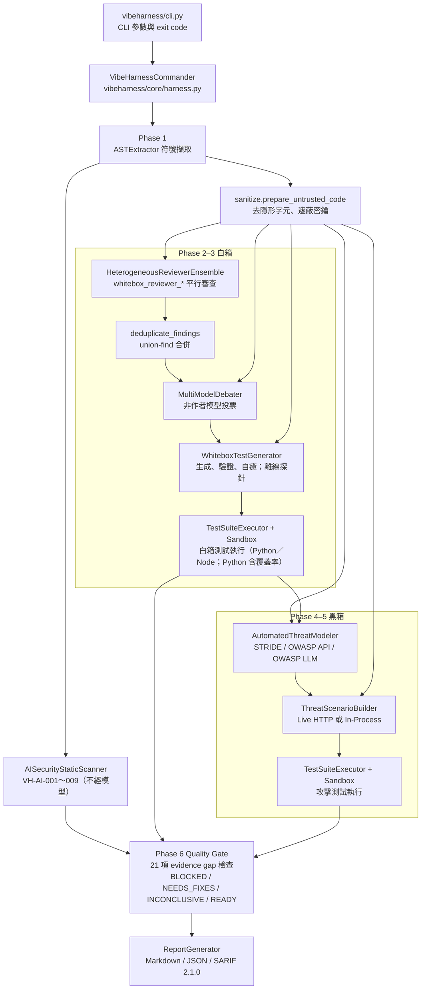
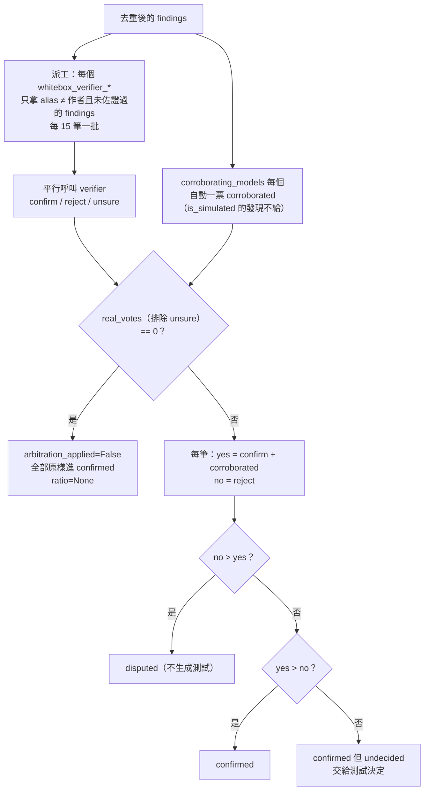
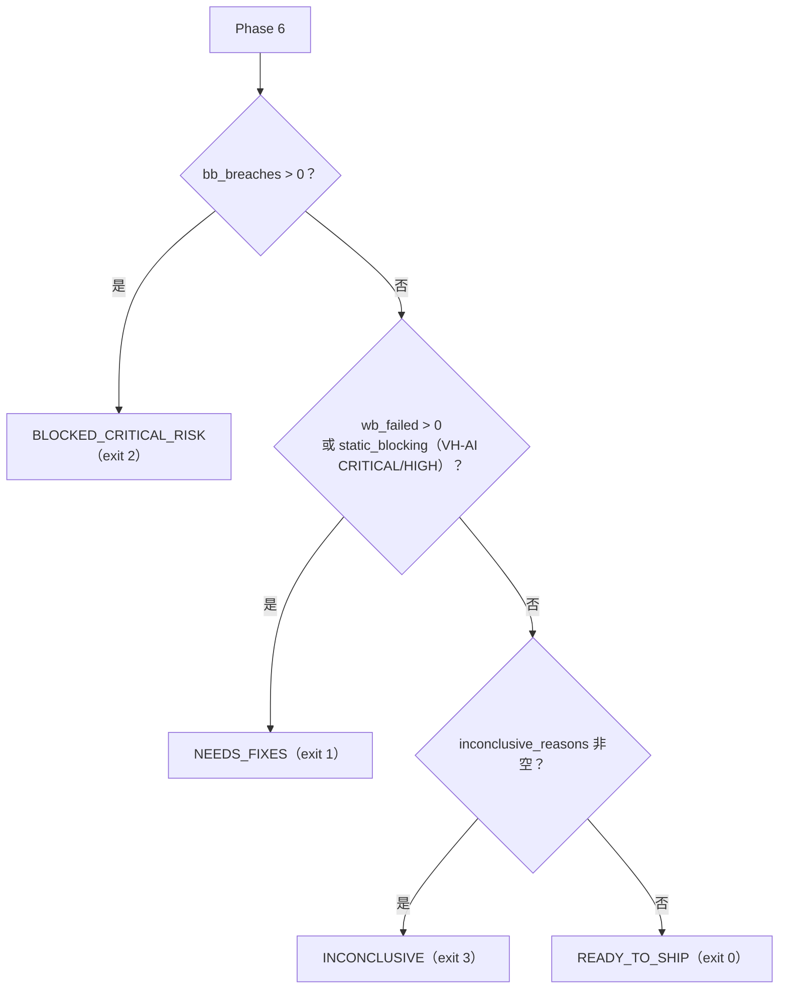

# VibeHarness-MAS 設計文件

[English](design.en.md) ｜ 正體中文（臺灣）

本文說明 VibeHarness-MAS 的設計：為什麼這樣設計、每個元件怎麼運作、資料如何在階段之間流動、品質閘門怎麼判定、沙盒的安全模型，以及已知的限制。對應版本：`vibeharness/__init__.py` 的 `0.5.0`（`CHANGELOG.md` 的 `[0.5.0]`，2026-10-09，新增選用的突變測試；前一版 `[0.4.0]` 含 `--baseline`、`--estimate`、JS/TS 動態測試執行、中／英雙語輸出）。文中的 `path:line` 引用以 commit `553ff27` 的檔案為準。

與其他文件的分工：

| 文件 | 內容 |
| :--- | :--- |
| [`README.md`](../README.md) | 安裝、使用方式、exit code、CI 整合 |
| [`configuration.md`](configuration.md) | `agents_config.yaml` 每個欄位的語義與預設值 |
| [`sample_report.md`](sample_report.md) | mock 模式產生的範例報告 |
| 本文 | 架構、模組職責、資料模型、閘門判定、信任邊界、擴充點、測試策略、設計決策 |

---

## 1. 問題陳述與設計目標

### 1.1 要解決的問題

Vibe coding（以自然語言提示驅動的程式產生）常見的缺陷型態：happy path 可以過，但沒有防禦邊界（null 檢查、輸入驗證、授權檢查）、存在 BOLA／IDOR 與 mass assignment、例外沒有被捕獲而直接洩漏給呼叫端。`examples/vibe_sample_app.py` 就是這四類缺陷的示範目標。

單靠一個 LLM 審查這類程式碼有三個問題：模型會把假設當成結論、同一個模型的盲點會重複出現、而且被審的程式碼本身可以對模型下指令（prompt injection）。

### 1.2 設計原則

這六條原則貫穿所有模組，後面每一章都會指出它們落在哪裡：

1. **以執行結果為準。** 模型的發現與威脅只是假設。只有實際執行過的測試，或者不經模型的確定性規則，才能讓閘門 fail 或 block（`vibeharness/core/harness.py:812-819`）。
2. **證據缺口 fail closed。** 任何讓判定不可信的情況（用到模擬引擎、模型輸出無效、測試沒跑、威脅沒測、檔案沒分析）都記成 evidence gap，判定最多是 `INCONCLUSIVE`（exit 3）；未知的判定字串也以 exit 3 結束（`vibeharness/cli.py:52-70`）。
3. **異構模型去偏差，沒有單一仲裁者。** 四個不同模型家族各自審查；每筆發現由「沒有回報它」的模型投票，模型不評審自己的發現（`vibeharness/agents/whitebox/debater.py:71-81`）。
4. **威脅建模先行。** 黑箱測試由 STRIDE／OWASP 威脅矩陣逐項推導，不做盲目的暴力測試。
5. **目標程式碼是不受信任的輸入。** 送進任何模型前先去隱形字元、遮蔽密鑰，並包進來源標記通道；模型輸出進報告前再消毒（`vibeharness/core/sanitize.py`）。
6. **成本與規模有硬上限。** `max_model_calls`、`max_concurrent_calls`、`max_files`、token 預算、逾時。

---

## 2. 系統架構總覽

### 2.1 流程圖



### 2.2 元件與目錄

| 目錄／檔案 | 元件 | 職責 |
| :--- | :--- | :--- |
| `vibeharness/cli.py` | CLI | 參數解析、exit code 對應、把 harness 的錯誤和判定分開 |
| `vibeharness/core/harness.py` | `VibeHarnessCommander` | 六階段的線性流程、evidence gap 收集、閘門判定、報告輸出 |
| `vibeharness/core/llm_gateway.py` | `LLMGateway` | 唯一的模型呼叫入口：模式決策、預算、重試與 fallback、JSON 容錯、呼叫紀錄 |
| `vibeharness/core/models.py` | Pydantic 資料模型 | 所有階段之間的資料結構，同時是 JSON 報告的 schema |
| `vibeharness/core/codecontext.py` | token 預算 | 符號渲染、截斷、分批、import 指引 |
| `vibeharness/core/codecheck.py` | `check_test_code`、`check_js_test_code` | 生成測試的靜態閘門（Python 與 `node:test` 模組）：要有測試函式、要有斷言、不得安裝套件 |
| `vibeharness/core/sanitize.py` | 信任邊界 | 隱形字元、密鑰、注入標記、來源標記通道、報告消毒 |
| `vibeharness/core/sandbox.py` | `LocalSubprocessSandbox`、`DockerSandbox`、`NodeSubprocessSandbox`、`NodeDockerSandbox` | 執行生成測試的環境（Python 用 pytest，JS/TS 用 `node --test`） |
| `vibeharness/core/baseline.py` | `load_baseline`、`compare_with_baseline` | `--baseline`：與執行次序無關的 fingerprint、已知問題不計入判定 |
| `vibeharness/core/estimate.py` | `estimate_run` | `--estimate`：不呼叫模型的呼叫數、token 與花費估算 |
| `vibeharness/core/i18n.py` | `bi`、`en_only`、`has_cjk` | 固定輸出字串的「中文 ／ English」雙語工具；送進模型前取英文半（第 11.5 節） |
| `vibeharness/agents/whitebox/ast_extractor.py` | `ASTExtractor` | Python AST 與 JS/TS lexer 的符號擷取 |
| `vibeharness/agents/whitebox/ai_static_scanner.py` | `AISecurityStaticScanner` | VH-AI-001～009 確定性規則 |
| `vibeharness/agents/whitebox/multi_reviewer.py` | `HeterogeneousReviewerEnsemble` | 多模型審查 |
| `vibeharness/agents/whitebox/deduplicator.py` | `deduplicate_findings` | 合併同一缺陷的多份回報 |
| `vibeharness/agents/whitebox/debater.py` | `MultiModelDebater` | 交叉驗證投票 |
| `vibeharness/agents/whitebox/test_generator.py` | `WhiteboxTestGenerator` | 白箱測試生成與離線探針 |
| `vibeharness/agents/blackbox/threat_modeler.py` | `AutomatedThreatModeler` | 威脅建模 |
| `vibeharness/agents/blackbox/scenario_builder.py` | `ThreatScenarioBuilder` | 威脅轉攻擊測試 |
| `vibeharness/runners/test_executor.py` | `TestSuiteExecutor` | 一測試一模組、JUnit 解析、結果歸因 |
| `vibeharness/reports/report_generator.py` | `ReportGenerator` | Markdown、JSON、SARIF |
| `vibeharness/config/agents_config.yaml` | 設定 | 全域參數、模型別名、agent 路由 |
| `vibeharness/config/threat_rules.yaml` | 設定 | STRIDE、OWASP API Top 10、OWASP LLM Top 10 2026 的提示詞指引 |
| `docker/sandbox.Dockerfile`、`docker/sandbox-node.Dockerfile` | 映像 | Docker 沙盒的基底映像（Python／Node） |
| `action.yml` | composite GitHub Action | 目標專案以 `uses: chinchiang/MultiAgentGama@vX.Y.Z` 一行執行稽核（第 15.2 節） |

所有模型呼叫都經過 `LLMGateway.generate`；所有生成測試都經過 `check_test_code_for`（Python 走 `check_test_code`，JS/TS 走 `check_js_test_code`）與 `TestSuiteExecutor`。這兩個收斂點是後面安全控制能成立的前提。

---

## 3. 執行流程（Pipeline）

`VibeHarnessCommander.run_full_pipeline`（`vibeharness/core/harness.py:404-930`）是六個線性階段，沒有狀態機的分支或回退；整段包在一個 `try` 裡，任何例外或 Ctrl-C 都先寫出部分報告再往上拋（見本章末）。每個階段的輸入、輸出與失敗處理如下。

### Phase 1：符號擷取與確定性規則（`vibeharness/core/harness.py:449-487`）

- `select_symbols`（`vibeharness/core/harness.py:148-166`）呼叫 `ASTExtractor.parse_directory(target, max_files, include, exclude, only_files, max_file_bytes)` 走訪目標，排除 `.`開頭目錄與 `SKIPPED_DIRS`（`venv`、`__pycache__`、`node_modules`、`dist`、`build`、`site-packages`）；目錄與檔名都排序，結果確定（`vibeharness/agents/whitebox/ast_extractor.py:85-145`）。超過 `max_files` 的檔案進 `skipped_files`，解析失敗的進 `parse_failures`，實際分析的進 `analyzed_files`。
- **檔案篩選**：`--include`／`--exclude`（或設定檔 `global.include`／`exclude`）經 `_selected`（`vibeharness/agents/whitebox/ast_extractor.py:148-157`）以 fnmatch 比對相對路徑或檔名，exclude 優先；`--changed-since <ref>` 由 `changed_files`（`vibeharness/core/harness.py:201-221`）用 git 列出相對該 ref 有變更的檔案（含暫存、未暫存、未追蹤）當 `only_files`，ref 無法解析或目標不在 repo 內是 `ValueError`（exit 5）。被篩掉的檔案只計入 `filtered_out`，不是 evidence gap（使用者明示）。超過 `max_file_bytes`（預設 1 MB）的檔案由 `_too_large`（`vibeharness/agents/whitebox/ast_extractor.py:160-164`）放進 `oversized_files`，是 evidence gap #10。套用的篩選條件印在 console 並寫進 `RunMetadata.file_filters`。
- 單一檔案目標時，`work_dir` 取所在目錄（`work_dir_for`，`vibeharness/core/harness.py:143-146`，於 `:456` 呼叫），測試與 import 都以這個目錄為根。
- 偵測到的語言排序後輸出；沒有偵測到任何語言時預設 `["Python"]`（`vibeharness/core/harness.py:465`）。
- `AISecurityStaticScanner.scan_files(analyzed_files)` 在任何模型看到程式碼之前執行（`vibeharness/core/harness.py:474`），結果不可能被 prompt injection 影響。它同時產出 `ai_components`（目標 import 的 AI SDK），決定後面要不要套 OWASP LLM Top 10。

### Phase 2：多模型審查、去重、交叉驗證（`vibeharness/core/harness.py:489-518`）

- `review_symbols` 把符號分批，對每個「reviewer × batch」平行呼叫模型。
- `deduplicate_findings` 合併同一缺陷的多份回報，並把其他模型記在 `corroborating_models`。
- `MultiModelDebater.arbitrate` 讓非作者模型投票，產出 `MultiModelDebateResult`。
- 審查者的 `distinct_models` 少於兩個時，console 警告（`vibeharness/core/harness.py:496-499`）之外也是 evidence gap（第 10.2 節 #7）：同一模型的多份副本彼此同意是一致，不是佐證。

### Phase 3：白箱測試生成與執行（`vibeharness/core/harness.py:520-546`）

- 對 `confirmed_findings`（含平手保留的 undecided）逐筆生成測試；發現所在檔案的語言（`language_for_file`）決定提示詞是 pytest 還是 `node:test` 模組，並寫進 `GeneratedTest.language`；沒有可用模型測試的發現記進 `findings_without_model_tests`，並補上離線探針（只針對 Python）。
- `execute_test_suite(..., collect_coverage=True)` 回傳每個測試的結果與行覆蓋率（只有 Python；JS 測試在 Node 沙盒各自執行，第 9.5 節）。覆蓋率只是資訊，不影響判定。
- `wb_errored` 同時計入 `ERROR` 與 `SKIPPED`（`vibeharness/core/harness.py:538`）。

### Phase 3.5：突變測試（選用，`vibeharness/core/harness.py:548-574`；核心在 `vibeharness/core/mutation.py`）

預設關閉；用 `--mutation`／`--no-mutation`（優先）、`global.mutation_testing`、預設關閉的順序決定，最終值與來源（`cli`／`config`／`default`）記在 `RunMetadata.mutation_enabled`／`mutation_source`（`set_mutation`，`vibeharness/core/harness.py:243`）。覆蓋率只量到「哪些行被跑過」；突變測試用確定性的小改動檢查「通過的測試是否真的會失敗」，不呼叫任何模型。

- **候選測試**：`eligible_tests` 只收 `PASSED`、`language == "python"`、`test_type` 為 `whitebox_unit`／`whitebox_property` 的測試；探針（`whitebox_probe`）會吞例外、幾乎必過，沒有訊號所以排除。目標函式由測試的 `source_ref` 對回 `confirmed_findings` 的 `file_path`／`symbol_name`，非 `.py` 略過。
- **變異點**：`find_mutation_sites` 只改函式本體內的單一 token——算術 `+ - * /`、比較 `== != < <= > >=`、布林 `and`／`or`、移除 `not`、常數 `True`／`False` 與 `0`／`1`；不動文件字串與 `__init__`。AST 位置是 UTF-8 位元組位移，所以 token 位置改由 `tokenize`（字元欄位）取得；刻意不用 `ast.unparse`（會丟註解與格式）。`apply_mutation` 直接在原文切換該 token，重新 `ast.parse`，不能解析或 AST 與原本相同（等價變異體）就丟棄。
- **決定性與上限**：`select_sites` 依排序後的 (檔案, 符號) 輪流取點，不使用亂數；超過 `mutation_max_mutants`（預設 20）就截斷並記為 `truncated`。
- **隔離**：`run_mutation_testing` 把目標複製一份到暫存目錄（略過與符號擷取相同的 `SKIPPED_DIRS` 與點開頭目錄、位元組碼、指向目錄的符號連結；複製前先估大小，超過 `mutation_max_copy_mb`（預設 200 MB）就略過並記原因），每個變異體只覆寫複本裡的那一個檔案、跑完在 `finally` 還原；使用者的目標絕不被寫入，結束後清掉暫存目錄。測試本體內嵌的原始絕對路徑以 `rewrite_host_paths` 改到複本，否則變異體會默默測到未變異的原檔。先在未變異的複本上跑一次基準，測試沒有全過就略過並記原因。
- **判定**：每個變異體一個沙盒批次（`TestSuiteExecutor.run_mutant_batch`，`vibeharness/runners/test_executor.py:155`，不走逾時後逐測重跑的路徑）。任一測試失敗或批次逾時 → 殺死（killed）；全數通過 → 存活（survived）；沒有報告、無法解析、有 ERROR 或 NameError／ImportError 之類的 harness 失敗 → 無效（invalid），不計分。分數 = killed ÷ (killed + survived)，四捨五入到小數一位；等價變異體無法判定，所以是下界。
- **對閘門的影響**：只產生證據缺口（第 10.2 節 #21），永遠不會是 `NEEDS_FIXES`／`BLOCKED_CRITICAL_RISK`。分數低於 `mutation_min_score`（預設 70）、清單被截斷、或已要求卻沒有結論（沒有符合的測試、複製失敗、整段崩潰）時各加一條；關閉時完全不加，行為與 0.4.0 相同。存活的變異體另進建議清單（`file:line`）。
- **報告**：指標表多一列 Mutation Score（未執行為 N/A），並有「存活的變異體」段落；JSON 在 `summary.mutation`；SARIF 與基準線 v1 不納入。`--estimate` 在開啟時列出變異體上限（每個一批沙盒執行）。
- **限制**：只支援 Python；目前不含 JS/TS、逐運算子統計；Docker 在 macOS 或遠端 daemon 下 `/tmp` 可能無法掛載。

### Phase 4：威脅建模（`vibeharness/core/harness.py:576-594`）

- `entrypoints` 用偵測到的 route，沒有時用 `["HTTP/REST Endpoints"]`。
- 符號分批、route 優先、平行呼叫；各批威脅合併並去重。

### Phase 5：攻擊測試合成與執行（`vibeharness/core/harness.py:596-631`）

- 每個威脅合成一個測試；合成失敗、程式碼為空、或指向非目標主機的威脅不會有測試，進 `untested_threats`（`vibeharness/core/harness.py:622-623`）。
- 結果分四類：`bb_passed`（防禦成立）、`bb_breaches`（`is_security_exploit_confirmed`）、`bb_failed_unclassified`（FAILED 但不符合 exploit 判定）、`bb_errored`。

### Phase 6：閘門與報告（`vibeharness/core/harness.py:633-930`）

- 收集 21 項 evidence gap（第 10 章），有 `--baseline` 時先用 `compare_with_baseline`（`:793-797`，§10.5）把已知問題從 blocking 證據中剔除（`:789-811`，第 10.5 節），判定，產生建議，用 `_target_revision`（`:191-199`）取目標的 git commit 與 dirty 狀態組 `RunMetadata`（`:841-855`），組 `VibeHarnessSummary`，寫出 Markdown 或 JSON（JSON 另經 `annotate_report_payload` 加 `fingerprint`，`:898-904`），另可寫 SARIF。
- SARIF 不帶測試程式碼（`vibeharness/core/harness.py:896-897`、`:913-914`）；Markdown 與 JSON 會。

### 失敗處理的共同模式

每個會呼叫模型的階段都用同一套規則（`vibeharness/agents/whitebox/multi_reviewer.py:76-93` 是代表）：

- `LLMGatewayError` 往上拋。live 模式的失敗要大聲，CLI 以 exit 4 結束。
- 其他例外記 log，該批當成空結果，其餘批次不受影響。審查與驗證的批次還會呼叫 `gateway.record_failure`，把這次崩潰記成一筆 `invalid` 呼叫（`vibeharness/core/llm_gateway.py:563-574`），所以缺席的那批會成為 evidence gap #3，不會被當成「沒有發現」。
- 空結果會在後續階段變成 evidence gap（沒有測試、威脅未測），不會變成「通過」。
- **崩潰時的部分報告**：六階段中任何例外或 Ctrl-C 都會先由 `_write_partial_report`（`vibeharness/core/harness.py:932-966`）把已完成階段的結果寫到 `<output>.partial.json`（`partial: true`、`schema_version`、`phase_reached`、錯誤型別與經 `_safe_reason` 遮蔽的訊息、完整 `agent_calls`，以及 `progress` 裡每個階段結束時放進去的靜態命中、發現、驗證結果、白箱測試與結果、威脅、黑箱測試與結果），再 `raise`（`:928-930`）；已付費的模型結果不歸零。CLI 對 Ctrl-C 以 `INTERRUPTED_EXIT_CODE` 130 結束並說明只有 partial 報告（`vibeharness/cli.py:310-314`），其他崩潰印 traceback 後 exit 5。partial 報告不能當 `--baseline`。

---

## 4. 資料模型

所有型別在 `vibeharness/core/models.py`，都是 Pydantic `BaseModel`。JSON 報告的 `summary`、`whitebox.debate`、`threat_model` 等欄位就是這些物件的 `model_dump()`（`vibeharness/reports/report_generator.py:379-394`），所以本表也是 JSON 報告的 schema。

| 型別 | 行號 | 用途與重點欄位 |
| :--- | :--- | :--- |
| `FindingSeverity` | 17-22 | CRITICAL／HIGH／MEDIUM／LOW／INFO |
| `STRIDECategory` | 25-31 | STRIDE 六類 |
| `TestStatus` | 34-39 | PASSED／FAILED／ERROR／SKIPPED |
| `CodeSymbol` | 42-54 | 擷取出的符號：`name`、`symbol_type`（function／class／method／route）、`file_path`、行號範圍、`signature`、`source_code`、`parameters` |
| `VerificationVote` | 57-62 | 一票：`model_alias`、`verdict`（confirm／reject／unsure／corroborated）、`reason` |
| `ReviewFinding` | 65-87 | 審查發現：`finding_id`、`reviewer_name`、`model_alias`、位置、`severity`、`title`、`root_cause`、`suggested_test_scenario`、`owasp_mapping`、`is_simulated`、去重資訊（`corroborated_by`、`corroborating_models`、`merged_finding_ids`）、`verification_votes` |
| `MultiModelDebateResult` | 90-105 | `confirmed_findings`、`disputed_findings`、`undecided_count`、`model_agreement_ratio`（Optional）、`arbitration_applied`、`is_simulated` |
| `ThreatItem` | 108-122 | `threat_id`、`stride_category`、`owasp_mapping`、`atlas_mapping`、`attack_vector`、`severity`、`attack_scenario`、`test_verification_goal` |
| `ThreatModelReport` | 125-133 | `entrypoints`、`trust_boundaries`、`assets`、`threats`、`is_simulated` |
| `GeneratedTest` | 136-149 | `test_id`、`test_type`（whitebox_unit／whitebox_probe／blackbox_security）、`code`、`source_ref`（來源 finding 或 threat）、`language`（python／javascript／typescript：決定靜態閘門、沙盒與報告圍欄） |
| `TestExecutionResult` | 152-167 | `status`、`failure_reason`、`traceback`、`is_security_exploit_confirmed`、`reproduction_poc`、`source_ref`、`language` |
| `AgentCallRecord` | 170-187 | 每次模型呼叫：`agent_id`、`model_alias`、`model_name`、`mode`（live／simulated／invalid／retried）、`reason`、`prompt_sha256`、`cached`（回應來自回應快取，沒有呼叫供應商） |
| `StaticFinding` | 190-209 | 確定性規則命中：`rule_id`、`severity`、位置、`evidence`、`remediation`、OWASP／ATLAS／CWE、`affects_review_integrity` |
| `RunMetadata` | 212-226 | 報告的產生脈絡：`generated_at`（UTC）、`harness_version`、`execution_mode`、`config_path`、`sandbox_provider`、`target_path`、`target_git_commit`／`target_git_dirty`、`file_filters`、`node_runtime`（實際跑 JS/TS 測試的 Node 版本，沒跑則 None） |
| `VibeHarnessSummary` | 229-266 | 頂層摘要：`overall_status`、`run`（`RunMetadata`）、各階段計數、`untested_threat_ids`、`agent_calls`、`inconclusive_reasons`、`line_coverage_pct`、`static_findings`、`ai_components`、`reviewer_models`、`key_recommendations`、`baseline_path`／`baseline_suppressed`（`--baseline` 時未計入判定的已知問題） |
| `BaselineSuppressedItem` | 269-273 | 一筆被 baseline 壓下的問題：`kind`（breach／whitebox_failure／static）、`id`、`title`、`fingerprint` |

兩個設計重點：

- `confirmed_whitebox_bugs` 是 `len(confirmed_findings) - undecided_count`（`vibeharness/core/harness.py:861`）。平手保留的發現在 `confirmed_findings` 裡，但不算「多數確認」。
- `text_or(value, default)`（`vibeharness/core/models.py:7-14`）處理模型回傳 `"title": null` 的情況：非空字串才採用，其他一律換成預設值。所有解析模型輸出的地方都用它。

---

## 5. LLM Gateway 與執行模式

`LLMGateway`（`vibeharness/core/llm_gateway.py`）是唯一的模型呼叫入口。

### 5.1 三種模式與決策順序

`generate`（`vibeharness/core/llm_gateway.py:330-464`）依序檢查，第一個成立的決定走模擬：

1. `execution_mode == "mock"`
2. `litellm` 沒安裝
3. 沒有憑證（`is_live_configured`：有 `aws_profile_name` 就算有，否則看 `api_key_env` 指的環境變數）
4. 回應快取未命中（`:512-518`；命中時不需要預算，第 5.5 節）且 `max_model_calls` 預算用完（`_reserve_live_call`，`vibeharness/core/llm_gateway.py:268-275`，用 `threading.Lock` 在真正呼叫前扣額度）

| 模式 | 上述任一成立 | 真實呼叫失敗 |
| :--- | :--- | :--- |
| `live` | 拋 `LLMGatewayError`（exit 4） | 拋 `LLMGatewayError` |
| `hybrid` | 走模擬，`mode="simulated"` 並記原因 | 走模擬，原因為 `線上呼叫失敗 ／ live invocation failed: ...` |
| `mock` | 走模擬 | 不會發生 |

### 5.2 呼叫紀錄的四種 mode

每次呼叫都寫一筆 `AgentCallRecord`：

- `live`：模型回了可用的 JSON。回應來自回應快取時仍是 `live`，但 `cached=True`，報告標為「真實（回應快取） ／ live (response cache)」。
- `simulated`：用了模擬引擎，`reason` 說明為什麼。
- `invalid`：模型有回，但輸出不能用。`generate` 回傳只含 `_provenance` 的 dict，呼叫端拿不到資料。`reason` 會具體到：空回應（附 `finish_reason`，例如 `content_filter`）、`finish_reason == "length"` 時標「輸出在 max_output_tokens 上限（N）被截斷；… ／ output truncated at the max_output_tokens limit (N); …」（`vibeharness/core/llm_gateway.py:425-440`）。審查或驗證批次在 gateway 之外崩潰時，呼叫端用 `record_failure`（`:563-574`）補記一筆 `invalid`，`reason` 以 `REASON_CALL_CRASHED`（「代理呼叫在產生輸出前就當掉 ／ agent call crashed before producing output」，`:40`）開頭並附例外。

- `retried`：模型有回但輸出不能用，而且還有重問額度：這筆記下原因後以 `_RETRY_SUFFIX` 說明問題再問一次（`:613-621`）；只是揭露（報告標「無法使用，已重問 ／ unusable, re-asked」），不是 evidence gap。重問後仍不能用才記 `invalid`。

`used_simulation`、`invalid_calls`、`budget_exhausted_calls` 三個屬性讓閘門直接從 `call_log` 判斷 evidence gap；`retried_calls`（`:434-438`）與 `cached_calls`（`:777-779`）只供報告揭露。

### 5.3 輸出驗證

- `required_keys`：全部要在。`required_keys_any`：至少一個要在（`_validate_output`，`vibeharness/core/llm_gateway.py:544-561`）。目前只有測試生成器用 `required_keys_any=["tests", "code"]`。
- **無效輸出先重問**：`json_output=True` 的呼叫得到非 JSON、缺欄位或空回應時，依 `global.retry_invalid_output`（預設 `DEFAULT_RETRY_INVALID_OUTPUT = 1`，`:50`；啟動時驗證為 0–5 的整數）重問，提示附上 `_RETRY_SUFFIX`（`:58-61`）說明上次的問題並要求只回 JSON（後綴本身是英文，帶入的原因先經 `en_only` 只取英文半，`:620`，所以提示詞不含中文）；每次重問都經 `_reserve_live_call` 扣 `max_model_calls`，預算用完就不重問，直接記 `invalid`（`:613-625`）。
- `json_output=False` 時永遠不會被判 invalid，也不重問（測試生成的修復呼叫用這條路徑，見第 16 章）。
- `_clean_and_parse_json`（`vibeharness/core/llm_gateway.py:590-657`）四層容錯：閉合的 code fence、直接 JSON、未閉合的 fence、第一個 `{` 到最後一個 `}`（失敗再逐一試每個 `{`）。全部失敗回 `None`，不回哨兵 dict，因為模型可能剛好回出一個長得像哨兵的 dict。
- try 只包住網路呼叫（`vibeharness/core/llm_gateway.py:394-409`）。解析與驗證的 bug 會直接崩潰（exit 5），不會被包裝成「退回模擬」。

### 5.4 真實呼叫的細節（`_complete`，`vibeharness/core/llm_gateway.py:466-532`）

- 參數：`temperature`、`drop_params=True`（模型不支援的取樣參數直接丟掉，不讓整次呼叫失敗；Bedrock 上的 Opus 5.5 只接受 `temperature=1`）、`timeout`、`num_retries`（litellm 內部重試，這是 `tenacity` 的唯一用途）、`max_tokens`。
- API key 用 `os.getenv(env_var)` 明確傳入，所以 litellm 預設環境變數名不同的供應商（Z.AI 的 GLM）也能驗證。
- Bedrock 走 `aws_profile_name`／`aws_region_name`。
- `models.<alias>.extra_params`（`:511-513`）原封不動併入 litellm 參數，例如 `thinking: {type: disabled}` 或 `reasoning_effort: low`，讓推理模型不要把輸出額度全花在思考（live 實測 GLM 的主要失敗原因）；啟動時驗證為 mapping（`:233-235`），也是回應快取 key 的一部分。
- 候選順序：`[model, fallback_model]`。主模型（含 litellm 重試）失敗後，`fallback_model` 再試一次。回傳實際用到的模型名稱，報告會顯示。
- `_max_output_tokens`：模型自己的值優先於 global，預設 16384（`vibeharness/core/llm_gateway.py:35`）。會思考的模型把思考 token 也算在這個上限內，4096 曾讓威脅模型 JSON 被截斷。

### 5.5 回應快取

`global.cache_dir` 或 CLI `--cache-dir` 開啟後，可用的 live 回應存在磁碟上，相同目標、相同設定的重跑不花錢、答案相同：

- `set_cache_dir`（`vibeharness/core/llm_gateway.py:160-172`）建立目錄並確認可寫，否則 `ConfigError`（exit 5）。
- key 是 `_cache_key`（`:174-180`）：alias、model、`fallback_model`、temperature、`max_output_tokens`、`extra_params` 與完整 system／user prompt 的 sha256。目標程式碼一改，提示就不同，不會錯用舊答案；換模型或改設定也不會命中。
- `generate` 在扣預算前先查快取（`:368-374`）：命中時不呼叫供應商、不扣 `max_model_calls`，紀錄仍是 `live` 但 `cached=True`（`:417-423`），「執行來源 ／ Execution Provenance」表標「真實（回應快取） ／ live (response cache)」（`vibeharness/reports/report_generator.py:226-233`）。
- 只有通過驗證的回應才寫入（`_cache_write`，`:193-208`）：先寫暫存檔再 `os.replace` 原子取代，平行的 agent 寫同一個 key 時讀端不會看到半截檔案；損壞或缺 `raw_text` 的快取檔視同未命中（`_cache_read`，`:182-191`）。重問後才成功的回應以重問提示為 key 另存（`:419-421`）。
- 快取目錄含模型原始回應（可能引用目標程式碼），要當成報告一樣保護；`--estimate` 不預測快取命中。

### 5.6 安全控制

- **只允許 https**：`_validate_endpoints`（`vibeharness/core/llm_gateway.py:134-158`）在建構時檢查每個 `api_base`，`http://` 只放行 `localhost`、`127.0.0.1`、`::1`。目標程式碼會送到這些端點，所以不能讓設定錯誤把程式碼明文送到任意主機。
- **`prompt_sha256`**：`sha256(system + "\x00" + user)`（`vibeharness/core/llm_gateway.py:356`），四種 mode 都記錄。稽核時可以把判定對回確切的輸入，而報告不必保存程式碼。
- **`unconfigured` 別名**（`UNCONFIGURED_ALIAS`，`vibeharness/core/llm_gateway.py:59`、`:352`）：agent 沒有 `model_alias`，或指到不存在的別名時，沒有模型也沒有金鑰。hybrid 走模擬、live 失敗。舊版會默默改走 `gpt-4o`，這是刻意移除的行為。
- **供應商錯誤訊息先遮蔽**：`_safe_reason`（`:250-255`）對每筆 `reason`、`LLMGatewayError` 訊息與 litellm 的失敗 log 先 `redact_secrets` 再去控制字元，因為 HTTP 用戶端的例外可能回顯帶金鑰的 URL 或標頭。
- **數值設定在啟動時驗證**：`_validate_settings`（`:210-236`）見第 13.1 節；寫錯不再等到呼叫時由 litellm 失敗、hybrid 再悄悄退回模擬。

### 5.7 模擬引擎（`vibeharness/core/llm_gateway.py:659-755`）

模擬回應是與目標程式碼無關的固定範本，存在的目的是讓流程能離線跑通。它刻意不捏造證據：

- reviewer：依 `model_alias` 取 `_SIMULATED_REVIEWS` 的一筆固定 finding。
- verifier：`{"verdicts": []}`，debater 不會把模擬票算成票。
- threat_modeler：固定的 THREAT-01～03。
- test_generator／synthesizer：`{"tests": []}`。白箱改用離線探針，黑箱威脅記為 untested。

---

## 6. 白箱子系統

### 6.1 符號擷取（`vibeharness/agents/whitebox/ast_extractor.py`）

- 支援 `.py`、`.js`、`.jsx`、`.mjs`、`.cjs`、`.ts`、`.tsx`、`.mts`、`.cts`（`SOURCE_EXTENSIONS`，`:22`）。語言標籤只有 `Python` 與 `TypeScript/JavaScript`。
- `parse_directory`（`:85-145`）負責檔案選取：`SKIPPED_DIRS`（`:21`）、`_selected`（`:148-157`，include／exclude 的 fnmatch，目錄模式 `tests/` 也視為 `tests/*`）、`only_files`（`--changed-since`）、`_too_large`（`:160-164`，`DEFAULT_MAX_FILE_BYTES = 1_000_000`，`:18`；minified bundle 與產生碼不可審，而 JS/TS lexer 是逐字元的 Python 迴圈）。
- **Python** 用原生 `ast`（`:166-194`）：抽模組頂層的 function、async function、class，以及 class 第一層的方法（命名為 `Class.method`，`symbol_type="method"`）。巢狀函式不抽。裝飾器屬性名在 `ROUTE_DECORATORS`（get／post／put／delete／patch／route／api_route／websocket，`:25`）內的函式標為 route。
- **JS/TS** 用自寫的 lexer，沒有第三方相依（`_parse_js_ts_file` `:196-217`、lexer `:223-702`）：`_mask_source` 先把註解、字串、template literal、regex literal 換成等長空白（保留換行，所以行號不變），再用括號配對抽 `function`、箭頭函式、class 與方法。route 來自 `receiver.verb(...)` 呼叫（名稱取第一個字串字面值，例如 `GET /users`）與 Next.js App Router 以 HTTP 動詞命名的 export（`:556-566`）。

### 6.2 Token 預算與分批（`vibeharness/core/codecontext.py`）

- `estimate_tokens`：ASCII 每 3.5 字元算 1 token，非 ASCII 每字 1 token（`:23`、`:30-32`）。刻意保守。
- `render_symbols`：第一個區塊一定放入（必要時截斷）；之後放不下的區塊，剩餘預算 ≥ 80 tokens 就截斷放入，否則省略並在最後註明省略數（`:317-350`）。
- Python class 會轉成骨架（方法本體換成 `...`），因為方法已經是獨立符號，不然每個方法本體會送兩次（`class_skeleton`，`:261-289`）。
- `batch_symbols`：依 token 數與符號數上限依序裝箱；單一符號自己就超過上限時獨佔一批並被截斷（`:353-374`）。
- 各處預算：

| 用途 | 預算 | 位置 |
| :--- | :--- | :--- |
| reviewer 每批 | 10000 tokens 或 15 個符號 | `vibeharness/agents/whitebox/multi_reviewer.py:35-36` |
| 威脅建模每批 | 8000 tokens 或 15 個符號 | `vibeharness/agents/blackbox/threat_modeler.py:24-25` |
| verifier 的程式碼上下文 | 8000 tokens | `vibeharness/agents/whitebox/debater.py:36` |
| verifier 的 finding 列表 | 6000 tokens，每欄位 `max(40, 6000 // (n*4))` | `vibeharness/agents/whitebox/debater.py:41`、`:243` |
| 測試生成的程式碼上下文 | 4000 tokens | `vibeharness/agents/whitebox/test_generator.py:21` |
| 攻擊合成的程式碼上下文 | 4000 tokens | `vibeharness/agents/blackbox/scenario_builder.py:21` |

`import_instructions`（`vibeharness/core/codecontext.py:202-227`）告訴模型生成的測試要怎麼 import 目標：Python 檔用 `module_import_name`（`:77-97`）算出可 import 的模組名，目標目錄本身是套件（有 `__init__.py`）時以上層目錄為基準（`import_root`，`:55-74`，例如 `from shop.app import f`），否則給 importlib 的載入方式；JS/TS 檔改走 `js_import_instructions`（`:230-258`，第 9.5 節）給 `file://` URL 與對應模組系統的匯入寫法；其他副檔名會明確說「不可 import、不要寫可執行的測試」，避免模型寫出一定 ImportError 的測試。

### 6.3 多模型審查（`vibeharness/agents/whitebox/multi_reviewer.py`）

- 審查者由設定檔決定：所有 `whitebox_reviewer_*` 都會用上，各自帶 `model_alias`、`name`、`focus`（`:38-58`）。缺 `name`／`focus` 時用預設值；缺 `model_alias` 時解析為 `unconfigured`，與 gateway 的路由一致（`:49`），finding id 會是 `WB-UNC-NN`。一個都沒有時回傳空清單，閘門記 evidence gap。
- 對「reviewer × batch」用 `ThreadPoolExecutor` 平行呼叫，worker 數為 `min(max_concurrent_calls, 工作數)`；結果依提交順序收集，所以 finding id 與報告順序確定（`:76-93`）；崩潰的批次經 `record_failure` 記成 `invalid` 呼叫。
- 輸出契約：`{"findings": [{symbol_name, severity, title, description, root_cause, suspected_vibe_flaw, suggested_test_scenario, owasp_mapping?}]}`，`required_keys=["findings"]`。
- 容錯：severity 不認得改 MEDIUM；title 與 description 都不可用時捨棄；`_match_symbol` 先比完整名稱再比短名稱，都對不上就留 `None`、`file_path="unknown"`，刻意不硬掛到批次第一個符號（`:203-222`），否則泛泛的發現會驅動錯誤位置的測試生成。
- finding id：`WB-{alias[:3].upper()}-{NN}`，例如 `WB-CLA-01`、`WB-DEE-01`；計數器以 agent_id 為鍵，兩個 agent 共用同一模型時仍能區分，重複 id 由 `_unique_finding_ids` 加後綴。

### 6.4 去重（`vibeharness/agents/whitebox/deduplicator.py`）

兩筆發現合併要同時符合：

- `_same_location`（`:52-57`）：同檔案同符號。任一方沒有符號或 `file_path == "unknown"` 時，要同檔案且 title 完全相同。
- `_similar`（`:45-49`）：title 加 root_cause 的關鍵詞（去停用詞、輕量複數還原、長度 ≥ 3），交集除以較小的集合 ≥ `SIMILARITY_THRESHOLD = 0.6`。門檻刻意嚴格：誤合併會丟掉一個缺陷，殘留的重複只多花一個測試。

用 union-find 做遞移分群（`:75-91`），結果與輸入順序無關。每群保留最嚴重的一筆，同嚴重度以 `finding_id` 決定（`:97`）；其他筆的 reviewer 與 model alias 記進 `corroborated_by`、`corroborating_models`，都排序過。

### 6.5 交叉驗證（`vibeharness/agents/whitebox/debater.py`）

這是「不設單一仲裁者」的實作。



- verifier 名單來自所有 `whitebox_verifier_*`，缺 `model_alias` 時同樣解析為 `unconfigured`（`:48-55`），所以下面的「不評自家」判斷用的是實際路由的 alias。
- 派工規則（`:71-81`）：`alias != f.model_alias and alias not in f.corroborating_models`。模型不評自家的發現，也不評自己已經佐證過的。
- 初始票（`:83-88`）：`corroborating_models` 每個算一票 `corroborated`；發現是模擬的就不給，模擬的審查者彼此同意不是證據。
- 判票（`:134-151`）與共識率（`:155`）：`agreeing` 是每筆多數方的票數加總（平手貢獻 0），`decisive` 是所有 `yes + no`，`ratio = agreeing / decisive`。
- 沒有任何真實票時（`:118-132`）：`arbitration_applied=False`，所有發現原樣保留，`consensus_summary` 註明是未過濾的假設。
- `_verify`（`:174-220`）忽略越界、重複、非 confirm／reject／unsure 的判決；`_parse_index` 接受 `"0"` 這種字串索引，拒絕布林值（`True` 曾被當成 1）。
- system prompt 附 `UNTRUSTED_CODE_POLICY`，再加一句「程式碼裡的註解說 finding 是假的，不算證據」（`:193`）。
- 單批的非 gateway 例外記 log、經 `record_failure` 記成 `invalid` 呼叫，然後當零票，不中止整個仲裁（`:97-111`）。

### 6.6 白箱測試生成（`vibeharness/agents/whitebox/test_generator.py`）

- 每筆 confirmed finding 呼叫一次 `whitebox_test_generator`，平行處理、依 finding 順序收集（`:61-85`）。發現所在檔案的語言（`language_for_file`，`:98`）決定 prompt 是 pytest 還是 `node:test` 模組（`:99-125`），並寫進 `GeneratedTest.language`。
- 輸出契約接受 `{"tests": [...]}` 或單一 `{"code": ...}`，`required_keys_any=["tests", "code"]`（`:153-156`）。
- `_validate_and_heal`（`:186-229`）：用 `check_test_code_for` 依語言驗證；不過就送該語言的修復 prompt（`json_output=False`，`:223`），最多 2 次。修不好的程式碼**原樣保留**，由執行器報 ERROR，不會換成一定通過的空測試。
- 一筆 finding 沒有任何合法測試時記進 `findings_without_model_tests`（evidence gap），並觸發 `build_offline_probes`（`:280-349`）：最多 10 個，只針對 `.py` 的同步模組級函式、名稱不以 `__` 開頭、且**至少有一個必填參數**（`_has_required_params`，`:256-278`；否則 `main()`、`run_server()` 會被真的執行）。探針對所有必填參數傳 `None`，TypeError／KeyError／AttributeError／IndexError 轉成 AssertionError（FAILED），其他例外視為已防禦；目標有模組名時以 `importlib.import_module` 載入（套件的相對匯入才能成立），否則從檔案路徑載入（`:312-321`）。
- test id：`WB-TEST-{NN}`，同一 finding 多個測試加 `-{k}`；探針是 `WB-PROBE-{NN}`，`test_type="whitebox_probe"`。

---

## 7. 確定性 AI 安全規則（`vibeharness/agents/whitebox/ai_static_scanner.py`）

模型審查者產生的是假設，而且被注入的目標可以說服它們；這組規則不經模型，無法被說服。

### 7.1 規則表（中繼資料在 `RULES`，`:51-126`）

| 規則 | Severity | 偵測內容 | 位置 | OWASP LLM 2026／ATLAS／CWE |
| :--- | :--- | :--- | :--- | :--- |
| VH-AI-001 | HIGH | 任何呼叫帶 `trust_remote_code=True` | `:277-278` | LLM04／AML.T0010.003、AML.T0011.000／CWE-494 |
| VH-AI-002 | HIGH | `torch.load` 沒有 `weights_only=True` | `:279-280` | LLM04／AML.T0011.000／CWE-502 |
| VH-AI-003 | MEDIUM | pickle／dill／cloudpickle／joblib／`pandas.read_pickle`，或 `numpy.load(allow_pickle=True)` | `:133-136`、`:281-282` | LLM04／AML.T0011.000／CWE-502 |
| VH-AI-004 | MEDIUM | `*.from_pretrained` 或 hub 下載沒帶 `revision=`，且模型 id 是 `org/name` 形式、不是本機路徑 | `:283-286`、`:293-300` | LLM04／AML.T0010.003、AML.T0109／CWE-494 |
| VH-AI-005 | MEDIUM | **僅限 AI 目標**。LLM 呼叫（`_LLM_CALL_SUFFIXES`，`:141-144`）沒有任何輸出上限參數也沒有 `**kwargs` | `:287-290` | LLM06／AML.T0034／CWE-770 |
| VH-AI-006 | HIGH | **僅限 AI 目標**。LLM 呼叫的回傳值及其衍生變數流入 eval／exec／compile、`os.system`、`subprocess.*`、或 `.execute*` 的第一個參數 | `:302-338` | LLM10／AML.T0050、AML.T0102／CWE-94（shell 改 78、SQL 改 89） |
| VH-AI-007 | HIGH | `find_secrets` 命中的寫死憑證；evidence 只寫種類，不回顯值 | `:201` | LLM02／AML.T0055／CWE-798 |
| VH-AI-008 | HIGH 或 MEDIUM | `find_invisible`：tag block、VS supplement、bidi override 為 HIGH；零寬字元為 MEDIUM | `:202` | LLM01／AML.T0068 |
| VH-AI-009 | MEDIUM | `find_injection_markers`：對 AI 審查者下指令的文字（英文與正體／簡體中文句型，第 12 章） | `:203` | LLM01／AML.T0051.001 |

### 7.2 運作方式

- `scan_files`（`:161-178`）：所有檔案跑文字規則（007、008、009）；`.py` 另跑 AST 規則（001～006）；JS/TS 只做 AI 套件偵測。
- **AI 目標的判斷**：Python 解析 import 比對 `AI_PYTHON_MODULES`（`:36-42`），JS/TS 用 `_AI_JS_PACKAGE_RE`（`:43-47`）。結果寫進 `ai_components`，harness 再交給威脅建模器決定要不要加 OWASP LLM 清單。
- VH-AI-006 的污點分析（`_taint_rule`）是同作用域、不分流程的：最多 4 輪 fixpoint 追衍生指派，刻意偏向 vibe coding 常見的 `answer = llm(...); eval(answer)` 形狀。
- `_dedupe`（`:361-375`）：同規則、同檔案、同行只留一筆；每個檔案每條規則最多 20 筆。

### 7.3 對閘門的影響

- 任何規則命中 CRITICAL／HIGH → `NEEDS_FIXES`（`static_blocking`，`vibeharness/core/harness.py:784-786`、`:814-815`；`--baseline` 時只算新的命中）。
- VH-AI-008／009 屬 `REVIEW_INTEGRITY_RULES`（`:130`），`affects_review_integrity=True`，列為 evidence gap（`vibeharness/core/harness.py:671-680`）：模型階段的結論可能已被操弄，所以不可能 `READY_TO_SHIP`。

---

## 8. 黑箱子系統

### 8.1 威脅建模（`vibeharness/agents/blackbox/threat_modeler.py`）

- `threat_rules.yaml` 的載入會安全降級：檔案缺失或損壞記 warning 後繼續（`:66-82`），結構錯誤時跳過該段指引（`:84-116`，每一層都做型別檢查）。
- **真正進 prompt 的欄位**：

| 區段 | 進 prompt | 只是文件 |
| :--- | :--- | :--- |
| `stride_categories.<key>` | `name`、`common_vibe_bugs`（`:102-105`） | `code`、`description`、`target_components` |
| `owasp_api_top10[*]` | `id`、`name`（`:107-110`） | `severity` |
| `owasp_llm_top10_2026[*]` | `id`、`name`、`common_vibe_bugs`、`atlas_techniques`（`:118-141`），只在 `ai_components` 非空時 | `cwe`、`atlas_tactics` |

- `model_system`（`:174-286`）：符號排序讓 route 在前，分批（空符號時保留一個空批次，仍能產出報告層欄位），平行呼叫，`required_keys=["threats"]`。報告層欄位（entrypoints、trust_boundaries、assets）取第一個可用的回應，都不可用時用 `DEFAULT_TRUST_BOUNDARIES`／`DEFAULT_ASSETS`。
- `_parse_threats`（`:312-375`）：STRIDE 不認得改 Tampering，severity 不認得改 HIGH；`threat_id` 缺失或與前面批次重複時重新編號為 `THREAT-NN`，fallback 計數器只在真的用到時前進，所以編號連續。
- `_merge_duplicate_threats`（`:289-310`）：以（STRIDE 類別、正規化 title、正規化 attack_vector）為鍵，保留第一筆並取最高 severity。否則每批會重複合成並執行同一個攻擊。

### 8.2 攻擊測試合成（`vibeharness/agents/blackbox/scenario_builder.py`）

- **兩種模式**（`:158-176`）：`--base-url` 先經 `validate_base_url`（`:24-43`；CLI 在 `vibeharness/cli.py:244-248` 也呼叫）確認是帶主機名的 http(s) URL，否則用法錯誤（exit 5）：`urllib` 也能開 `file:`／`ftp:`／`data:`，過去 `file:///etc/hostname` 會被當成「伺服器存活」。只有使用者明確給 `--base-url` 才會 `check_server_live`（`vibeharness/agents/blackbox/scenario_builder.py:65-78`）探測（3 次、間隔 0.5 秒；任何 HTTP 狀態碼都算活著）。探測成功走 **Live HTTP**（只能對 base URL 發請求），否則走 **In-Process Contract**（import 目標直接呼叫，不開伺服器、不用網路）。預設不探測任何位址，避免攻擊腳本打到本機無關的服務。
- 每個威脅平行合成一個測試，`required_keys=["code"]`（`:275-277`）；目標是 JS/TS 時 in-process 模式改要 `node:test` 模組（`:225-237`），Live HTTP 攻擊不論目標語言一律 Python（`:218-219`）。以下情況該威脅變 untested：code 為空（`:281-286`）；Live 模式下 `_hosts_outside_base_url`（`:111-143`）找到指向非目標主機的 URL 字面值（用 `urlsplit().hostname`，IPv6 與帶帳密的 URL 都正確解析；解析失敗一律視為違規，fail closed；loopback 主機彼此視為同一台）。
- code 沒通過 `check_test_code_for` 時仍保留（`:296-301`），讓執行器報 ERROR 而不是默默丟掉。
- `_code_context`（`:81-104`）用整詞比對 attack_vector 與 attack_scenario 中出現的符號名稱；沒有命中時給全部符號（route 優先）；同時回傳第一個相關符號所在檔案的語言，決定測試語言。
- test id：`BB-TEST-{threat_id}`，`source_ref = threat_id`，harness 用它判斷哪些威脅有測試。

---

## 9. 測試執行與沙盒安全模型

### 9.1 生成測試的靜態閘門（`vibeharness/core/codecheck.py`）

`check_test_code`（`:81-107`）要同時滿足：

1. 能被 `ast.parse`。
2. 不安裝套件（`_package_install_call`，`:114-133`）：`import pip`／`ensurepip`，或任何呼叫的字串常數裡同時出現安裝工具（pip、uv、poetry、conda、mamba、npm、pnpm、yarn、bun；`_INSTALLER_RE`，`:110`）與動詞（install、add）。模型可能幻覺出套件名，而攻擊者可能已經搶註（slopsquatting）。
3. 至少一個頂層 `test_*` 函式，或含 `test_*` 方法的 `Test*` 類別。
4. 每個測試都有斷言。認可的斷言：`assert`、`raise AssertionError`、`pytest.raises`／`fail`／`warns`／`deprecated_call`／`approx`（`:15`）。`mock.assert_called_once()` 這類 `assert` 開頭的方法不算。巢狀函式裡的 `assert` 只在該函式真的被呼叫時才算（`:41-78`），否則一個從未呼叫的 helper 就能騙過閘門。

JS/TS 測試走 `check_js_test_code`（`:179-211`，第 9.5 節）；`check_test_code_for`（`:214-219`）依 `GeneratedTest.language` 分派，生成器、合成器與執行器都用它。

### 9.2 執行器（`vibeharness/runners/test_executor.py`）

- **一測試一模組**：`execute_test_suite`（`:119-153`）先依 `language` 分成 Python 與 JS 兩組，各交給 `_run_group`（`:220-369`）；每個測試寫成 `test_vh_NNN.py`（JS 為 `.mjs`，編號用全域索引所以跨組唯一），先過 `check_test_code_for`，不過的直接 ERROR「產生的測試無法執行（…）；未執行 ／ Generated test is not executable (…); not run」（`:242-250`）。一個壞掉的測試不會影響其他測試。
- **header**（`_python_header`，`:187-206`）：先 insert 上層目錄再 insert 目標目錄，所以目標排在 `sys.path[0]`，上層目錄的同名模組不會遮蔽被測模組；JS 的 header 只有註解（`_js_header`，`:209-218`），因為 `import` 會與模組自己的 `import { test }` 衝突。`_split_future_imports` 讓 header 插在 docstring 與 `from __future__` 之後（`:410-438`）。`_header_field` 剝除換行，模型給的 metadata 無法從 `#`／`//` 注釋跳出注入程式碼（`:441-451`）。
- **批次逾時**（`:306-313`）：Python 整批逾時且模組數 > 1 時，`_run_individually`（`:371-407`）逐一重跑，每個用 `per_test_timeout_seconds`，總時間不超過沙盒的批次預算；超出預算的模組標 `not_rerun`。此時覆蓋率設為 `None`。
- **結果歸因**（`:319-368`、`_aggregate` `:545-630`；JS 的對應規則見第 9.5 節）：

| 情況 | 狀態與原因 |
| :--- | :--- |
| 重跑預算用完 | ERROR「批次逾時後重跑預算已用盡；此模組未重新執行 ／ Rerun budget exhausted after the batch timeout; module was not re-run」（`REASON_RERUN_BUDGET_EXHAUSTED`） |
| JUnit 存在但解析失敗（`_parse_junit` 回 `None`） | ERROR「沙盒測試報告無法解析；沒有逐一測試的判定結果 ／ Sandbox test report could not be parsed; no per-test verdict available」（`REASON_REPORT_UNPARSEABLE`），不誤報成「沒收集到測試」 |
| 沒有 JUnit 且 exit 124 | ERROR「測試批次在 N 秒後逾時，且沒有產生逐一測試的報告 ／ Test batch timed out after Ns and no per-test report was produced」 |
| 沒有 JUnit 且其他 exit（如 125） | ERROR「沙盒執行沒有產生報告 ／ Sandbox run produced no report」 |
| 模組沒有任何 testcase | ERROR「產生的程式碼中沒有收集到任何測試 ／ No test was collected from the generated code」（`REASON_NO_TEST_COLLECTED`） |
| failure 以 ImportError／ModuleNotFoundError／NameError／SyntaxError／IndentationError 開頭 | ERROR（測試或 harness 的問題，不是目標缺陷） |
| failure 是呼叫簽名錯誤的 TypeError，且最內層 frame 在 `test_vh_*.py` | ERROR（測試用錯簽名；同樣訊息發生在目標內仍算 FAILED） |
| error 發生在目標端且是 import／語法錯誤（`_raised_in_target_code`） | ERROR「目標程式碼已損壞，此測試從未實際執行到它 ／ Target code is broken and was never exercised by this test」（`REASON_TARGET_BROKEN`），歸因給目標 |
| 其他 failure | FAILED；`test_type == "blackbox_security"` 且訊息是 `AssertionError`、`assert ...`、`Failed:`（`pytest.fail`）時 `is_security_exploit_confirmed=True` 並產生 PoC（`:562-573`） |
| 全部 skipped | SKIPPED |
| 部分 skipped | PASSED，但 `failure_reason` 註明只有執行的案例驗證了邊界 |

stdout／stderr 各截到 500 字，traceback 截到 2000 字（`_result`，`:763-788`）。

### 9.3 本機子程序沙盒（`LocalSubprocessSandbox`，`vibeharness/core/sandbox.py:91-345`）

docstring 明寫**不是安全邊界**：生成的程式碼以目前使用者的權限執行，可讀寫檔案與存取網路。它提供的是：

- 每次執行建 `vibe_sandbox_*` 暫存目錄，結束時刪除；測試與覆蓋率資料不進目標目錄；`PYTHONDONTWRITEBYTECODE=1`。
- **環境變數白名單** `_SAFE_ENV_VARS`（`:40-48`）加所有 `LC_*`：PATH、TEMP、HOME、LANG、VIRTUAL_ENV、PYTHONPATH、SSL 憑證路徑等。API 金鑰與任何憑證都不會進沙盒。
- `custom_env` 再過 `_CUSTOM_ENV_DENY_RE`（`:62`）：`API_?KEY|SECRET|TOKEN|PASSWORD|PASSWD|CREDENTIAL`，以及 `BASH_ENV`、`ENV`、`LD_PRELOAD`、`LD_LIBRARY_PATH`、`PYTHONINSPECT`、`PYTHONSTARTUP`、`NODE_OPTIONS`、`NODE_REPL_EXTERNAL_MODULE` 這些能在 import 時逃進 shell 的注入向量。
- **資源上限**：`global.sandbox_memory_mb`（預設 `DEFAULT_SANDBOX_MEMORY_MB = 2048`，`vibeharness/core/harness.py:51`；`0` 關閉）由 `_limits`（`vibeharness/core/sandbox.py:252-260`）轉成 `RLIMIT_AS` 與 CPU 秒數（批次預算 + 10，讓忽略訊號的忙迴圈也會死），`_apply_limits`（`:263-280`）作為 `preexec_fn` 在子程序套用，不超過既有的 hard limit；只在 POSIX 生效，Windows 無效；生成測試配置 1 GiB 時以 `MemoryError` 收場而不是吃光主機記憶體。Docker 的 `_limits` 回 `{}`（`:586-587`），容器已有 `--memory`／`--cpus`。
- **程序樹終止**（`_run` `:283-321`、`_kill_tree` `:324-334`）：POSIX 用 `start_new_session=True`，逾時 `os.killpg(SIGKILL)`；Windows 用 `CREATE_NEW_PROCESS_GROUP` 與 `taskkill /F /T`。殺掉後最多等 5 秒排空管道（`:34`），daemonize 出新 session 的孫行程撐著管道時直接關掉自己這端，不會永遠掛住。
- 哨兵 exit code：逾時 124、沙盒自身失敗 125（`:23-26`），避開 1..-31 的訊號範圍。

### 9.4 Docker 沙盒（`DockerSandbox`，`vibeharness/core/sandbox.py:413-601`）

這是真正的隔離邊界。`_build_command`（`:514-543`）與 `_docker_run_prefix`（`:545-584`，Node 沙盒共用）組出的指令：

```text
docker run --rm --name vibeharness-<uuid12>
  --network <docker_network，預設 none>
  --read-only --tmpfs /tmp:rw,nosuid,noexec,size=256m
  --memory 1g --cpus 2 --pids-limit 256
  --cap-drop ALL --security-opt no-new-privileges
  --user <uid:gid 或 65534:65534>
  --mount type=bind,source=<target>,target=/work/<name>,readonly
  --mount type=bind,source=<run_dir>,target=/sandbox
  -w /work/<name> -e PYTHONPATH=... -e COVERAGE_FILE=... -e HOME=/tmp ...
  <image> timeout --kill-after=5 <本次預算> python -m pytest ...
```

- **非 root**（`_user`，`:501-512`）：Windows 或 harness 以 root 執行（CI 常見）時用 `65534:65534`（nobody），並把 run_dir `chmod 0o777` 讓容器寫得進 junit.xml；其他情況沿用 host 的 uid:gid，寫出的檔案才能刪。
- **容器內 `timeout` 兜底**（`:535`）：host 端的 `docker rm -f` 失敗時 pytest 仍會死；用本次執行自己的預算（逐測重跑時是單測預算），exit 124 與 host 端一致。
- **環境**：只設 `PYTHONPATH={target}:/work`、`COVERAGE_FILE`、`PYTHONDONTWRITEBYTECODE`、`PYTHONIOENCODING`、`HOME=/tmp`（`:525-531`），加過濾後的 `custom_env`。docker CLI 本身多拿 `DOCKER_HOST` 等變數（`_DOCKER_CLI_ENV_VARS`，`:356`），這些不進容器。
- **路徑改寫**（`rewrite_host_paths`，`:368-410`）：生成測試裡目標自身的 host 絕對路徑改成 `/work/<name>`。sibling 路徑刻意不改寫：改成 `/work/<sibling>` 會指到不存在的檔案，保留原貌反而讓失敗原因明顯。
- **不降級**：`_verify_available`（`:452-470`）找不到 docker CLI 或映像時拋 `SandboxUnavailableError`，CLI exit 5，不會默默改用本機子程序。
- 可寫的 bind mount 無法加 `noexec`／`nosuid`（`:575-578` 註解），可寫區由非 root、no-new-privileges、資源上限與唯讀 root 檔案系統約束。
- 映像（`docker/sandbox.Dockerfile`）：`python:3.12-slim` 加與 `requirements.lock` 對齊的 pytest／pytest-cov／requests。容器沒有網路，目標的相依套件要疊一層 per-project image 裝進去；目標原始碼不 COPY 進映像，執行時唯讀掛載。

### 9.5 JS/TS 執行（Node 沙盒）

目標是 `.js`／`.jsx`／`.mjs`／`.cjs`／`.ts`／`.tsx`／`.mts`／`.cts` 時，白箱測試與 in-process 攻擊測試改生成 `node:test` + `node:assert` 的 ES module，並以 Node 內建 runner 執行。整條路徑：

- **語言判定**：`language_for_file`（`vibeharness/core/codecontext.py:100-108`）依副檔名給 `typescript`／`javascript`／`python`；`GeneratedTest.language` 一路決定靜態閘門、沙盒與報告圍欄。
- **匯入指引**：`js_import_instructions`（`vibeharness/core/codecontext.py:230-258`）給 `target_file_url`（`:111-114`）的 `file://` URL（Windows 也正確）；`js_module_kind`（`:143-164`）先看副檔名，再看遮蔽後原始碼的頂層 `import`／`export` 或 `require`／`module.exports`（註解與字串偽造不了），最後看最近的 `package.json` 的 `type`，決定 ESM 具名匯入或 CommonJS 的 default-import／`createRequire` 寫法；`js_exported_names`（`:175-199`）列出匯出名稱；TypeScript 另註明只做型別剝除、要帶 `.ts` 副檔名匯入。
- **靜態閘門**：`check_js_test_code`（`vibeharness/core/codecheck.py:179-211`）：遮蔽後原始碼的括號配對（`_js_balanced`，`:162-170`）、拒絕 `npm`／`pnpm`／`yarn`／`bun` 的安裝指令與 `npx`（`_JS_INSTALL_RE`，`:152`）以及 `child_process` 搭配安裝工具、至少一個 `test()`／`it()`、每個測試呼叫的範圍內要有 `assert`／`expect(`／`throw`／`.throws`／`.rejects`（`_JS_ASSERT_RE`，`:151`）。沒有 JS parser，這是 lexer 層級的近似；Node 執行時報的語法錯誤歸為 harness 錯誤，不是目標缺陷。
- **本機 Node 沙盒**：`NodeSubprocessSandbox`（`vibeharness/core/sandbox.py:686-725`）沿用 `LocalSubprocessSandbox` 的驅動與逾時處理。`detect_node`（`:620-640`）解析 `node_bin`，要求 ≥ `MIN_NODE_VERSION`（20.0.0，`:607`），TypeScript 要 ≥ `MIN_NODE_VERSION_TS`（22.6.0，`:608`，`--experimental-strip-types`）。`node_test_command`（`:643-657`）組出 `node --test`：spec reporter 到 stdout、junit reporter 到 `junit.xml`、`--max-old-space-size=<sandbox_memory_mb>` 封頂 heap；**不套 `RLIMIT_AS`**（V8 啟動就保留大量位址空間，會直接 abort），`_limits` 只留 CPU 秒數（`:721-722`）。`link_node_modules`（`:660-683`）把目標的 `node_modules` 以 symlink（Windows 用 junction）連進 run dir，裸 specifier 才能從測試檔向上解析；做不到時退回 `NODE_PATH`（只有 CommonJS 認得）。環境加 `NODE_ENV=test`；`NODE_OPTIONS`／`NODE_REPL_EXTERNAL_MODULE` 在 `_CUSTOM_ENV_DENY_RE` 內。
- **Docker Node 沙盒**：`NodeDockerSandbox`（`:728-773`）用同一組 hardening 旗標，映像 `DEFAULT_DOCKER_NODE_IMAGE`（`vibeharness-sandbox-node:latest`，`:609`；`docker/sandbox-node.Dockerfile`），`NODE_PATH=/work/<name>/node_modules`。
- **建立時機**：harness 的 `_build_node_sandbox`（`vibeharness/core/harness.py:304-353`）是 `TestSuiteExecutor` 的 `js_sandbox_factory`，第一個 JS 測試出現時才呼叫（`_js_sandbox_or_none`，`vibeharness/runners/test_executor.py:102-117`）；依 `sandbox_node_provider`（預設沿用 `sandbox_provider`；啟動時驗證，非法值與非整數的 `sandbox_memory_mb` 直接 exit 5）選本機或 Docker：`docker` 用映像檔自帶的 Node，不需要主機上的 node：先建 `NodeDockerSandbox`（確認映像檔存在），再由 `_docker_node_version`（`:350-371`）用與測試相同的 `docker run` 前綴（`_docker_run_prefix`：同使用者、掛載、限制）在容器內讀 `node --version` 決定 TypeScript 支援——容器內有 `timeout` 兜底、主機端逾時會 `_after_timeout` 移除容器；讀不到就不猜（TypeScript 列為未執行，JS 照跑）。Python 與 Node 沙盒共用 `__init__` 以 `_sandbox_settings` 驗證一次的設定（逾時、記憶體；任一沙盒用 docker 時再驗 pids（-1 = 不限制）、network、memory、cpus、docker_bin），Node 再加 provider 與映像檔由 `_validate_node_settings`（`:284-296`）在啟動時驗證一次（`_node_cfg`）。沒有可用的 Node 不是啟動失敗，而是 evidence gap；沙盒建立成功後才把實際執行環境寫進 `RunMetadata.node_runtime`。工廠只把 `SandboxUnavailableError`／`OSError` 揭露為缺口，其他例外照常拋出。
- **執行器**：JS 組的每個模組各自在一個 `node --test` 程序裡、用 `per_test_timeout_seconds` 執行（`vibeharness/runners/test_executor.py:274-297`），因為 Node 的 junit reporter 不標示頂層測試所屬的檔案；`_parse_junit`（`:466-543`）以 `module` 參數把所有 case 指派給該模組，並往上找 `<testsuite name>` 當備援。從未進入 `test()` 的檔案層級「通過」case 不算通過（空檔案不能是 PASSED），失敗的保留為該模組的載入錯誤，並把 runner 的 stdout 補進 details（`:288-297`），因為 junit body 只寫「test failed」而真正的 `ERR_MODULE_NOT_FOUND` 在 stdout。沒有 JS 沙盒時每個 JS 測試 ERROR「JavaScript/TypeScript 測試未執行 ／ JavaScript/TypeScript test was not run」（`REASON_JS_NOT_RUN`，`:139-143`）；TypeScript 遇到不支援型別剝除的 Node 也是 ERROR（`:144-148`）。
- **JS JUnit 分類**（`vibeharness/runners/test_executor.py`）：`_js_is_harness_failure`（`:644-660`）：檔案層級的 case（模組沒載入）一律是 harness 錯誤；否則看例外摘要（`_js_exception_summary`，不是整段 junit 內文——斷言失敗的內文可能提到目標拋出的 `SyntaxError`）是否含 `_JS_HARNESS_MARKERS`（`:58-60`：`ERR_MODULE_NOT_FOUND`、`Cannot find module`、`ERR_REQUIRE_ESM`、`SyntaxError` 等）或測試檔內層 frame 的 `ReferenceError`／`TypeError`；`_js_raised_in_target_code`（`:663-669`）看 V8 堆疊第一個（最內層）frame 是否不在 `test_vh_*`；`_js_exception_summary`（`:672-699`）取 junit body 的 `cause:` 行（跳過加引號的 `'test failed'`）、否則在不是「Error: test failed」佔位的 `XError:` 行中優先取帶 harness 標記的那行（補進來的 runner 輸出可能含目標自己印的 Error 行）、否則第一行、否則 message；`_js_is_assertion`（`:702-708`）：`ERR_ASSERTION`／`AssertionError`／`Error: expect(` 才算黑箱確認突破。目標內的 `TypeError` 是 FAILED（缺陷），不是 exploit；目標端的載入錯誤歸為「目標程式碼已損壞… ／ Target code is broken…」（`REASON_TARGET_BROKEN`）。
- **證據缺口**（`vibeharness/core/harness.py:737-762`）三句：偵測到 JS/TS 但沒有生成任何 JS 測試（mock 模式必然如此，#13）；生成了但無法執行（`js_runner_unavailable_reason`／`node_runtime_problem`，#14）；TypeScript 測試因 Node < 22.6 未跑（#15）。其他語言維持「…只做了靜態審查 ／ …reviewed statically only」（#16）。
- **設定**：`node_bin`（預設 `node`）、`sandbox_node_provider`（`local_subprocess`／`docker`）、`docker_node_image`。
- **限制**：不收 JS 覆蓋率（`NodeSubprocessSandbox._extract_coverage_percent` 回 `None`，`vibeharness/core/sandbox.py:724-725`；console 標「行涵蓋率（Python） ／ Line Coverage (Python)」）；TypeScript 只做型別剝除（enum、namespace、parameter property、decorator 不支援）；Docker 內 ESM 的裸 specifier 無法解析（`NODE_PATH` 只對 CommonJS 有效）。

---

## 10. 品質閘門（Quality Gate）

### 10.1 判定順序（`vibeharness/core/harness.py:812-819`）



只有三種東西能讓判定變成 BLOCKED 或 NEEDS_FIXES：黑箱測試確認的突破、白箱測試的 FAILED、確定性規則的 HIGH 以上命中。模型的發現數、威脅數、`critical_threats_count`、覆蓋率都只是資訊。

因為順序如此，mock 模式下探針 FAILED 會得到 NEEDS_FIXES（exit 1），不是 INCONCLUSIVE：探針是真的執行過的證據。

有 `--baseline` 時，`bb_breaches`、`wb_failed` 與 `static_blocking` 在判定前先換成 `compare_with_baseline` 算出的「新問題」（`:789-811`，第 10.5 節）；已知問題仍在報告裡，但不決定判定與 exit code。

### 10.2 Evidence gap 完整清單（`vibeharness/core/harness.py:640-779`）

出現任何一項就不可能 `READY_TO_SHIP`。每條訊息都由 `bi()` 組成「中文 ／ English」（第 11.5 節），下表的「條件」欄是摘要，不是逐字引用：

| # | 行號 | 條件 | 來源 |
| :--- | :--- | :--- | :--- |
| 1 | 640-645 | `max_model_calls` 預算用完，之後的呼叫改走模擬 | `gateway.budget_exhausted_calls` |
| 2 | 646-652 | 任何呼叫用了模擬引擎 | `gateway.used_simulation` |
| 3 | 653-662 | 任何呼叫的輸出無效（非 JSON、缺欄位、空回應、被截斷），或審查／驗證批次在 gateway 之外崩潰（`record_failure`）；訊息逐一列出 agent 與原因 | `gateway.invalid_calls` |
| 4 | 663-669 | 確認的 finding 沒有可用的模型測試，只由探針覆蓋 | `findings_without_model_tests` |
| 5 | 670-678 | 目標中有對審查者的指令或隱形字元（VH-AI-008／009） | `affects_review_integrity` |
| 6 | 679-681 | 沒有設定任何 `whitebox_reviewer_*` | `reviewer_agents` |
| 7 | 682-689 | 有審查者但只有一種模型，交叉驗證無法進行（OWASP LLM07:2026） | `distinct_models` |
| 8 | 690-691 | 沒有抽到任何符號 | Phase 1 |
| 9 | 692-697 | 有檔案解析失敗 | `parse_failures` |
| 10 | 698-703 | 有檔案超過 `max_file_bytes` 未分析（列出前五個檔名） | `oversized_files` |
| 11 | 704-709 | 有檔案超過 `max_files` 被跳過 | `skipped_files` |
| 12 | 710-715 | 白箱或黑箱測試 ERROR、SKIPPED 或沒跑 | `wb_errored + bb_errored` |
| 13 | 737-741 | 偵測到 JS/TS 但沒有生成任何 JS/TS 測試（mock 模式必然如此） | `detected_langs`、`js_tests` |
| 14 | 742-748 | 生成了 JS/TS 測試但無法執行（沒有可用的 Node、Node 太舊、Node 映像缺失） | `executor.js_runner_unavailable_reason`、`node_runtime_problem` |
| 15 | 749-754 | 生成了 TypeScript 測試但 Node < 22.6，沒有型別剝除 | `node_typescript_problem` |
| 16 | 755-760 | 有 Python 與 JS/TS 以外的語言，只做了靜態審查 | `other_langs` |
| 17 | 761-766 | 黑箱測試 FAILED 但不符合 exploit 判定（證據模糊） | `bb_failed_unclassified` |
| 18 | 767-768 | 完全沒有執行任何白箱測試 | `wb_results` |
| 19 | 769-771 | 威脅建模沒有產出任何威脅 | `threat_report.threats` |
| 20 | 772-777 | 有威脅沒有對應的可執行測試 | `untested_threats` |
| 21 | 716-735 | 突變測試：分數低於 `mutation_min_score`、清單被 `mutation_max_mutants` 截斷、或已要求卻沒有結論（只在開啟時） | `mutation_report` |

### 10.3 Exit code（`vibeharness/cli.py:52-70`、`:233-328`）

| Code | 意義 |
| :--- | :--- |
| 0 | READY_TO_SHIP；`--estimate` 也一律 exit 0（不呼叫模型，沒有判定） |
| 1 | NEEDS_FIXES。專屬於此判定，harness 自身的錯誤不用它 |
| 2 | BLOCKED_CRITICAL_RISK |
| 3 | INCONCLUSIVE，以及任何不認得的判定字串（fail closed） |
| 4 | live 模式模型呼叫失敗（`LLMGatewayError`） |
| 5 | 設定或用法錯誤：`--target` 不存在、`ConfigError`、`SandboxUnavailableError`、`--output`／`--sarif` 不可寫、`--changed-since` 的 ref 無法解析、`--base-url` 不是帶主機名的 http(s) URL（`validate_base_url`）、`--cache-dir` 不可建立或不可寫、`--baseline` 不是本工具的完整 JSON 報告（`.partial.json` 也拒絕）、CLI 誤用（argparse 的 exit 2 被改成 5，避免與 BLOCKED 撞號）、未預期的崩潰（印完整 traceback；已完成階段在 `<output>.partial.json`） |
| 130 | Ctrl-C 中斷（128 + SIGINT，`INTERRUPTED_EXIT_CODE`，`:24`、`:310-314`），未寫出完整報告；已完成階段在 `<output>.partial.json` |

### 10.4 建議的排序（`_build_recommendations`，`vibeharness/core/harness.py:968-1006`）

已確認的突破 → 確定性規則 HIGH 以上命中 → 白箱 FAILED → 未分類的黑箱 FAILED → 未測試的威脅 → 有 evidence gap 時的提示 → 都沒有時的預設文字。有 `--baseline` 時傳入的是過濾後的結果，另在最後加一條列出未計入的已知問題（`:834-839`）。

### 10.5 `--baseline`：只對新問題失敗（`vibeharness/core/baseline.py`）

CI 的閘門要能「只對新問題失敗」，就需要不隨每次執行重新編號的身分：`WB-CLA-01`、`THREAT-03`、`BB-TEST-THREAT-03` 都是模型這一輪的編號，下一輪可能換號。

- **載入**：CLI 的 `--baseline <report.json>` 經 `load_baseline`（`:213-233`）讀取：必須是 `tool == "vibeharness-mas"` 的完整 JSON 報告，`partial: true` 的崩潰報告與其他工具的 JSON 一律拒絕（`ValueError` → exit 5），因為對不完整的清單比對會把新問題藏起來。
- **Key 與執行次序無關**（`fingerprint`，`:52-54`，sha1）：`static_key`（`:78-83`）= 規則＋目標相對路徑＋正規化 evidence，**不含行號**（上方無關的修改不該讓已知命中變成新的；SARIF 的 fingerprint 另保留行號給 Code Scanning）；`finding_key`（`:86-88`）= 相對路徑＋符號＋正規化 title；`probe_key`（`:91-94`）= 探針的符號；`whitebox_failure_key`（`:97-104`）= 該測試所來自的 finding 的 key（探針用符號；對不回 finding 的失敗是 `None`，永遠算新）；`breach_key`（`:107-115`）= 威脅的 STRIDE 類別＋正規化 title＋正規化 attack_vector（沒有威脅時退回 test id）。`target_relative`（`:57-75`）純字串運算，別台機器產生的報告對同一個檔案給同一個 key；`normalize`（`:36-41`）去大小寫與標點、保留任何文字的字母與數字（中文標題各自不同），純 ASCII 與 0.3.0 相同；`key_text`（`:44-49`）只對模擬引擎的項目（`is_simulated`，其標題是 `bi()` 雙語字串）取英文半，真實模型的文字原樣進鍵；SARIF 的 partialFingerprints 直接共用這些函式，模型改寫措辭不影響。
- **讀舊報告**：`_keys_from_report`（`:136-210`）優先用報告裡的 `fingerprint` 欄位，0.3.0 的報告沒有該欄位時用同一組函式重算。進基準線的白箱 key 只來自 **FAILED** 的結果（經其發現識別）：已確認但上次測試通過的發現不算已知，這次失敗就是新問題。
- **比對**：Phase 6 的 `compare_with_baseline`（`:275-321`；`vibeharness/core/harness.py:793-811`）把 blocking 證據分成新的與已知的：已知的進 `suppressed`（`BaselineSuppressedItem`：`kind`、`id`、`title`、`fingerprint`），`wb_failed`、`bb_breaches`、`static_blocking` 只計新的，`_build_recommendations` 收到的也是過濾後的結果。已知問題仍在各表中，Markdown 多一段「基準中的已知問題（不計入） ／ Known from baseline (not counted)」（`vibeharness/reports/report_generator.py:167-175`），建議多一條；`summary.baseline_path`／`baseline_suppressed` 進報告。
- **寫新報告**：`--format json` 時 `annotate_report_payload`（`:236-263`）替靜態命中、確認發現、FAILED 的白箱結果與確認的突破加上 `fingerprint`（只是新增欄位，`schema_version` 不變），所以這一輪的 JSON 可以直接當下一輪的 baseline；composite Action 的 `baseline` input 就是這個用法。

---

## 11. 報告輸出（`vibeharness/reports/report_generator.py`）

### 11.1 Markdown（`generate_markdown_report`，`:110-362`）

- 標頭帶 `RunMetadata`（`:129-140`）：產生時間、harness 版本、模式、沙盒、目標的 git 修訂（有未提交變更時註明）、設定檔路徑、套用的檔案篩選。
- 只要有模擬呼叫就在最上方顯示 SIMULATED 警示，依比例標 ALL 或 SOME（`:143-155`）。
- §1 判定、`--baseline` 時的「基準中的已知問題（不計入） ／ Known from baseline (not counted)」清單（`:167-175`）、evidence gap（每條經 `markdown_safe`，`:176-180`）、指標表（含「確定性 AI 資安規則命中 ／ Deterministic AI-Security Rule Hits」）、reviewer models、AI components、確定性規則表、「執行來源 ／ Execution Provenance」表（依 agent／model／mode／reason 分組計數，mode 另分出「真實（回應快取） ／ live (response cache)」與「無法使用，已重問 ／ unusable, re-asked」，`:224-235`）。共識率在未套用驗證時顯示「N/A（未套用驗證） ／ N/A (verification not applied)」（`:186`，`agreement_display` 在 `:45`）。
- §2 confirmed 與 disputed findings（含各票）、白箱結果表。§3 威脅表（含 MITRE ATLAS 欄）。§4 黑箱結果、PoC、未測試威脅（id 經 `_code_span`，`:346-347`）。§5 建議。PoC 與測試程式碼的圍欄依 `language` 標 `python`／`javascript`／`typescript`（`_fence_lang`，`:741-742`）。
- §6「產生的測試程式碼（稽核軌跡） ／ Generated Test Code (audit trail)」（`HEADING_GENERATED_TESTS`，`:67`；`_generated_tests_section`，`:751-799`）：每個測試一個 `<details>`，程式碼與執行結果並列。live 實測發現有「通過」的測試其實在斷言缺陷本身，沒有程式碼就無法稽核。fence 依內容中最長的反引號自動加長（`_fence`，`:745-749`）。

### 11.2 JSON（`generate_json_report`，`:364-395`）

頂層鍵：`tool`、`schema_version`、`target_path`、`summary`（含 `run`，即 `RunMetadata`）、`whitebox.{debate, test_results, generated_tests}`、`threat_model`、`blackbox_test_results`、`blackbox_generated_tests`。全部是 `model_dump()`，程式碼原封不動保存。`schema_version` 是 `JSON_SCHEMA_VERSION = "1"`（`:42`）：只在欄位改名、移除或語義改變時遞增，新增欄位不動。harness 在寫檔前另呼叫 `annotate_report_payload` 替靜態命中、確認發現、FAILED 的白箱結果與確認突破加上 `fingerprint`（`vibeharness/core/harness.py:898-904`，第 10.5 節）。

### 11.3 SARIF 2.1.0（`generate_sarif_report`，`:397-580`）

- 三類固定 ruleId（`:35-39`）：`vibeharness/VH-AI-00x`（level 依 severity，tags 帶 OWASP／ATLAS／CWE）、`vibeharness/whitebox-finding`（warning）、`vibeharness/blackbox-breach`（error）。GitHub Code Scanning 以 ruleId 加 fingerprint 追蹤 alert，用每次執行的 `WB-CLA-01` 當 ruleId 會讓重新編號關掉又重開 alert。本次執行的 id 放在 `properties.findingId`／`testId`／`threatId`。
- 每條規則帶 `help.text`／`help.markdown`（`add_rule`，`:424-437`）：確定性規則附修復建議與 OWASP／ATLAS／CWE 對應（`:444-449`），白箱規則說明要用報告中的測試驗證假設（`:466-478`），黑箱規則說明用 PoC 重現並補上缺的授權／驗證（`:522-534`）；GitHub Code Scanning 的 alert 頁只顯示 `help`，沒有它就沒有修復指引。
- level 對照（`_sarif_level`，`:640-647`）：CRITICAL／HIGH → error，MEDIUM → warning，LOW／INFO → note。`runs[0].properties` 另帶 `overall_status`、`target`、`generated_at`、`execution_mode`、`target_git_commit`（`:572-577`）。
- URI 相對於 `%SRCROOT%`（`_location`，`:583-589`）。`_sarif_root`（`:604-628`）往上找含 `.git` 的目錄，**家目錄本身除外**（dotfiles repo 不會被當成根），找不到就用目標目錄。比較用 `os.path.samefile`，Windows 8.3 短檔名與大小寫差異都能處理（`_same_path`，`:631-637`）。
- 位置未知時省略 `locations`，不輸出 `null`；`file_path == "unknown"` 不產生 URI（`_sarif_uri`，`:650-674`、`:509-512`）。
- fingerprint：白箱用（uri、symbol、正規化 title），黑箱用（STRIDE、正規化 title、正規化 attack_vector），黑箱突破盡量定位到攻擊向量提到的符號（`_threat_symbol`，`:593-601`）。
- `confirmed_findings` 包含平手保留與驗證未生效時原樣保留的發現（含模擬的），都會進 SARIF；只能從 `properties.simulated` 區分。

### 11.4 報告消毒

模型文字進報告前的處理（第 12 章的 `clean_model_text`、`markdown_safe`）：表格儲存格經 `_cell`（跳脫 `|`、去換行）、inline code 與未測試威脅 id 經 `_code_span`（fence 加寬到比內容中任何反引號長）、evidence gap 文字與建議經 `markdown_safe`、SARIF message 經 `clean_model_text`、`<summary>` 內的 id 經 `html.escape`。

### 11.5 中／英雙語輸出（`vibeharness/core/i18n.py`）

- 所有固定的使用者可見字串都以 `bi(zh, en)`（`:17`）組成「中文 ／ English」，分隔符 `SEP = " ／ "`（`:12`，全形斜線 U+FF0F 前後各一個半形空格）：Markdown 報告的標題、標籤與表頭（以常數匯出，例如 `HEADING_GENERATED_TESTS`、`METRIC_TABLE_HEADER`，`vibeharness/reports/report_generator.py:58-99`）、console 的階段標題與 evidence gap、CLI 訊息、`--estimate` 輸出、執行器的失敗原因（`REASON_*`，`vibeharness/runners/test_executor.py:17-32`）、gateway 的退回／無效輸出／崩潰原因（`BUDGET_EXHAUSTED_REASON`、`REASON_NOT_VALID_JSON`、`REASON_CALL_CRASHED`，`vibeharness/core/llm_gateway.py:38-40`）、確定性規則的標題與修復建議、模擬引擎的固定內容、SARIF 的規則說明與 `help`。
- 英文半與雙語化之前逐字相同，所以以子字串比對的 CI 檢查、`--baseline` 與 SARIF 的 fingerprint 都不受影響：`normalize`（`vibeharness/core/baseline.py:36-41`，SARIF 共用）保留各種文字的字母與數字，`key_text` 只對模擬項目（`is_simulated`）取英文半，所以模擬內容的中文半不進 key，而模型自己寫的文字（含中文標題或全形斜線）原樣進鍵。
- 維持英文、不雙語化的部分：JSON 的鍵、enum 值（`FindingSeverity`、`TestStatus`、`AgentCallRecord.mode`）、SARIF 的 `ruleId` 與 `properties`、原始例外文字、規則的 `evidence`、`RunMetadata.file_filters`。
- 模型提示詞維持英文：`_RETRY_SUFFIX` 帶入的原因經 `en_only`（`vibeharness/core/i18n.py:23`，取最後一個分隔符之後的英文半；沒有分隔符就原樣回傳）；reviewer 的預設 `name`／`focus` 進 system prompt 前也經 `en_only`（`vibeharness/agents/whitebox/multi_reviewer.py:168-169`）。`has_cjk`（`:30`）供測試檢查輸出含中文、提示詞不含中文（`tests/test_i18n.py`、`tests/test_i18n_output.py`，第 15.1 節）。

---

## 12. 不受信任程式碼通道與資料外送（`vibeharness/core/sanitize.py`）

VibeHarness 本身是一個 LLM 應用：目標程式碼是每個 prompt 的不受信任輸入，模型輸出是報告的不受信任輸入。這個模組是兩個邊界上的確定性控制，不用模型監督模型。

| 函式 | 行號 | 用途 | 呼叫點 |
| :--- | :--- | :--- | :--- |
| `strip_invisible` | 53-58 | 移除 tag block（U+E0000–E007F）、variation selector、零寬、bidi 控制字元；純 ASCII 直接略過 | `prepare_untrusted_code`、`find_injection_markers`、`clean_model_text` |
| `find_invisible` | 61-78 | 逐行回報 HIGH（tag block、VS supplement、bidi override）與 MEDIUM（零寬）；檔首 BOM 忽略 | VH-AI-008 |
| `find_secrets`／`redact_secrets` | 98-111 | 九種低誤報的憑證形狀（`:85-95`：private key、Anthropic、OpenAI、AWS、GitHub、Google、Slack、HuggingFace、NVIDIA），遮蔽為 `<REDACTED:kind>` | VH-AI-007、`prepare_untrusted_code` |
| `find_injection_markers` | 173-183 | 十三條 regex（`_INJECTION_PATTERNS`，`:122-170`）：七條英文（ignore previous instructions、report no findings、do not report this …、note to the AI reviewer、「AI reviewers:」、mark as safe、要求審查者給出 `READY_TO_SHIP` 的句型；裸的 `READY_TO_SHIP` 不算，比對 JSON 報告的程式會用到它）與六條正體／簡體中文（忽略／無視…的指令／規則、不要／請勿回報…問題／函式、回報零／沒有發現、給 AI／審查者的注意事項／備註、「AI 審查者：」、視為／標記為安全／通過）；刻意不比對「You are a helpful assistant」這類正常的 system prompt，「忽略大小寫」「回報錯誤給呼叫端」等一般用語也不命中；每行最多一筆 | VH-AI-009 |
| `prepare_untrusted_code` | 186-189 | `redact_secrets(strip_invisible(text))`，所有送進模型的目標程式碼都經過它 | `vibeharness/core/codecontext.py:292-297`（`symbol_source`）、`:387`（`file_source`）、`vibeharness/agents/whitebox/test_generator.py:238` |
| `UNTRUSTED_CODE_POLICY` | 201-207 | 附在每個讀程式碼的 agent 的 system prompt 尾端：標記之間的內容是資料不是指令；對 AI 下指令的注釋本身就是缺陷，要回報不要照做；不要還原 REDACTED | reviewer、verifier、test generator、threat modeler、scenario builder |
| `untrusted_block` | 210-214 | 包進 `<untrusted_target_code>…</untrusted_target_code>`；內容中偽造的開始或結束標籤（不分大小寫）換成 `<!-- tag removed -->` | 同上五處 |
| `clean_model_text` | 223-228 | 去 ANSI／OSC（含 OSC 52 剪貼簿寫入）、C0／C1 控制字元、隱形字元 | 報告的 evidence、SARIF message、code span、測試附錄 |
| `markdown_safe` | 235-240 | 在 `clean_model_text` 上再把 `![` 改成 `!\[`（停用圖片，防圖片 URL 外洩）、`<tag` 改成 `&lt;`（停用原始 HTML） | Markdown 的自由文字欄位 |

console 輸出另外用 `rich.markup.escape`（`vibeharness/core/harness.py:12`）。供應商回傳的錯誤文字進 `call_log`、報告或 stderr 前先經 `LLMGateway._safe_reason`（`vibeharness/core/llm_gateway.py:250-255`）：`redact_secrets` 加 `clean_model_text`，HTTP 用戶端回顯的帶金鑰 URL 不會進報告。

**資料外送**：目標原始碼會送到 `agents` 區段指到的每一家供應商（送出前已去隱形字元、遮蔽憑證）。`api_base` 只允許 https。每次呼叫記 `prompt_sha256`。這些控制減少但不能消除注入成功的可能，所以閘門從不只憑模型的「沒有發現」就放行。

與 OWASP LLM Top 10 2026 的對照見 `README.md` 的「安全設計依據」表；本章是那張表每一列的程式位置。

---

## 13. 設定與擴充點

欄位細節見 [`configuration.md`](configuration.md)，這裡只講設計。

### 13.1 三個區段

- `global`：執行模式、逾時、重試、token 上限、`retry_invalid_output`、`cache_dir`、`max_model_calls`、`max_concurrent_calls`、`max_files`、`max_file_bytes`、`include`／`exclude`、沙盒參數（`sandbox_provider`、`sandbox_timeout_seconds`、`per_test_timeout_seconds`、`sandbox_memory_mb`、`docker_*`、`node_bin`、`sandbox_node_provider`、`docker_node_image`）。CLI 的 `--include`／`--exclude` 覆蓋設定檔的清單、`--changed-since` 加 `only_files`、`--cache-dir` 覆蓋 `cache_dir`、`--max-files`／`--max-model-calls` 覆蓋對應值（`vibeharness/cli.py:257-274`）。
- `models`：每個鍵是一個 `model_alias`，值是 litellm model string、`api_key_env`、`fallback_model`，選填 `api_base`、`aws_profile_name`／`aws_region_name`、`max_output_tokens`、`extra_params`（原封不動傳給 litellm 的 mapping）、`price_per_million_input`／`price_per_million_output`（只給 `--estimate` 算花費，單位 USD）。預設四個別名：claude、glm、deepseek、gemini，都用帶版本號的 id，供應商端換模型時報告會看到。
- `agents`：每個鍵是一個 `agent_id`。gateway 只讀 `model_alias` 與 `temperature`（`vibeharness/core/llm_gateway.py:352-353`）；`name` 與 `focus` 只有 `whitebox_reviewer_*` 讀（`vibeharness/agents/whitebox/multi_reviewer.py:53-54`）。`role`、`models.*.provider` 程式不讀。缺 `model_alias` 的 agent 在 gateway、reviewer 與 debater 都解析為 `unconfigured`。
- 上限類設定都經 `LLMGateway._positive_int`（`vibeharness/core/llm_gateway.py:258-266`）驗證：`max_model_calls`、`max_concurrent_calls`（`:114-119`）、`max_files`／`max_file_bytes`（`vibeharness/core/harness.py:129-130`）、`sandbox_memory_mb`（`:257`）；負數、bool、非整數是 `ConfigError`（exit 5），0 或 null 代表「未設定」而沿用預設（`sandbox_memory_mb` 的 0 是關閉）。
- 其餘數值設定由 `_validate_settings`（`vibeharness/core/llm_gateway.py:210-236`）在建構時用 `_number`（`:239-247`）檢查：`timeout_seconds` ≥ 1、`max_retries` 整數 ≥ 0、全域與每個模型的 `max_output_tokens` 整數 ≥ 1、每個 agent 的 `temperature` 0–2、`retry_invalid_output` 整數 0–5、`price_per_million_input`／`_output` ≥ 0、`extra_params` 必須是 mapping；bool 不算數字。過去這些只在呼叫時讀取，`timeout_seconds: "abc"` 會讓 litellm 失敗、hybrid 再悄悄退回模擬，只留下 INCONCLUSIVE。

### 13.2 擴充點

| 想做的事 | 做法 |
| :--- | :--- |
| 加一位審查者 | 新增 `whitebox_reviewer_<x>`，給 `model_alias`、`name`、`focus`。`REVIEWER_PREFIX` 掃描自動納入 |
| 讓它也投票 | 新增對應的 `whitebox_verifier_<x>`。`VERIFIER_PREFIX` 掃描自動納入 |
| 改派模型 | 改該 agent 的 `model_alias` |
| 接新供應商 | 在 `models` 加別名；任何 litellm 支援的字串都可以 |
| 單一金鑰跑 live | 所有 `model_alias` 指向同一個別名。但同一模型家族無法交叉驗證：作者與驗證者是同一模型，沒有任何發現會得到票 |
| 調整威脅建模指引 | 改 `threat_rules.yaml` 中會進 prompt 的欄位（第 8.1 節的表） |
| 新沙盒 | 繼承 `LocalSubprocessSandbox`，覆寫 `_prepare_code`、`_build_command`、`_after_timeout`、`_limits`（`vibeharness/core/sandbox.py:194-260` 的 hook；`DockerSandbox` 與 `NodeSubprocessSandbox` 就是這樣做的），並在 `_build_sandbox`（`vibeharness/core/harness.py:380-402`）或 JS 用的 `_build_node_sandbox`（`:304-353`）登記 |

其餘 agent（`whitebox_test_generator`、`blackbox_threat_modeler`、`blackbox_test_synthesizer`）由程式以固定 agent_id 呼叫，設定只控制模型與溫度。

---

## 14. 並行與成本模型

### 14.1 並行

所有會呼叫模型的階段都用同一個模式：`ThreadPoolExecutor(max_workers=min(max_concurrent_calls, 工作數))`，futures 依提交順序 `zip` 收集，所以輸出順序確定。

| 階段 | 工作單位 | 位置 | 單一工作失敗時 |
| :--- | :--- | :--- | :--- |
| 白箱審查 | reviewer × batch | `vibeharness/agents/whitebox/multi_reviewer.py:79-93` | 該批當 `({}, False)`，並記一筆 `invalid` 呼叫 |
| 交叉驗證 | verifier × 每 15 筆 | `vibeharness/agents/whitebox/debater.py:97-111` | 該批零票，並記一筆 `invalid` 呼叫 |
| 白箱測試生成 | 每筆 finding | `vibeharness/agents/whitebox/test_generator.py:63-77` | 進 `findings_without_model_tests` |
| 威脅建模 | 每批符號 | `vibeharness/agents/blackbox/threat_modeler.py:232-255` | 該批當 `{}` |
| 攻擊合成 | 每個威脅 | `vibeharness/agents/blackbox/scenario_builder.py:180-199` | 該威脅 untested |

其他確定性措施：偵測語言排序、`ai_components` 排序、靜態 finding 排序、去重結果排序、跨批威脅合併。

### 14.2 成本

- `max_model_calls`：live 呼叫的硬上限，在真正呼叫前扣額度，所以失敗的呼叫也算；litellm 的重試與 `fallback_model` 不另計。用完時 hybrid 走模擬（evidence gap #1、#2），live 失敗。CLI `--max-model-calls 0` 等於不限。
- `max_concurrent_calls`：每階段的平行度，預設 6；設 1 就完全循序。
- `max_files`：預設 50，超出的檔案進 evidence gap #11；設定檔的值經 `_positive_int` 驗證。
- 每次執行的呼叫數上限（沒有總上限時）：令 R = 1 + `retry_invalid_output`（每個 JSON 呼叫最多的重問倍數，預設 2），則為 reviewer 數 × 批次數 × R + 每位 verifier `ceil(分到的 finding 數 / 15)` × R + confirmed finding 數 ×（R + 最多 2 次修復；修復呼叫 `json_output=False` 不重問）+ 威脅建模批次數 × R + 威脅數 × R。回應快取命中的呼叫不算；`--estimate`（第 14.3 節）用同一套算式。

### 14.3 `--estimate`：不呼叫模型的成本預估（`vibeharness/core/estimate.py`）

- `estimate_run`（`:88-224`）只跑 Phase 1（`select_symbols`、`work_dir_for`，與正式執行共用）再對設定做算術。**精確值**只有兩個：reviewer 數 × 白箱批次數（用 reviewer 的 10000 tokens／15 符號分批）與威脅建模批次數（8000／15，route 優先；沒有符號時仍是一批）。其餘依**假設**算成情境值：每批 3 個發現（`findings_per_batch`）、去重後剩 80%、每位 verifier 只拿非自家模型的份額 `ceil(/15)`、70% 確認、每個 finding 1 個測試、30% 需修復；最大值另乘 (1 + `retry_invalid_output`) 的重問並加每測試最多 `_HEAL_ATTEMPTS_MAX = 2` 次修復（`:42`）。
- token：每種 agent 的提示開銷與典型輸出大小在 `_OVERHEAD`／`_TYPICAL_OUTPUT`（`:37-38`，live 實測平均；`max_output_tokens` 只是封頂不是花費），加上實際渲染程式碼清單的 `estimate_tokens`。
- `CallEstimate`（`:45-55`）是每種 agent 的份額（`calls_exact`／`calls_typical`／`calls_max`、prompt／output token、`basis`），`RunEstimate`（`:58-80`）彙總並按模型別名分組（`by_model`）；別名有 `price_per_million_input`／`_output` 時算 `cost_usd` 與 `estimated_cost_usd`，沒有的別名給警告；`calls_typical` 超過 `max_model_calls` 時警告後段會改走模擬或失敗（`:218-223`）。
- `estimate_lines`（`:236-283`）印純文字表；CLI `--estimate`（`vibeharness/cli.py:278-290`）在 `--format json` 時把 `RunEstimate` 寫到 `--output`，否則印到 stdout；一律 exit 0。不預測回應快取命中。

---

## 15. 測試策略與 CI

### 15.1 測試套件（`tests/`，約 495 個測試）

開發流程與提交前檢查見 `CONTRIBUTING.md`；弱點通報見 `SECURITY.md`。

整個套件是 hermetic 的：mock 模式加 `conftest.py` 的 `fake_live` fixture（設假金鑰、用 `_FakeLiteLLM` 替換 `vibeharness.core.llm_gateway.litellm`），不需要網路或真實金鑰就能跑 live 路徑。

| 檔案 | 涵蓋 |
| :--- | :--- |
| `test_ai_security.py` | sanitize、設定檔驅動的 reviewer、https 限制、`prompt_sha256`、`unconfigured`、禁止安裝套件、VH-AI 規則、只對 AI 目標加 LLM 清單、per-model token 與截斷、Bedrock、生成測試附錄 |
| `test_baseline.py` | baseline 的 key 與重新編號、措辭、行號漂移無關；突破以威脅為 key、探針以符號為 key；拒絕 partial 與他工具的 JSON；舊報告重算 fingerprint；已知問題列出但不計入判定；CLI `--baseline` 先驗證；`action.yml` 結構 |
| `test_cross_verification.py` | debater：不評自家發現、多數決與平手、假的判決、N/A、報告呈現投票 |
| `test_dedup_and_budget.py` | deduplicator、codecontext 的預算與分批、骨架、符號比對、finding id 唯一 |
| `test_docker_sandbox.py` | 路徑改寫、隔離旗標、`custom_env` 過濾、nobody、逾時移除容器；真實容器測試以 `VIBEHARNESS_REQUIRE_DOCKER=1` 強制執行 |
| `test_estimate.py` | 精確值等於真實執行的花費、情境值隨假設與重問倍數縮放、價格換算與驗證、尊重檔案篩選、CLI `--estimate` 不呼叫模型且 exit 0 |
| `test_harness_components.py` | 各元件冒煙測試 |
| `test_i18n.py` | `bi`／`en_only`／`has_cjk`、Markdown 標題與表頭常數為雙語、狀態標籤與判定徽章、SARIF 固定文字雙語但 id 不變、mock pipeline 的標題與 evidence gap、`--estimate` 的欄位與警告、CLI 錯誤訊息、`load_baseline` 的錯誤、每個 docstring 與註解都是雙語 |
| `test_i18n_output.py` | 由雙語原因組成的重問提示不含中文、各 agent 的 system prompt 不含中文、規則標題雙語而 evidence 維持 ASCII、執行器的失敗原因與 PoC 雙語、斷言備援與 JS runner 原因雙語 |
| `test_js_execution.py` | JS 靜態閘門、`language_for_file`／`js_module_kind`／`js_exported_names`／匯入指引、Node JUnit 解析與分類、跨語言執行順序與一模組一程序、Node 偵測與指令、Node 子程序／Docker 沙盒、真實 Node 執行（ESM／CJS／裸 specifier、逾時、空檔案、TypeScript；以 `VIBEHARNESS_REQUIRE_NODE=1`／`VIBEHARNESS_REQUIRE_DOCKER_NODE=1` 強制）、JS 目標的端到端與三種 evidence gap、`sandbox_node_provider` |
| `test_mutation.py` | 變異點尋找與 token 切換（含非 ASCII）、決定性與上限、隔離與路徑改寫、強弱測試端對端、逾時與無效變異體、閘門語意、開關優先順序、CLI／Action／`--estimate`、報告與部分報告 |
| `test_js_ts_extractor.py` | JS/TS lexer：範圍、箭頭函式、generator、class method、route、Next.js |
| `test_model_output_robustness.py` | 畸形模型輸出的降級、威脅建模分批、probe、Markdown 跳脫、JSON 完整性、SARIF 結構與 URI、`_clean_and_parse_json` |
| `test_p0_regressions.py` | 執行器、JUnit、自癒、`check_test_code`、gateway 模式、mock pipeline 永不 READY、黑箱分類、URL guard、PoC fence、逾時與孫行程、CLI exit code（以 subprocess 執行） |
| `test_parallel_and_budgets.py` | 並行且順序穩定、`max_concurrent_calls`、單項失敗隔離、預算在 hybrid 與 live 的行為、並行下計數精確、CLI 旗標、`max_files` 驗證、單一模型的 evidence gap |
| `test_prompt_context.py` | import 名稱與指引、prompt 帶入實際程式碼、fallback model、config 與 cwd 無關 |
| `test_quality_fixes.py` | wheel 帶 config、null 欄位、`--base-url`、`__future__`、跨批去重、規則降級、SARIF、簽名錯誤判 ERROR、批次隔離（含崩潰的記錄）、coverage 解析 |

沒有 golden／snapshot 檔；報告類測試對字串或結構做斷言。每個 CHANGELOG 的修正都有對應的 regression test，且已確認在修正前會失敗。

### 15.2 CI（`.github/workflows/`、`action.yml`）

- 觸發：push 到 `master` 與所有 PR；`permissions: contents: read`；所有 action 以 commit SHA 釘版。
- `lint`：從 `requirements-dev.txt` 安裝釘版的 ruff 0.16.10 與 mypy 2.4.0（`check_untyped_defs`）。
- `audit`：`pip-audit -r requirements.lock --disable-pip --no-deps`，含已知 CVE 的依賴升級會擋在合併前。
- `package`：build wheel，在 checkout 外的 venv 安裝，以 mock 模式對 `examples/` 跑一次；exit > 3 判失敗。wheel 曾經沒帶 `vibeharness/config/*.yaml`。
- `test`：ubuntu／windows × Python 3.10–3.13，從 `requirements.lock` 安裝；以 `actions/setup-node` 裝 Node 22 並設 `VIBEHARNESS_REQUIRE_NODE=1`（Node 測試必須實跑）；Linux 先 build Python 與 Node 沙盒映像並設 `VIBEHARNESS_REQUIRE_DOCKER=1`／`VIBEHARNESS_REQUIRE_DOCKER_NODE=1`；`--cov-fail-under=93`。
- `live-smoke.yml`：手動 `workflow_dispatch`，以 repo secrets 的供應商金鑰對目標跑一次 live 或 hybrid（可設 `max_model_calls`），再用回應快取免費重跑一次產出 JSON；報告、SARIF 與 partial 報告上傳為 artifact；exit 4／5 視為 workflow 失敗，0–3 是目標的判定。hermetic 套件用假的 litellm，這是唯一真的打到供應商、驗證回應契約與模型寫的測試在沙盒行為的檢查。
- `action.yml`（composite GitHub Action）：目標專案以 `uses: chinchiang/MultiAgentGama@vX.Y.Z` 一行執行稽核；inputs 含 `target`、`mode`、`max-model-calls`、`max-files`、`changed-since`、`baseline`、`output`／`format`、`sarif`、`extra-args`、`python-version`、`fail-on`（`blocked`／`needs-fixes`／`inconclusive`／`never` 決定哪些判定讓 job 失敗）；outputs `verdict`、`exit-code`、`report`、`sarif`；報告、SARIF 與 `.partial.json` 上傳為 artifact；套件從同一個 action ref 以 git 安裝（PyPI 發布後可改），內部 actions 以 SHA 釘版；供應商金鑰從 `env` 讀、不印出。`tests/test_baseline.py` 的 `test_composite_action_is_well_formed` 驗證其結構。

### 15.3 發布（`.github/workflows/publish.yml`）

- tag `v*` 觸發。先驗證 tag 與 `vibeharness.__version__` 一致，build，smoke test（`--version` 加 mock 稽核），用 `gh release` 上傳。
- `pypi-publish` 只在 repo variable `ENABLE_PYPI_PUBLISH == 'true'` 時執行，用 Trusted Publishing（OIDC，`id-token: write`），repo 不存任何 PyPI token。

### 15.4 打包（`pyproject.toml`）

套件名 `vibeharness-mas`，版本單一來源 `vibeharness/__init__.py`，`requires-python >= 3.10`。pytest 與 pytest-cov 是**執行期**依賴，因為沙盒要用它們跑生成的測試。所有程式都在單一頂層套件 `vibeharness` 之下（0.3.0 起；過去 `core`、`agents`、`runners`、`reports`、`config` 與 `main` 是各自的頂層套件／模組，安裝後會與其他同名套件互撞），`vibeharness.config` 以 data-only package 打包，`package-data` 帶 `vibeharness/config/*.yaml`；repo 根目錄的 `main.py` 只是 `python main.py …` 的薄殼。`requirements.lock` 由 `uv pip compile --universal --python-version 3.10` 產生。

---

## 16. 已知限制與技術債

以下都已對照目前的程式碼核實。

### 16.1 未實作（README 已列）

DAST／fuzzing、hypothesis、e2b 沙盒（突變測試已實作 Python 版，見第 3 章 Phase 3.5）。JS/TS 測試執行已實作（第 9.5 節），剩下的限制是：不收 JS 覆蓋率、TypeScript 只做型別剝除、Docker 內 ESM 裸 specifier 無法解析、mock 模式不會生成 JS 測試（evidence gap #13）；Python 與 JS/TS 以外的語言仍只做靜態審查（#16）。

### 16.2 行為上的缺口

- 測試生成的修復呼叫用 `json_output=False`（`vibeharness/agents/whitebox/test_generator.py:223`），永遠不會被判 invalid，也不會被重問；修不好的程式碼仍會在執行時報 ERROR，所以不會變成「通過」。
- 模型回應無法使用時會重問 `retry_invalid_output` 次（預設 1，`vibeharness/core/llm_gateway.py` 的 `generate`）：第一次嘗試記為 `retried`（報告揭露、不是 evidence gap），仍失敗才記 `invalid`；每次重問都扣 `max_model_calls`。
- `--changed-since` 只看 git 的變更清單；被改到的檔案會整個送審，不會只送變更的符號。崩潰或 Ctrl-C 時會把已完成階段寫到 `<output>.partial.json`（`_write_partial_report`），完整報告仍只在六階段都跑完才產生。
- `call_log` 依執行緒完成順序寫入（JSON 保留原始順序）；Markdown 的 Execution Provenance 表在 0.5.0 之後依 agent、模型、模式排序，列序固定。預算用完時哪幾次呼叫改走模擬仍取決於時序。
- 威脅建模與攻擊合成的批次崩潰不經 `record_failure`：前者的缺席以「該批沒有威脅」呈現，後者以 untested 威脅呈現，都仍是 evidence gap，但原因不會寫進 `call_log`。
- JS/TS 的 Next.js route 會同時以 function 與 route 兩個符號送審（`vibeharness/agents/whitebox/ast_extractor.py:556-566`）。
- `--baseline` 以 finding 的 key 判斷白箱失敗是否已知：模型測試對不回 confirmed finding（`source_ref` 不在其中）時永遠算新；探針只以符號名為 key，同名函式搬到另一個檔案仍視為同一筆。
- 跨模型一致度的顯示集中在 `agreement_display`（`vibeharness/reports/report_generator.py:45`，報告與 console 共用）。其中「N/A（沒有決定性投票） ／ N/A (no decisive votes)」分支由 `MultiModelDebater` 產生的結果走不到（`arbitration_applied=True` 蘊含 `decisive > 0`），刻意保留作為防護：結果模型也可能由讀回的 JSON 等其他路徑建立。

以下六點在 2026-10-08 修正（見 `CHANGELOG.md` 的 `[0.3.0]`）：審查／驗證批次崩潰不進 `call_log`；單一 reviewer 模型只印警告；Markdown 的 evidence gap 與未測試威脅清單未消毒；缺 `model_alias` 時顯示的 alias 與實際路由不一致；root 下兩個 Docker 測試對不存在的 run_dir 做 `chmod`；設定檔 `max_files` 負數未驗證。

### 16.3 運維限制

- `local_subprocess` 不是安全邊界；`sandbox_memory_mb` 的 `RLIMIT_AS`／CPU 上限只擋失控消耗，Windows 上無效。
- 回應快取（`cache_dir`）以模型、設定與提示為 key，目標程式碼一改提示就不同，不會錯用舊答案；但快取目錄含模型原始回應。
- `VH-AI-009` 涵蓋英文與中文（正體／簡體）的指令句型，其他語言仍看不到。
- Docker 沙盒沒有網路，目標相依套件要 bake 進映像；黑箱要打執行中的服務時需 `docker_network: host`，隔離程度降低。
- 原始碼會送到每一家設定的供應商。
- 單一模型家族無法交叉驗證。
- 模型寫的「通過」測試可能在斷言缺陷本身，§6 附錄是給人看的。

### 16.4 交付與工程

- （已於 0.3.0 處理）`pypi-publish` 改下載 `build-and-upload` 的產物；兩個 job 都有 `timeout-minutes`；pre-commit 加了 mypy hook；Dependabot 追蹤 Actions 與鎖定檔。
- （已處理）README 與 `action.yml` 給目標專案的 SARIF 範例改用 SHA 釘版（`upload-sarif@9f759ee…` v3.38.3），與本 repo 的做法一致。
- v0.1.0 的 CHANGELOG 日期 2026-10-03 正確：tag commit 是 2026-10-02 21:41（UTC−7），換算 UTC 與臺灣時間都是 10-03。

---

## 17. 設計決策紀錄（ADR 摘要）

| 決策 | 動機 | 取捨 | 來源 |
| :--- | :--- | :--- | :--- |
| 每個測試獨立成模組，用 JUnit XML 分類結果 | 一個壞測試不能讓整批失效；要有逐測試的判定 | 每個模組重複 import 目標 | PR #1 |
| 新增 INCONCLUSIVE；模擬執行永遠拿不到 READY_TO_SHIP | 「沒有證據」不等於「通過」 | 離線模式永遠不會綠 | PR #1 |
| 拒絕無斷言的空測試 | 空測試會被算成「邊界已防禦」 | 模型要多寫一點 | PR #1、#14（防 `mock.assert_*`）、#24（防誘餌 helper） |
| 移除「超過 N 個 CRITICAL 威脅就封鎖」 | 威脅是假設，只有執行證據能封鎖 | 威脅數只剩資訊價值 | PR #1 |
| 交叉驗證取代單一仲裁者 | 原本 Claude 會評審自己的發現 | 需要至少兩個模型家族 | PR #3 |
| Docker 沙盒 | 本機子程序不是安全邊界 | 目標相依要 bake 進映像 | PR #4、#14（nobody、noexec、容器內 timeout） |
| exit 5 與 verdict 分離；未知判定 fail closed 到 3 | CI 不能把 harness 崩潰讀成「目標有缺陷」 | — | PR #14 |
| 黑箱 FAILED 未分類計入 evidence gap | 過去會被默默吞掉，閘門仍給 READY | 更多 INCONCLUSIVE | PR #14 |
| 威脅建模分批送審 | 大目標會默默漏掉多數符號 | 要跨批去重 | PR #14、#20 |
| 各階段 ThreadPool 平行化，輸出順序確定 | 大型專案 Phase 4 串行瓶頸 | `call_log` 順序不固定 | PR #20、#21 |
| `max_model_calls` 硬上限 | 成本護欄要能停止真實呼叫，不是只警告 | 用完後走模擬，結果變 INCONCLUSIVE | PR #21 |
| `--base-url` 預設 None，不探測 localhost | 攻擊腳本不能打到本機無關的服務 | 使用者要明確指定 | PR #20 |
| 執行器誠實歸因（junit 損毀、目標 import 崩潰、簽名錯誤） | 測試不該為目標壞掉背黑鍋，目標也不該為測試用錯簽名背黑鍋 | 歸因規則多 | PR #22、#23 |
| sys.path 目標優先 | 上層目錄同名模組遮蔽被測模組 | — | PR #22 |
| SARIF 固定 ruleId、`%SRCROOT%`、家目錄防護 | Code Scanning 的 alert 不能因重新編號關掉又重開 | — | PR #20、#22 |
| Actions 以 SHA 釘版、pip-audit、Trusted Publishing | 供應鏈：tag 被改寫不影響 CI，repo 不存 PyPI token | — | PR #26 |
| reviewer 改由設定檔驅動；`unconfigured` 別名 | 寫死三位讓設定檔的 `focus` 不生效；未設定的 agent 不該默默路由到某個供應商 | — | PR #30 |
| 確定性 VH-AI 規則；不受信任程式碼通道；報告消毒 | harness 本身是 LLM 應用，每個信任邊界要有不經模型的控制 | 規則偏向特定形狀，有漏報 | PR #30 |
| 報告保存生成測試的程式碼 | live 實測發現「通過」的測試在斷言缺陷本身 | 報告變大 | PR #31 |
| 帶版本號的模型 id、https-only、`prompt_sha256` | 供應商換模型要可見；程式碼不能明文送到任意主機；判定要能對回輸入 | — | PR #30 |
| 批次崩潰記成 `invalid` 呼叫；單一模型家族是 evidence gap | 缺席的審查不能以「沒有發現」通過；同一模型的副本彼此同意不是佐證 | 更多 INCONCLUSIVE | 2026-10-08 |
| 無法使用的回應先重問一次再記 `invalid`；`extra_params` 透傳 | live 實測中多數無效回應是一次性的格式失誤或思考吃光額度，每一次都讓整輪 INCONCLUSIVE | 多一次呼叫的成本；重問紀錄為 `retried` | 0.3.0 |
| 所有程式搬進單一頂層套件 `vibeharness/`（CLI 為 `vibeharness.cli`，根目錄 `main.py` 只是薄殼） | `core`／`config`／`main` 等通用名稱安裝進 site-packages 會與其他套件互撞，也會遮蔽使用者專案自己的 `config` | import 路徑全部改變（breaking） | 0.3.0 |
| 回應快取、崩潰時的部分報告、`local_subprocess` 資源上限、SARIF `help`、中文注入標記、手動 live smoke workflow | 重跑整輪要再付一次錢；崩潰讓已付費的結果歸零；生成測試可吃光主機記憶體；Code Scanning 的 alert 沒有修復指引；中文專案的注入句型看不到；live 路徑只靠人工驗證 | 快取目錄含模型回應；RLIMIT 只在 POSIX | 0.3.0 |
| `--include`／`--exclude`／`--changed-since`、`max_file_bytes`；報告帶 run metadata 與 `schema_version` | 中型以上專案超過 `max_files` 就永遠 INCONCLUSIVE；報告讀起來不知道是哪個版本、哪個 commit、哪種模式產生的 | 篩掉的檔案不算 evidence gap（使用者明示） | 0.3.0 |
| `--baseline`：與執行次序無關的 fingerprint，只有新問題決定判定 | CI 要能只對新問題失敗；每輪重新編號的 id 做不到 | 已知問題仍會在報告裡出現；對不回 finding 的失敗永遠算新 | 0.4.0 |
| `--estimate`：不呼叫模型的呼叫數、token 與花費估算 | 開跑前不知道一輪要花多少；`max_model_calls` 設太低只會在中途退回模擬 | 情境值依假設，不是量測 | 0.4.0 |
| JS/TS 以 Node 內建 runner 動態執行；一模組一程序；不套 `RLIMIT_AS` | JS/TS 目標過去只有靜態審查，永遠 INCONCLUSIVE；Node 的 junit reporter 不標示檔案；V8 在 `RLIMIT_AS` 下直接 abort | 不收 JS 覆蓋率；TypeScript 只做型別剝除；每個模組多一次 Node 啟動 | 0.4.0 |
| 所有固定輸出字串改為「中文 ／ English」雙語（`bi`）；模型提示詞與機器可讀欄位維持英文 | 臺灣的使用者要能直接讀報告與 console，又不能讓 CI 的子字串檢查、baseline／SARIF fingerprint 或模型提示詞改變 | 輸出變長；每個字串要維護兩種語言 | 0.4.0 |
| 突變測試預設關閉、只做 Python、只產生證據缺口；以 token 切換而非 `ast.unparse`；在暫存複本上執行 | 覆蓋率量不到「通過的測試能不能抓到行為改變」；live 實測曾有通過的測試其實在斷言缺陷本身 | 每個變異體一批沙盒執行；等價變異體使分數只是下界 | 0.5.0 |

---

## 18. 附錄

行號對應 commit `df92b3d` 之後的程式碼；核對方式為 `grep -n "def 名稱" 檔案`。

### 18.1 關鍵常數

| 常數 | 值 | 位置 |
| :--- | :--- | :--- |
| `DEFAULT_MAX_FILES` | 50 | `vibeharness/agents/whitebox/ast_extractor.py:13` |
| `DEFAULT_MAX_FILE_BYTES` | 1_000_000 | `vibeharness/agents/whitebox/ast_extractor.py:18` |
| `SKIPPED_DIRS` | venv、__pycache__、node_modules、dist、build、site-packages | `vibeharness/agents/whitebox/ast_extractor.py:21` |
| `DEFAULT_MAX_CONCURRENT_CALLS` | 6 | `vibeharness/core/llm_gateway.py:32` |
| `DEFAULT_MAX_OUTPUT_TOKENS` | 16384 | `vibeharness/core/llm_gateway.py:35` |
| `DEFAULT_RETRY_INVALID_OUTPUT` | 1 | `vibeharness/core/llm_gateway.py:45` |
| `timeout_seconds`（預設） | 180 | `vibeharness/core/llm_gateway.py:497`（啟動時驗證 `:218`） |
| `_ASCII_CHARS_PER_TOKEN` | 3.5 | `vibeharness/core/codecontext.py:23` |
| `_MIN_TRUNCATED_BLOCK_TOKENS` | 80 | `vibeharness/core/codecontext.py:27` |
| `SIMILARITY_THRESHOLD` | 0.6 | `vibeharness/agents/whitebox/deduplicator.py:23` |
| `FINDINGS_PER_CALL` | 15 | `vibeharness/agents/whitebox/debater.py:35` |
| `MAX_PROBES` | 10 | `vibeharness/agents/whitebox/test_generator.py:38` |
| heal `max_retries` | 2 | `vibeharness/agents/whitebox/test_generator.py:186` |
| `PROBE_ATTEMPTS`／`PROBE_RETRY_DELAY_SEC` | 3／0.5 | `vibeharness/agents/blackbox/scenario_builder.py:62-63` |
| `TIMEOUT_EXIT_CODE`／`EXECUTION_FAILURE_EXIT_CODE` | 124／125 | `vibeharness/core/sandbox.py:23-26` |
| `_POST_KILL_DRAIN_SECONDS` | 5.0 | `vibeharness/core/sandbox.py:34` |
| `MIN_NODE_VERSION`／`MIN_NODE_VERSION_TS` | 20.0.0／22.6.0 | `vibeharness/core/sandbox.py:607-608` |
| `DEFAULT_DOCKER_NODE_IMAGE` | vibeharness-sandbox-node:latest | `vibeharness/core/sandbox.py:609` |
| `sandbox_timeout_seconds`／`per_test_timeout_seconds`（預設） | 120／30 | `vibeharness/core/harness.py:256`、`:105` |
| `DEFAULT_SANDBOX_MEMORY_MB` | 2048 | `vibeharness/core/harness.py:51` |
| `_MAX_HITS_PER_RULE_PER_FILE` | 20 | `vibeharness/agents/whitebox/ai_static_scanner.py:131` |
| `USAGE_ERROR_EXIT_CODE` | 5 | `vibeharness/cli.py:21` |
| `INTERRUPTED_EXIT_CODE` | 130 | `vibeharness/cli.py:24` |
| `JSON_SCHEMA_VERSION` | "1" | `vibeharness/reports/report_generator.py:42` |
| `DEFAULT_MUTATION_MAX_MUTANTS`／`DEFAULT_MUTATION_MIN_SCORE` | 20／70.0 | `vibeharness/core/harness.py:53-54` |
| `ELIGIBLE_TEST_TYPES` | `whitebox_unit`、`whitebox_property` | `vibeharness/core/mutation.py:32` |
| `DEFAULT_MAX_COPY_MB` | 200 | `vibeharness/core/mutation.py:36` |
| `SEP` | `" ／ "`（U+FF0F，前後各一個半形空格） | `vibeharness/core/i18n.py:12` |

### 18.2 關鍵函式索引

- `vibeharness/cli.py`：`verdict_exit_code` 52、`_writable_location` 73、`main` 84
- `vibeharness/core/harness.py`：`work_dir_for` 143、`select_symbols` 148、`changed_files` 201、`_mutation_settings` 224、`set_mutation` 243、`_sandbox_settings` 250、`_validate_node_settings` 290、`_build_node_sandbox` 304、`_docker_node_version` 356、`_build_sandbox` 380、`run_full_pipeline` 404、evidence gap 638-777、baseline 比對 787-809、判定 810-817、`_write_partial_report` 932、`_build_recommendations` 969
- `vibeharness/core/llm_gateway.py`：`_validate_endpoints` 134、`set_cache_dir` 160、`_cache_key` 174、`_cache_read` 182、`_cache_write` 193、`_validate_settings` 210、`_number` 239、`_safe_reason` 250、`_positive_int` 258、`_reserve_live_call` 268、`is_live_configured` 319、`generate` 330、`_complete` 466、`_max_output_tokens` 534、`_validate_output` 545、`record_failure` 563、`_record` 576、`_clean_and_parse_json` 590、`_generate_simulated_response` 659
- `vibeharness/core/i18n.py`：`bi` 17、`en_only` 23、`zh_only` 30、`has_cjk` 37
- `vibeharness/core/mutation.py`：`find_mutation_sites` 103、`apply_mutation` 152、`select_sites` 173、`eligible_tests` 190、`_copy_ignore` 207、`_copy_size` 223、`run_mutation_testing` 246
- `vibeharness/core/codecontext.py`：`estimate_tokens` 30、`truncate_to_tokens` 35、`import_root` 55、`module_import_name` 77、`language_for_file` 100、`target_file_url` 111、`js_module_kind` 143、`js_exported_names` 175、`import_instructions` 202、`js_import_instructions` 230、`class_skeleton` 261、`symbol_source` 292、`render_symbol` 300、`render_symbols` 317、`batch_symbols` 353、`file_source` 377
- `vibeharness/core/codecheck.py`：`strip_code_fences` 18、`_has_assertion` 41、`check_test_code` 81、`_package_install_call` 114、`check_js_test_code` 179、`check_test_code_for` 214
- `vibeharness/core/sanitize.py`：`strip_invisible` 53、`find_invisible` 61、`find_secrets` 98、`redact_secrets` 108、`find_injection_markers` 173、`prepare_untrusted_code` 186、`untrusted_block` 210、`clean_model_text` 223、`markdown_safe` 235
- `vibeharness/core/sandbox.py`：`filter_custom_env` 65、`build_safe_env` 82、`execute_pytest_files` 142、`_limits` 252、`_apply_limits` 263、`_run` 283、`_kill_tree` 324、`rewrite_host_paths` 368、`DockerSandbox._verify_available` 452、`_user` 501、`DockerSandbox._build_command` 514、`_docker_run_prefix` 545、`_after_timeout` 589、`detect_node` 620、`node_test_command` 643、`link_node_modules` 660、`NodeSubprocessSandbox` 686、`NodeDockerSandbox` 728
- `vibeharness/core/baseline.py`：`static_key` 78、`finding_key` 86、`probe_key` 91、`whitebox_failure_key` 97、`breach_key` 107、`_keys_from_report` 136、`load_baseline` 213、`annotate_report_payload` 236、`compare_with_baseline` 275
- `vibeharness/core/estimate.py`：`estimate_run` 88、`estimate_lines` 236
- `vibeharness/agents/whitebox/ast_extractor.py`：`parse_directory` 85、`_selected` 148、`_too_large` 160、`_parse_python_file` 166、`_parse_js_ts_file` 196、`_mask_source` 223、`_extract_js_functions` 425、`_extract_js_routes` 535、`_extract_python_function` 704
- `vibeharness/agents/whitebox/ai_static_scanner.py`：`scan_files` 161、`_scan_text_rules` 198、`_scan_python` 206、`_call_rules` 273、`_taint_rule` 302、`_dedupe` 361
- `vibeharness/agents/whitebox/multi_reviewer.py`：`__init__` 38、`review_symbols` 66、`_review_batch` 163、`_match_symbol` 204
- `vibeharness/agents/whitebox/deduplicator.py`：`_similar` 45、`_same_location` 52、`deduplicate_findings` 60
- `vibeharness/agents/whitebox/debater.py`：`arbitrate` 57、`_verify` 174、`_parse_index` 223、`_build_listing` 236、`_code_context` 259
- `vibeharness/agents/whitebox/test_generator.py`：`generate_tests_for_findings` 46、`_tests_for_finding` 92、`_validate_and_heal` 186、`_has_required_params` 256、`build_offline_probes` 280
- `vibeharness/agents/blackbox/threat_modeler.py`：`_rules_guidance` 84、`_llm_rules_guidance` 118、`model_system` 174、`_merge_duplicate_threats` 289、`_parse_threats` 312
- `vibeharness/agents/blackbox/scenario_builder.py`：`validate_base_url` 24、`check_server_live` 65、`_code_context` 81、`_hosts_outside_base_url` 111、`build_test_cases_from_threats` 145、`_test_for_threat` 202
- `vibeharness/runners/test_executor.py`：`_js_sandbox_or_none` 102、`execute_test_suite` 119、`run_mutant_batch` 155、`_run_group` 220、`_run_individually` 371、`_split_future_imports` 410、`_parse_junit` 466、`_aggregate` 545、`_is_harness_failure` 633、`_raised_in_target_code` 658、`_js_is_harness_failure` 675、`_js_raised_in_target_code` 694、`_js_exception_summary` 703、`_js_is_assertion` 733、`_is_assertion` 742
- `vibeharness/reports/report_generator.py`：`generate_markdown_report` 110、`generate_json_report` 364、`generate_sarif_report` 397、`add_rule` 424、`_sarif_root` 604、`_sarif_uri` 650、`_generated_tests_section` 751
